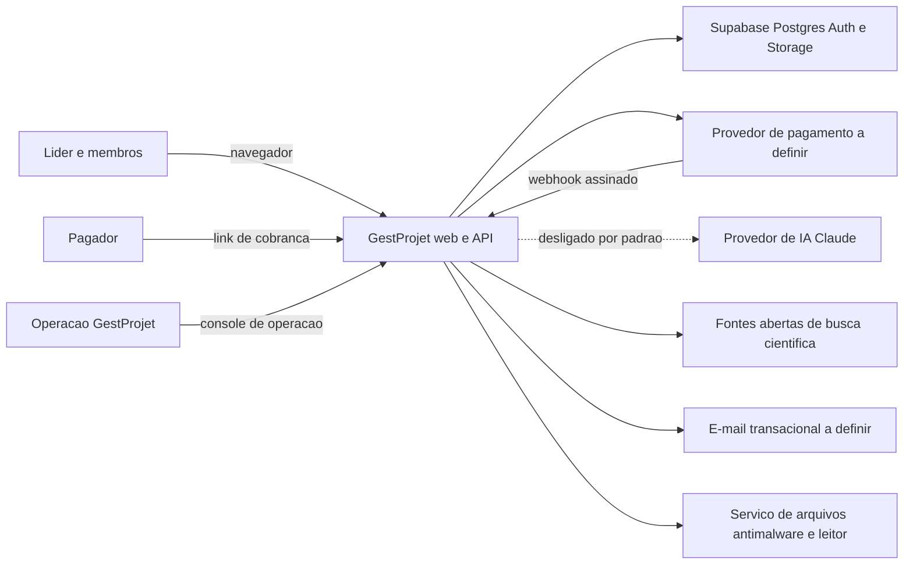
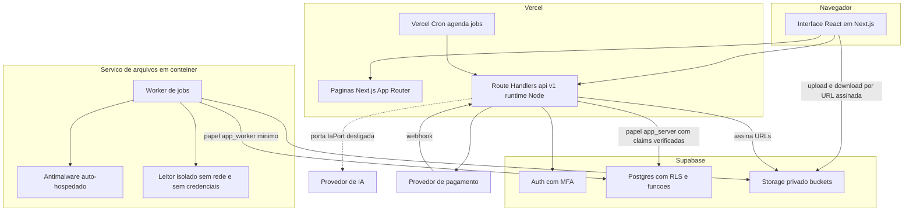
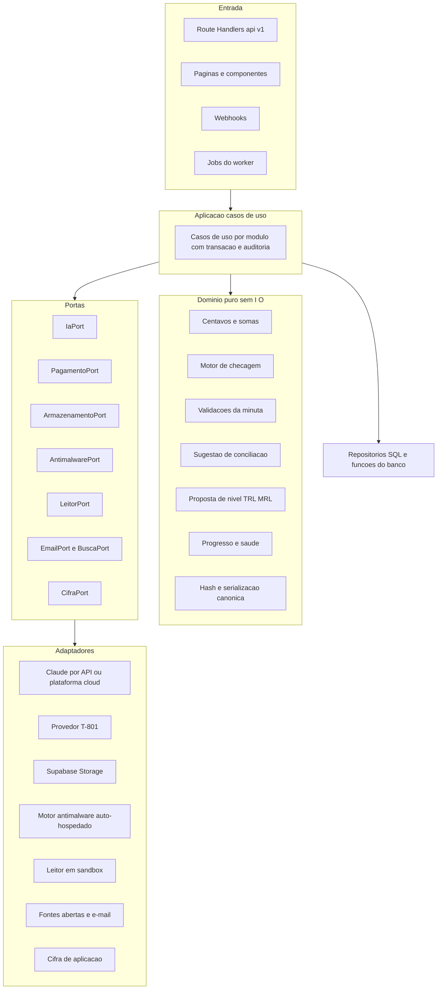
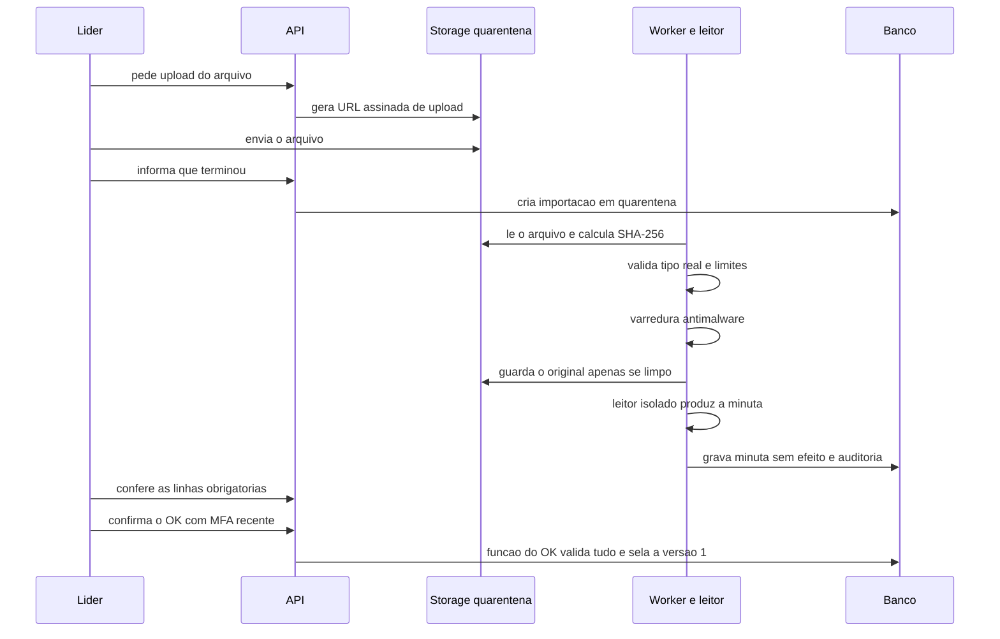

# GestProjet: especificação técnica (SPEC)

Versão: 0.1 (rascunho para aprovação do dono, T-014) · Data: 2026-11-25 · Autor: desenvolvedor (T-013)

PRD de referência: `docs/01-prd.md` **v0.2.1, APROVADO** (25/11/2026), com as decisões do dono do mesmo dia (provedor de IA = Claude, sem exigência de região, conferência de 100% das linhas em minuta lida por IA). Também lidos como requisitos de arquitetura: `docs/06-seguranca.md` v0.4 (175 controles SEG), `docs/04-workflows.md` v0.2.1, `docs/03-ux.md` v0.3 e `TASKS.md`.

Convenções deste documento:
- "a conferir" = característica de produto de terceiros (Supabase, Vercel, Claude, bancos, provedor de pagamento) que **não foi verificada**. Deve ser conferida na documentação oficial vigente antes de depender dela. Nada foi afirmado de memória como garantia.
- `[SUPOSIÇÃO]` = escolha técnica minha, sem decisão do dono, com valor inicial configurável.
- Redação sobre normas: "alinhado às práticas das ABNT NBR ISO 21500:2021, 21502:2021 e 21512:2026", nunca "conformidade".
- Moeda: reais (BRL), valores em **centavos inteiros** (`bigint`), nunca ponto flutuante (RN-009).
- Nomes técnicos (tabelas, rotas, variáveis) em minúsculas; o produto se escreve **GestProjet**.
- IDs: RF, RN, RNF, Q do PRD; SEG e QS do `06-seguranca`; D e DW dos fluxos; ADR-NNNN em `docs/adr/`.

Índice: 1 Visão geral · 2 Stack · 3 Módulos e motores · 4 Modelo de dados · 5 APIs · 6 Eventos de auditoria · 7 Importação, leitura e integrações · 8 Rastreabilidade · 9 Requisitos não funcionais, infraestrutura e testes · 10 Plano por épico · 11 Riscos, questões e ADRs · 12 Lista de verificação.

---

## 1. Visão geral da arquitetura

### 1.1 Resumo

O GestProjet é um **monólito modular** em TypeScript: uma aplicação Next.js (páginas e API REST `/api/v1`) hospedada na Vercel, um projeto Supabase (Postgres com RLS, Auth com MFA, Storage privado) e **um pequeno serviço de arquivos em contêiner** (varredura antimalware auto-hospedada, leitor isolado e worker de jobs), necessário porque os controles SEG-207, SEG-215 e SEG-251 exigem varredura e leitura sem enviar arquivo a terceiros e sem rede. A lógica de negócio fica em um **núcleo de domínio puro** (sem I/O) com **portas** para tudo que é externo (IA, pagamento, armazenamento, antimalware, leitor, e-mail, busca); cada porta tem um adaptador substituível (RNF-26).

Princípios que guiam o desenho:
1. **O banco é a última linha de defesa.** Isolamento por projeto (RLS), imutabilidade, "uma versão vigente", somente leitura por atraso e trilha de auditoria valem **mesmo que a aplicação erre** (triggers, constraints, privilégios). Ver ADR-0002, 0003, 0004, 0008.
2. **O navegador não fala com o banco.** Só com a aplicação (páginas e `/api/v1`), com o Supabase Auth (por rotas próprias) e com URLs assinadas de arquivo. Ver ADR-0002.
3. **IA sugere, pessoa decide.** Nenhum caminho de código grava efeito a partir de saída de IA sem ato de pessoa (RN-014, SEG-121). Leitura de PDF e imagem por IA fica **desligada por padrão** (RF-153, SEG-222). Extrato e conciliação nunca usam IA (SEG-251).
4. **Mais simples que atenda o MVP.** Sem microsserviços, sem fila externa, sem cache distribuído. A fila é uma tabela Postgres (ADR-0011).
5. **Tudo configurável que o PRD diz configurável:** classificação da despesa, regras, escala TRL/MRL, efeito da assinatura, limites, janelas de conciliação, região (RN-007, RN-018, RNF-25).

### 1.2 Diagrama de contexto

### 1.3 Diagrama de contêineres

### 1.4 Diagrama de componentes (monólito modular em camadas)

Estrutura de repositório proposta (confirmar na T-102): `apps/web` (Next.js), `apps/worker` (worker em contêiner), `packages/dominio` (núcleo puro, testável sem banco), `packages/portas` (interfaces e esquemas), `packages/adaptadores`, `supabase/migrations`, `supabase/tests` (políticas e imutabilidade), `e2e` (Playwright).

### 1.5 Fluxos de dados críticos (sequência resumida)

**Importar o plano e dar o OK (planilha ou manual; IA desligada):**

**Checagem antes da compra:** a API reúne, em uma leitura consistente, as regras confirmadas vigentes, a linha de base vigente (ou a ausência dela), o saldo da linha e as cotações; o **motor de domínio** calcula o resultado (precedência do bloqueio, RN-043); a função de gravação, executável **só** pelo papel da aplicação, confere pertencimento e permissão e grava a checagem imutável com suas verificações e o evento `checagem.registrada` na mesma transação (SEG-103, SEG-200). O cliente nunca envia o resultado.

---

## 2. Stack e justificativa

| Camada | Escolha | Justificativa | ADR |
|---|---|---|---|
| Linguagem | TypeScript em modo estrito, em toda a base (web, API, worker, domínio) | Um só idioma, tipos compartilhados entre API e interface, domínio testável sem banco | 0001 |
| Web e API | Next.js (App Router), páginas e Route Handlers `/api/v1`, runtime Node | Decisão do dono (T-010); Route Handlers dão uma API REST testável, com webhooks e controle fino de cabeçalhos | 0001, 0012 |
| Hospedagem web | Vercel | Decisão do dono (T-010); região das funções por configuração (a conferir limites de tempo, corpo e memória das funções) | 0001, 0009 |
| Banco | Postgres do Supabase com RLS, constraints, triggers e funções PL/pgSQL | Isolamento e invariantes no banco (SEG-020, SEG-228); valores em `bigint` centavos | 0002, 0003, 0004 |
| Autenticação | Supabase Auth com MFA TOTP, **chamado por rotas próprias** da API | Rotas próprias permitem limite de taxa, resposta uniforme e auditoria de falhas (SEG-007, SEG-011); a conferir os recursos de MFA e de duração de sessão da versão vigente | 0012 |
| Arquivos | Supabase Storage privado; **acesso só por URL assinada emitida pela API** | Auditoria de cada download e validade de até 60 s (SEG-064, SEG-209) | 0005, 0006 |
| Serviço de arquivos | Contêiner próprio: worker, antimalware auto-hospedado, leitor isolado | Varredura sem enviar o arquivo a terceiros e leitura sem rede nem credenciais (SEG-207, SEG-215, SEG-251). Provedor do contêiner **a definir** (decisão técnica com custo, seção 11.2) | 0006, 0011 |
| Jobs e filas | Tabela `job` no Postgres (`FOR UPDATE SKIP LOCKED`), worker no contêiner, Vercel Cron só para agendar | Atomicidade com a transação de domínio, sem novo serviço; volume baixo (RNF-13) | 0011 |
| IA | Porta `IaPort`; adaptador do **Claude (Anthropic)**; **desligada por padrão** | Decisão do dono (provedor); contratação em aberto (Q-24); substituível (RNF-26) | 0005 |
| Pagamento | Porta `PagamentoPort`; provedor **em aberto** (T-801); Pix, boleto e cartão; página hospedada | Nenhum dado de cartão na plataforma (RNF-10, SEG-140); webhook assinado e idempotente | 0005 |
| Antimalware | Porta `AntimalwarePort`; motor auto-hospedado; **proibido** serviço externo de varredura para extrato e plano | SEG-251, SEG-222 | 0005, 0006 |
| Criptografia por campo | Cifra de aplicação (AES-GCM), chave de dados e chave de HMAC separadas, chaves em cofre por ambiente | SEG-062; descrição do extrato precisa ser consultável pela conciliação | 0013 |
| E-mail | Porta `EmailPort`, provedor a definir (T-902); sem dado financeiro no corpo | SEG-074 | 0005 |
| Busca científica | Porta `BuscaPort` com fontes abertas (OpenAlex, Crossref, SciELO); serviço pago só se T-701 decidir | RN-023, SEG-130 | 0005 |
| Validação | Esquemas declarativos compartilhados (um validador de esquemas à escolha na T-102), gerando o contrato OpenAPI | Entrada validada no servidor (SEG-072) | 0012 |
| Testes | Vitest (unidade e integração), testes de política em SQL (pgTAP ou equivalente, a escolher na T-102), Playwright (ponta a ponta) | Seção 9.8 | n/a |
| Qualidade | ESLint, `tsc --noEmit`, auditoria de dependências, varredura de segredos no CI | SEG-063, SEG-073 | n/a |
| Migrações | Supabase CLI, migrações **imperativas** versionadas no repositório (`supabase migration new`), sempre para frente | Skill supabase; seção 9.5 | 0002 |
| Observabilidade | Logs estruturados sem dado pessoal, métricas p95, erros com remoção de campos | SEG-068, SEG-250; ferramenta a escolher (T-903) | n/a |

**Regras de dependências:** versões fixadas e `lockfile` versionado (skill supabase, SEG-073); nenhuma variável `NEXT_PUBLIC_` carrega segredo (SEG-132); só a chave publicável do Supabase pode ir ao navegador, se houver uso.

**Moeda e números:** colunas monetárias `bigint` em centavos com `check (valor between 0 and 99999999999999)` (limite R$ 999 bilhões, dentro do inteiro seguro do JavaScript); no TypeScript, tipo marcado `Centavos` com validação `Number.isSafeInteger`; exibição pt-BR somente na interface; `moeda char(3)` explícita em `projeto`, `assinatura`, `cobranca` e `ia_uso`, com `check (moeda = 'BRL')` na 1ª versão (sem multimoeda); as demais tabelas herdam a moeda do projeto. Percentuais e confiança em `numeric` com escala definida; nunca `float`.

**Datas:** instantes em `timestamptz` (UTC no banco, relógio do servidor); vigência e datas de despesa em `date`; competência mensal em `date` com `check (extract(day from mes) = 1)`; exibição em America/Sao_Paulo (RNF-11).

**Identificadores:** `uuid` por tabela de negócio (SEG-026: nunca tratado como segredo); tabelas de alto volume de inserção e ordem (`auditoria.evento`, `lancamento_extrato`) usam também `seq bigint generated always as identity`. Geração de UUID ordenável por tempo fica como melhoria quando a versão do Postgres do Supabase permitir (a conferir).

**Domínios fechados:** colunas `text` com `check (col in (...))` em vez de tipos `enum` nativos (migração mais simples). A lista de valores está em 4.2.

---
<!-- FIM-PARTE-1 -->
