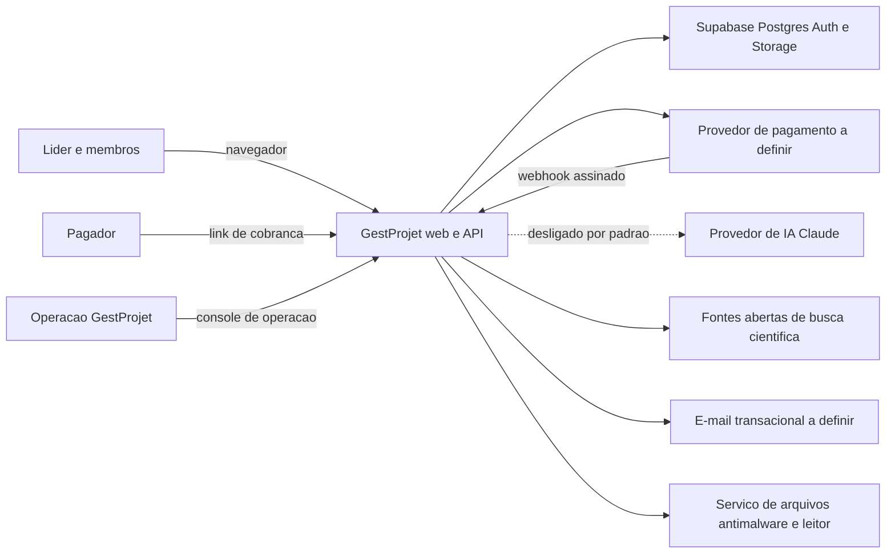
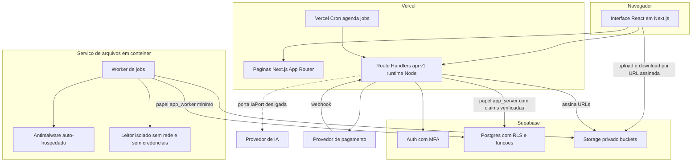
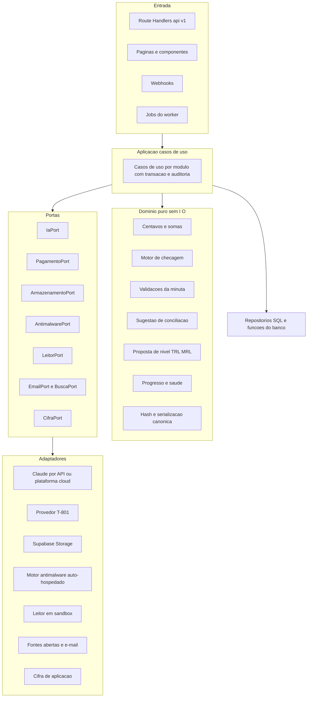
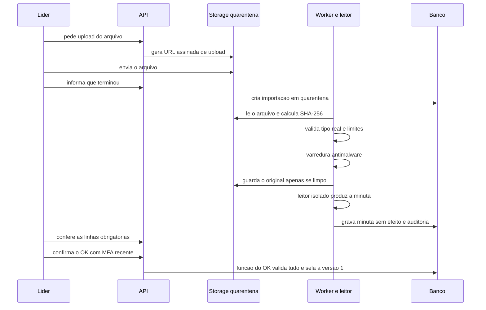

# GestProjet: especificação técnica (SPEC)

Versão: 0.1 (rascunho para aprovação do dono, T-014) · Data: 2026-11-25 · Autor: desenvolvedor (T-013)

PRD de referência: `docs/01-prd.md` **v0.2.1, APROVADO** (25/11/2026), com as decisões do dono do mesmo dia (provedor de IA = Claude, sem exigência de região, conferência de 100% das linhas em minuta lida por IA). Também lidos como requisitos de arquitetura: `docs/06-seguranca.md` v0.4 (175 controles SEG), `docs/04-workflows.md` v0.2.1, `docs/03-ux.md` v0.3 e `TASKS.md`.

Convenções deste documento:
- "a conferir" = característica de produto de terceiros (Supabase, Vercel, Claude, bancos, provedor de pagamento) que **não foi verificada**. Deve ser conferida na documentação oficial vigente antes de depender dela. Nada foi afirmado de memória como garantia.
- `[SUPOSIÇÃO]` = escolha técnica minha, sem decisão do dono, com valor inicial configurável.
- Redação sobre normas: "alinhado às práticas das ABNT NBR ISO 21500:2021, 21502:2021 e 21512:2026", nunca "conformidade".
- Moeda: reais (BRL), valores em **centavos inteiros** (`bigint`), nunca ponto flutuante (RN-009).
- Nomes técnicos (tabelas, rotas, variáveis) em minúsculas; o produto se escreve **GestProjet**.
- IDs: RF, RN, RNF, Q do PRD; SEG e QS do `06-seguranca`; D e DW dos fluxos; ADR-NNNN em `docs/adr/`.

Índice: 1 Visão geral · 2 Stack · 3 Módulos e motores · 4 Modelo de dados · 5 APIs · 6 Eventos de auditoria · 7 Importação, leitura e integrações · 8 Rastreabilidade · 9 Requisitos não funcionais, infraestrutura e testes · 10 Plano por épico · 11 Riscos, questões e ADRs · 12 Lista de verificação.

---

## 1. Visão geral da arquitetura

### 1.1 Resumo

O GestProjet é um **monólito modular** em TypeScript: uma aplicação Next.js (páginas e API REST `/api/v1`) hospedada na Vercel, um projeto Supabase (Postgres com RLS, Auth com MFA, Storage privado) e **um pequeno serviço de arquivos em contêiner** (varredura antimalware auto-hospedada, leitor isolado e worker de jobs), necessário porque os controles SEG-207, SEG-215 e SEG-251 exigem varredura e leitura sem enviar arquivo a terceiros e sem rede. A lógica de negócio fica em um **núcleo de domínio puro** (sem I/O) com **portas** para tudo que é externo (IA, pagamento, armazenamento, antimalware, leitor, e-mail, busca); cada porta tem um adaptador substituível (RNF-26).

Princípios que guiam o desenho:
1. **O banco é a última linha de defesa.** Isolamento por projeto (RLS), imutabilidade, "uma versão vigente", somente leitura por atraso e trilha de auditoria valem **mesmo que a aplicação erre** (triggers, constraints, privilégios). Ver ADR-0002, 0003, 0004, 0008.
2. **O navegador não fala com o banco.** Só com a aplicação (páginas e `/api/v1`), com o Supabase Auth (por rotas próprias) e com URLs assinadas de arquivo. Ver ADR-0002.
3. **IA sugere, pessoa decide.** Nenhum caminho de código grava efeito a partir de saída de IA sem ato de pessoa (RN-014, SEG-121). Leitura de PDF e imagem por IA fica **desligada por padrão** (RF-153, SEG-222). Extrato e conciliação nunca usam IA (SEG-251).
4. **Mais simples que atenda o MVP.** Sem microsserviços, sem fila externa, sem cache distribuído. A fila é uma tabela Postgres (ADR-0011).
5. **Tudo configurável que o PRD diz configurável:** classificação da despesa, regras, escala TRL/MRL, efeito da assinatura, limites, janelas de conciliação, região (RN-007, RN-018, RNF-25).

### 1.2 Diagrama de contexto

### 1.3 Diagrama de contêineres

### 1.4 Diagrama de componentes (monólito modular em camadas)

Estrutura de repositório proposta (confirmar na T-102): `apps/web` (Next.js), `apps/worker` (worker em contêiner), `packages/dominio` (núcleo puro, testável sem banco), `packages/portas` (interfaces e esquemas), `packages/adaptadores`, `supabase/migrations`, `supabase/tests` (políticas e imutabilidade), `e2e` (Playwright).

### 1.5 Fluxos de dados críticos (sequência resumida)

**Importar o plano e dar o OK (planilha ou manual; IA desligada):**

**Checagem antes da compra:** a API reúne, em uma leitura consistente, as regras confirmadas vigentes, a linha de base vigente (ou a ausência dela), o saldo da linha e as cotações; o **motor de domínio** calcula o resultado (precedência do bloqueio, RN-043); a função de gravação, executável **só** pelo papel da aplicação, confere pertencimento e permissão e grava a checagem imutável com suas verificações e o evento `checagem.registrada` na mesma transação (SEG-103, SEG-200). O cliente nunca envia o resultado.

---

## 2. Stack e justificativa

| Camada | Escolha | Justificativa | ADR |
|---|---|---|---|
| Linguagem | TypeScript em modo estrito, em toda a base (web, API, worker, domínio) | Um só idioma, tipos compartilhados entre API e interface, domínio testável sem banco | 0001 |
| Web e API | Next.js (App Router), páginas e Route Handlers `/api/v1`, runtime Node | Decisão do dono (T-010); Route Handlers dão uma API REST testável, com webhooks e controle fino de cabeçalhos | 0001, 0012 |
| Hospedagem web | Vercel | Decisão do dono (T-010); região das funções por configuração (a conferir limites de tempo, corpo e memória das funções) | 0001, 0009 |
| Banco | Postgres do Supabase com RLS, constraints, triggers e funções PL/pgSQL | Isolamento e invariantes no banco (SEG-020, SEG-228); valores em `bigint` centavos | 0002, 0003, 0004 |
| Autenticação | Supabase Auth com MFA TOTP, **chamado por rotas próprias** da API | Rotas próprias permitem limite de taxa, resposta uniforme e auditoria de falhas (SEG-007, SEG-011); a conferir os recursos de MFA e de duração de sessão da versão vigente | 0012 |
| Arquivos | Supabase Storage privado; **acesso só por URL assinada emitida pela API** | Auditoria de cada download e validade de até 60 s (SEG-064, SEG-209) | 0005, 0006 |
| Serviço de arquivos | Contêiner próprio: worker, antimalware auto-hospedado, leitor isolado | Varredura sem enviar o arquivo a terceiros e leitura sem rede nem credenciais (SEG-207, SEG-215, SEG-251). Provedor do contêiner **a definir** (decisão técnica com custo, seção 11.2) | 0006, 0011 |
| Jobs e filas | Tabela `job` no Postgres (`FOR UPDATE SKIP LOCKED`), worker no contêiner, Vercel Cron só para agendar | Atomicidade com a transação de domínio, sem novo serviço; volume baixo (RNF-13) | 0011 |
| IA | Porta `IaPort`; adaptador do **Claude (Anthropic)**; **desligada por padrão** | Decisão do dono (provedor); contratação em aberto (Q-24); substituível (RNF-26) | 0005 |
| Pagamento | Porta `PagamentoPort`; provedor **em aberto** (T-801); Pix, boleto e cartão; página hospedada | Nenhum dado de cartão na plataforma (RNF-10, SEG-140); webhook assinado e idempotente | 0005 |
| Antimalware | Porta `AntimalwarePort`; motor auto-hospedado; **proibido** serviço externo de varredura para extrato e plano | SEG-251, SEG-222 | 0005, 0006 |
| Criptografia por campo | Cifra de aplicação (AES-GCM), chave de dados e chave de HMAC separadas, chaves em cofre por ambiente | SEG-062; descrição do extrato precisa ser consultável pela conciliação | 0013 |
| E-mail | Porta `EmailPort`, provedor a definir (T-902); sem dado financeiro no corpo | SEG-074 | 0005 |
| Busca científica | Porta `BuscaPort` com fontes abertas (OpenAlex, Crossref, SciELO); serviço pago só se T-701 decidir | RN-023, SEG-130 | 0005 |
| Validação | Esquemas declarativos compartilhados (um validador de esquemas à escolha na T-102), gerando o contrato OpenAPI | Entrada validada no servidor (SEG-072) | 0012 |
| Testes | Vitest (unidade e integração), testes de política em SQL (pgTAP ou equivalente, a escolher na T-102), Playwright (ponta a ponta) | Seção 9.8 | n/a |
| Qualidade | ESLint, `tsc --noEmit`, auditoria de dependências, varredura de segredos no CI | SEG-063, SEG-073 | n/a |
| Migrações | Supabase CLI, migrações **imperativas** versionadas no repositório (`supabase migration new`), sempre para frente | Skill supabase; seção 9.5 | 0002 |
| Observabilidade | Logs estruturados sem dado pessoal, métricas p95, erros com remoção de campos | SEG-068, SEG-250; ferramenta a escolher (T-903) | n/a |

**Regras de dependências:** versões fixadas e `lockfile` versionado (skill supabase, SEG-073); nenhuma variável `NEXT_PUBLIC_` carrega segredo (SEG-132); só a chave publicável do Supabase pode ir ao navegador, se houver uso.

**Moeda e números:** colunas monetárias `bigint` em centavos com `check (valor between 0 and 99999999999999)` (limite R$ 999 bilhões, dentro do inteiro seguro do JavaScript); no TypeScript, tipo marcado `Centavos` com validação `Number.isSafeInteger`; exibição pt-BR somente na interface; `moeda char(3)` explícita em `projeto`, `assinatura`, `cobranca` e `ia_uso`, com `check (moeda = 'BRL')` na 1ª versão (sem multimoeda); as demais tabelas herdam a moeda do projeto. Percentuais e confiança em `numeric` com escala definida; nunca `float`.

**Datas:** instantes em `timestamptz` (UTC no banco, relógio do servidor); vigência e datas de despesa em `date`; competência mensal em `date` com `check (extract(day from mes) = 1)`; exibição em America/Sao_Paulo (RNF-11).

**Identificadores:** `uuid` por tabela de negócio (SEG-026: nunca tratado como segredo); tabelas de alto volume de inserção e ordem (`auditoria.evento`, `lancamento_extrato`) usam também `seq bigint generated always as identity`. Geração de UUID ordenável por tempo fica como melhoria quando a versão do Postgres do Supabase permitir (a conferir).

**Domínios fechados:** colunas `text` com `check (col in (...))` em vez de tipos `enum` nativos (migração mais simples). A lista de valores está em 4.2.

---
## 3. Módulos, motores e responsabilidades

### 3.1 Componentes e requisitos atendidos (RF e RN → componente)

Cada componente é um módulo do monólito (pasta própria em `packages/dominio` e casos de uso). Os testes de cada um estão na seção 8. "Épico" refere-se à seção 10.

| ID | Componente | Responsabilidade | RF | RN | Épico |
|---|---|---|---|---|---|
| C-IDN | Identidade e acesso | Cadastro, login, recuperação, MFA TOTP, passo-a-cima (step-up), sessão, limite de taxa; rotas próprias de autenticação | RF-110, RF-111 | n/a | E01 |
| C-PRJ | Projetos e equipe | Cadastro do projeto, painel, fases, encerramento, convites, níveis, revogação, transferência de liderança, "quem aprova mudanças" | RF-001 a RF-004, RF-020, RF-030 a RF-034, RF-114, RF-151 | RN-001, RN-002, RN-003, RN-048, RN-050 | E01, E02 |
| C-DAD | Camada de dados e RLS | Políticas por projeto, funções privadas de pertencimento, privilégios, triggers de imutabilidade e de somente leitura, índices | RF-033 | RN-020, RN-022 | E01 |
| C-ARQ | Arquivos e documentos | Registro de arquivo, quarentena, hash, URL assinada, edital e termo, comprovantes, retenção e descarte | RF-040, RF-055 (anexos), RF-125 (original), RNF-12 | RN-020, RN-035 | E03 |
| C-REG | Regras e classificações | Classificação da despesa configurável, regras com fonte e versões, confirmação pelo líder, enquadramento | RF-041 a RF-043, RF-066, RF-121 | RN-004, RN-005, RN-007, RN-008, RN-026 | E03 |
| C-PLN | Plano e linha de base | Minuta, conferência, validações, OK, versões imutáveis, ajustes, comparação, medida de progresso, marcos, tarefas | RF-010 a RF-013, RF-120, RF-122, RF-126 a RF-129, RF-132, RF-135, RF-150 | RN-025, RN-027, RN-028, RN-030, RN-031, RN-033, RN-037, RN-045, RN-047, RN-050, RN-053 | E10, E11 |
| C-IMP | Importação e leitura | Pipeline de arquivo, leitura de planilha e (desligada) de PDF e imagem, derivados, origem de cada campo | RF-123, RF-124 | RN-030, RN-035 | E10, E15 |
| C-IA | Adaptador de IA | `IaPort`, esquema de saída, limites e custo, registro de cada chamada, chave de feature flag | RF-043, RF-067, RF-090, RF-091, RF-153 | RN-014, RN-015, RN-051 | E15 |
| C-EXE | Execução e despesas | Despesa, estorno, comprovante, resumo mensal, "sem execução", painel previsto × executado, marca de mês conferido, rendimentos manuais | RF-050, RF-051, RF-053, RF-054, RF-055, RF-130, RF-131, RF-152 | RN-009, RN-010, RN-011, RN-012, RN-032, RN-038, RN-044, RN-046 | E04, E12 |
| C-CHK | Checagem antes da compra | Motor de checagem, cotações, registro imutável, superação de bloqueio | RF-060 a RF-065 | RN-006, RN-008, RN-012, RN-013, RN-024, RN-029, RN-043 | E05 |
| C-EXT | Extrato e conciliação | Conta, importação OFX e CSV, mapeamento, deduplicação, conciliação, exceções, rendimentos do extrato | RF-052, RF-146 a RF-149 | RN-039, RN-040, RN-041, RN-042 | E13 |
| C-MAT | Maturidade TRL e MRL | Escala configurável, critérios "a validar", evidências, proposta, nível oficial, histórico | RF-070 a RF-074 | RN-016, RN-052 | E06 |
| C-GES | Gestão enxuta e saúde | Riscos, questões, partes interessadas, calendário, lições, justificativa, checklist de saúde por fase | RF-020 a RF-024, RF-133 a RF-138 | RN-021, RN-033, RN-034, RN-049 | E14 |
| C-BUS | Busca científica | Palavras-chave, busca nas fontes, deduplicação por DOI, marcas | RF-080 a RF-083 | RN-023 | E07 |
| C-ASS | Assinatura e cobrança | Assinatura por projeto, pagador, cobrança, webhook, efeito da situação, teste de 30 dias | RF-100 a RF-105 | RN-017, RN-018, RN-019 | E08 |
| C-AUD | Auditoria | Cadeia de eventos com hash, registro transacional, consulta do líder, verificação periódica | RF-112 | RN-020 | E01 |
| C-LGPD | Titular e exportação | Exportação do projeto, direitos do titular, aceite de termos, retenção | RF-106, RF-113 | RN-020 | E09, E08 |
| C-CRI | Criptografia e segredos | Cifra por campo, HMAC, chaves por ambiente, mascaramento | n/a | n/a | E01 |
| C-OPS | Operação | Feature flags, jobs, retenção, backup, observabilidade, alertas, console de operação | RF-153, RNF-04, RNF-06 | RN-051 | E01, E09 |
| C-UI | Interface | Telas T01 a T49 de `docs/03-ux.md`, componentes, acessibilidade | todos | RN-021, RN-036 | todos |

Regra de dependência entre módulos: os módulos **não** acessam tabelas uns dos outros; falam por casos de uso do módulo dono do dado. Exceções documentadas: `C-PLN` e `C-EXE` compartilham `linha_uid` (identidade da linha); `C-CHK` lê regras (C-REG), linha de base (C-PLN) e saldo (C-EXE) por funções de leitura.

### 3.2 Camadas e responsabilidades

- **Domínio** (`packages/dominio`): funções puras (centavos, somas, validações da minuta, motor de checagem, sugestão de conciliação, proposta de nível, progresso, saúde, serialização canônica e hash). Sem acesso a rede, banco, relógio ou aleatoriedade (recebem tudo por parâmetro, o que torna os testes determinísticos).
- **Aplicação** (casos de uso): abre a transação, carrega o contexto, chama o domínio, grava por funções do banco e **emite o evento de auditoria na mesma transação** (SEG-103). Uma função de aplicação por rota da seção 5.
- **Dados**: tabelas, políticas, funções e triggers (seção 4). Operações **críticas** (OK da linha de base, ajuste vigente, confirmação de importação de extrato, conciliar, fechar período, registrar checagem, aplicar evento de pagamento) são funções `private.fn_*` com `SECURITY DEFINER`, `set search_path = ''`, verificação explícita de `auth.uid()`, papel, MFA recente e "projeto gravável", e `EXECUTE` concedido **só** ao papel `app_server`.
- **Adaptadores**: implementam as portas (7.8); trocar fornecedor não toca domínio nem aplicação.

### 3.3 Motores de domínio (regras de cálculo normativas)

**3.3.1 Motor de checagem (RF-060 a RF-064, RN-006, RN-029, RN-043).** Entrada: item (categoria escolhida da lista ou "não encontrei"), valor estimado em centavos, quantidade, data prevista, etapa e linha escolhidas (ou "não encontrei linha"), declaração de correspondência, cotações; contexto lido de forma consistente: regras **confirmadas** na versão vigente, linha de base vigente **íntegra** (ou ausência de OK), saldo da linha, vigência do projeto. Oito verificações, cada uma com resultado `passou`, `bloqueou`, `pendente` ou `nao_verificada`, motivo em linguagem simples e fonte da regra (documento, cláusula, página):

| # | Verificação | Passa | Bloqueia | Pendente | Sem OK da linha de base |
|---|---|---|---|---|---|
| 1 | Plano | há linha de base vigente | n/a | não há OK (RN-029) | vira aviso |
| 2 | Item | permitido pelas regras confirmadas | vedado | fora das regras, ou regra não confirmada que afetaria o caso | continua feita |
| 3 | Linha e objeto | linha da etapa informada e declaração registrada | n/a | "não encontrei linha" (saída: pedir ajuste, Q-31) | `nao_verificada` |
| 4 | Classificação | a da linha é a admitida para o item (ou a regra não restringe) | outra classificação (indica a correta) | n/a | `nao_verificada` |
| 5 | Saldo da linha | valor estimado ≤ saldo (RN-010) | maior que o saldo | n/a | `nao_verificada` |
| 6 | Cotações | válidas distintas (RN-008) ≥ mínimo da faixa; ou "não exige" explícito | menos que o mínimo | nenhuma regra de cotação cadastrada | continua feita |
| 7 | Limites | dentro dos limites cadastrados | acima de limite | n/a | continua feita |
| 8 | Vigência | data prevista dentro da vigência | fora (RN-024) | n/a | continua feita |

**Resultado:** `bloqueado` se qualquer verificação bloqueou; senão `pendente` se alguma ficou pendente (inclui "plano sem aprovação" quando nada bloqueia); senão `permitido`. O aviso "plano sem aprovação: linha, classificação e saldo da linha não foram verificados" acompanha qualquer resultado quando não há OK. A faixa de cotação respeita o campo `limite_inclusivo` da regra; cotações do mesmo fornecedor (mesmo HMAC de CPF/CNPJ ou, sem documento, mesmo nome normalizado) contam como uma (RN-008, `[SUPOSIÇÃO]` do PRD). A checagem **não reserva saldo** (RN-010). O resultado, as oito verificações, as versões de regra e de linha de base e a declaração ficam **imutáveis** (RF-064).

Vetores de teste obrigatórios (RF-062, D25): (1) vedado + 1 de 3 cotações, com OK → `bloqueado` com 2 motivos; (2) o mesmo com 3 cotações → `bloqueado` só "item vedado"; (3) o mesmo **sem OK** → `bloqueado` com os 2 motivos e o aviso de plano; (4) permitido + 2 de 3 cotações → `bloqueado` só por cotações; (5) permitido + 3 cotações + **sem OK** → `pendente: plano sem aprovação`; (6) saldo R$ 500,00 e checagem R$ 500,00 → passa; R$ 500,01 → bloqueia; (7) limite inclusivo e exclusivo na fronteira da faixa; (8) duas das três cotações do mesmo fornecedor → conta 2.

**3.3.2 Saldo e execução (RN-010, RN-032, RN-038, RN-046).** `saldo_linha(linha_uid) = valor_aprovado na versão vigente − Σ despesas da linha + Σ estornos`, calculado em transação com bloqueio da linha de identidade (`FOR UPDATE` em `plano_linha`, SEG-066, SEG-233). Executado da linha no mês = Σ despesas com data no mês + resumo vigente do mês **se não houver despesa detalhada** (o resumo substituído não entra na soma, por regra do banco). Trimestre = soma de três meses de calendário (`[SUPOSIÇÃO]`, Q-22). Totais de etapa, meta e projeto são sempre calculados (RN-025).

**3.3.3 Validações da minuta (RF-127).** Executadas no servidor a cada alteração e **recalculadas no OK** (SEG-230). `impede` o OK: classificação fora da lista; valor ausente, zero, negativo, texto, notação científica ou `null` (a checagem é feita sobre o inteiro em centavos). Exigem `ciente` com justificativa: (a) soma ≠ total impresso, com a diferença em reais; classificação inconsistente (mesmo objeto normalizado com classificações diferentes em etapas diferentes, RN-037); duplicidade (mesma etapa, classificação, objeto normalizado e valor); períodos inconsistentes (repetido, fora de ordem, mês faltando ou fora da vigência); total ilegível (referência quebrada). Baixa confiança (< 0,80, configurável) → linha de risco, conferência obrigatória. Normalização do objeto para comparar: minúsculas, sem acentos, espaços colapsados.

**3.3.4 Conferência obrigatória (RF-126, RN-053, SEG-266).** A origem da minuta (`ia`, `planilha`, `manual`) é gravada pelo servidor. `ia`, ou **qualquer linha vinda de IA** (minuta mista, comparação), exige 100% das linhas conferidas uma a uma, sem "marcar todas". `planilha` e `manual`: linhas de risco (baixa confiança, alerta, valor ou classificação corrigidos) + as 5 de maior valor + amostra de 20% das demais (mínimo 5; todas se forem menos de 5), sorteada por gerador criptograficamente seguro no servidor, com a **semente e o hash da minuta gravados**; a amostra é fixa por versão da minuta; correção que cria nova linha de risco acrescenta à lista. Parâmetros configuráveis (`conferencia.*` em `config_plataforma`). Cada conferência é um registro por linha (autor, hora, "origem exibida"); o OK é recusado se faltar linha obrigatória (verificado no servidor, nunca por marca do cliente).

**3.3.5 Progresso (RF-132, RN-033).** Etapa: `marcos` = concluídos ÷ total; `zero_cem` = 0 ou 100; `percentual_estimado` = valor informado, rotulado "estimado" com data. Meta = média simples das etapas **com medida definida**; projeto = média simples das metas (`[SUPOSIÇÃO]`, Q-29). Etapa sem medida não entra e vira pendência.

**3.3.6 Sugestão de conciliação (RF-147, RN-040, SEG-255, SEG-251).** Determinística, no servidor, sem IA. Para cada débito sem despesa conciliada: candidatos = despesas não estornadas do mesmo projeto com valor igual (tolerância configurável, padrão 0) e data dentro da janela (padrão 5 dias, `[SUPOSIÇÃO]` Q-48); pontuação por similaridade de descrição (interseção de termos normalizados, sem dado pessoal em log); motivos legíveis ("mesmo valor; data 2 dias antes; fornecedor igual"; "valor e data conferem; descrição diferente"). Sem candidato 1:1, tenta combinações de até 4 despesas cuja soma feche ao centavo (e o inverso, vários débitos para uma despesa). A sugestão **nunca grava** par; a confirmação é por par, pelo líder (3.3.7).

**3.3.7 Regras de gravação da conciliação.** Na confirmação, a função verifica no banco: mesmo projeto; nenhum registro estornado; soma dos valores ligados fecha ao centavo; o lançamento não é ligado além do que fecha; `FOR UPDATE` nos registros; valor e data de nenhum dos dois mudam.

**3.3.8 Crédito e rendimento (RF-149, RN-042).** Sugestão por termos configuráveis na descrição do banco (`extrato.termos_rendimento`); só vale com confirmação do tipo (`rendimento`, `parcela_recebida`, `outro`) pelo líder; mudança de tipo cria novo registro de histórico com motivo. O rendimento **nunca** altera saldo de linha nem de classificação (verificação no banco e teste); não existe rota nem função de "destinação".

**3.3.9 Proposta de nível TRL e MRL (RF-072).** Por escala: nível proposto = maior N tal que todos os critérios dos níveis 1 a N têm ao menos uma evidência ligada ativa; lacunas = critérios do nível N+1 sem evidência. Se algum critério considerado estiver "a validar", a proposta leva o aviso `baseada_em_criterios_a_validar` (RF-072). A proposta não é nível oficial; só o líder confirma (RN-016). IA, quando ligada, apenas acrescenta citações às evidências. *Divergência registrada na seção 11.1 (PRD 5.8 × RF-072).*

**3.3.10 Saúde do projeto (RF-138, RN-034, RN-049).** Cada item do catálogo tem fase, tipo [A] (calculado por função SQL de leitura) ou [L] (última resposta do líder) e retorna **três estados distintos**: `atendido`, `nao_atendido`, `nao_verificavel` (com motivo e dependência, ex.: "depende de Q-12"). `nao_verificavel` nunca entra como atendido em total, painel ou exportação (SEG-236). Nada muda de estado por o checklist estar completo; não há código que leia o checklist como condição de operação (teste).

**3.3.11 Hash e serialização canônica (SEG-229).** Uma só implementação, **no banco**, para hash de versão da linha de base e de evento de auditoria: texto canônico = campos em ordem fixa documentada, valores `jsonb::text` (chaves ordenadas pelo Postgres), `NULL` representado por marcador fixo, inteiros sem formatação; hash `sha256`. Verificações periódicas usam a mesma função.

---
<!-- FIM-PARTE-2 -->
