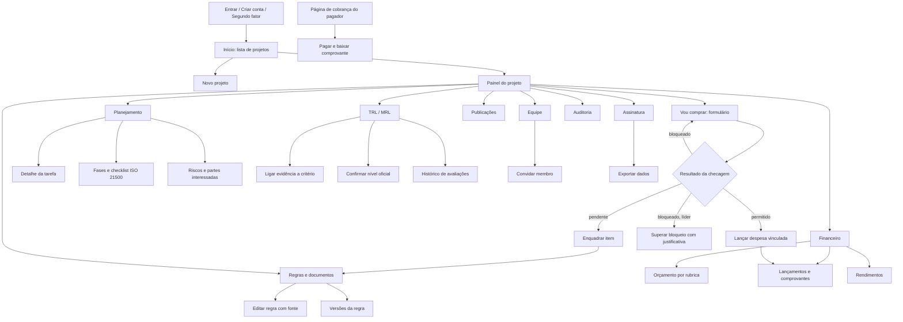

# Gestprojet: guia de UX e interface

Versão: 0.1 · Data: 24/11/2026 · Status: rascunho, aguarda aprovação do dono (T-017) · Autor: designer
Fontes: `docs/00-briefing.md`, `docs/01-prd.md` (aprovado), `CLAUDE.md` (identidade de partida). Protótipo navegável: `design/index.html` (abrir no navegador; todos os dados são fictícios e marcados como EXEMPLO).

Este guia não decide nada que esteja em "Questões em aberto" do PRD. Onde o desenho depende de uma delas, o ponto está marcado com **(Q-xx)** e a seção 8 lista o que muda conforme a resposta. Nenhuma regra de edital é inventada: todo edital, cláusula, página e valor do protótipo é fictício.

## 1. Princípios

Os sete princípios da skill, ajustados ao PRD, mais um oitavo vindo do caso que originou o produto.

1. **Uma tela, uma pergunta.** O usuário é o pesquisador líder: ocupado, muitas vezes fora do escritório, sem ser especialista em software. Cada tela responde a uma pergunta ("posso comprar isto?", "quanto sobra na rubrica?", "o que precisa da minha atenção?").
2. **Antes de gastar vem primeiro.** A checagem "Vou comprar" é a ação mais importante do produto (RF-060 a RF-066). Ela está a 1 clique de qualquer tela, em verde, no menu e no cabeçalho de cada tela principal, e fixa no rodapé do celular.
3. **Situação do projeto sempre visível:** vigência, execução financeira, plano de trabalho e pendências aparecem no painel e o nome do projeto, financiador e vigência ficam no cabeçalho de todas as telas.
4. **Dinheiro sem ambiguidade:** valores à direita, `R$ 1.234,56`, números tabulares, previsto × realizado × saldo lado a lado; saldo negativo com sinal de menos, ícone e texto, nunca só cor (RN-009, RNF-14).
5. **Nunca só cor.** Todo estado (permitido, bloqueado, pendente, atende, não atende, estouro) combina **cor + ícone com forma própria + palavra**, e a barra de estouro ainda tem listras. O teste de aceite: a tela em tons de cinza continua dizendo a mesma coisa.
6. **Evidência e fonte a um clique:** toda verificação mostra a fonte da regra (documento, cláusula, página); todo número de TRL/MRL leva à evidência; todo painel diz de onde vem o dado.
7. **IA identificada, pessoa decide:** saída de IA aparece com o rótulo "sugestão da IA", a fonte e os botões aceitar, editar e rejeitar; nada vale antes do aceite (RN-014, RF-090). Sem IA, tudo funciona (RF-091).
8. **Resultado antes de detalhe.** Na checagem, primeiro a resposta em uma palavra, depois o que fazer, depois as verificações com os motivos. O líder decide em segundos e só desce se quiser entender o porquê.
9. **Acessibilidade WCAG 2.2 AA e português do Brasil** (RNF-08, RNF-11): contraste mínimo, foco visível, teclado, rótulos, alvos de toque de 44 px, datas `DD/MM/AAAA`, moeda `R$`, termos do meio (rubrica, termo de outorga, edital, prestação de contas, cotação).

Tom de voz: direto, frases curtas, sem jargão de software ("Não compre ainda: 2 motivos impedem esta compra", e não "Validação falhou"). Fala com "você". Diz o que aconteceu e o que fazer. Nunca culpa. Nunca diz "certificado" para ISO 21500: sempre "estrutura alinhada à ISO 21500" (RN-021).

## 2. Identidade visual

### 2.1 Personalidade e logotipo

- **Três adjetivos:** confiável (lida com dinheiro público), clara (decisão rápida), científica (laboratório, evidência).
- **Cores de partida (CLAUDE.md):** azul-marinho como principal e verde como acento. O azul comunica seriedade e é a base do menu e dos botões comuns; o verde marca a ação-chave ("Vou comprar"), o selo ISO 21500 e o sucesso.
- **Logotipo (orientações):** um "G" desenhado como um arco aberto, com um frasco de laboratório verde dentro da abertura. Versão sobre fundo escuro (menu lateral): G branco, frasco verde `#4FD08F`. Versão sobre fundo claro: G em azul-marinho. Área de respiro de metade da altura do G; tamanho mínimo de 24 px; nunca distorcer, nunca recolorir o frasco para vermelho ou amarelo (confunde com estados). O protótipo traz uma versão provisória em SVG; o arquivo final do logotipo é a ser entregue pelo dono ou criado na implementação (T-107).
- **Ícones:** traço de 2 px, cantos arredondados, sempre acompanhados de texto; decorativos para leitor de tela (`aria-hidden`).

### 2.2 Tokens de cor

Os valores abaixo são os do protótipo (`design/index.html`, variáveis `--c-*`) e são a fonte única para a implementação (T-107). O tema claro é o padrão; o escuro segue a preferência do sistema e pode ser alternado pelo usuário (botão "Tema escuro", escolha lembrada no navegador).

| Token | Função | Claro | Escuro |
|---|---|---|---|
| `bg` | fundo da página | `#F4F7FB` | `#0A1120` |
| `surface` | cartões, campos | `#FFFFFF` | `#111B30` |
| `surface-2` | superfície sutil, cabeçalhos | `#EAF0F8` | `#18253F` |
| `border` | divisores decorativos | `#C9D4E3` | `#2A3A57` |
| `border-strong` | borda de campos e botões (UI) | `#6A7B95` | `#7D8DA8` |
| `text` | texto principal | `#0E1A33` | `#E8EEF8` |
| `text-muted` | texto secundário | `#475671` | `#A6B4CC` |
| `primary` | azul-marinho: botão comum | `#0B2A5B` | `#8DB4FF` |
| `on-primary` | texto sobre `primary` | `#FFFFFF` | `#0A1B3D` |
| `primary-hover` | hover | `#143E82` | `#B3CDFF` |
| `link` | links | `#0B4FA8` | `#9CC0FF` |
| `accent` | verde: ação-chave | `#0A6B41` | `#4FD08F` |
| `on-accent` | texto sobre `accent` | `#FFFFFF` | `#04210F` |
| `accent-hover` | hover do verde | `#07583A` | `#7BE0AE` |
| `accent-text` | texto verde sobre cartão | `#07583A` | `#6FE0A3` |
| `accent-soft` | fundo do selo ISO | `#E0F3E8` | `#0F2E22` |
| `ok-fg` / `ok-bg` / `ok-bd` | permitido, atende, sucesso | `#075E3A` / `#E1F4EA` / `#075E3A` | `#6FE0A3` / `#0F2E22` / `#6FE0A3` |
| `warn-fg` / `warn-bg` / `warn-bd` | pendente, alerta | `#734000` / `#FFF0CC` / `#9A5B00` | `#FFCB66` / `#33260A` / `#C98A1B` |
| `err-fg` / `err-bg` / `err-bd` | bloqueado, erro, estouro | `#9E1717` / `#FDE8E8` / `#9E1717` | `#FF9B9B` / `#3A1414` / `#FF9B9B` |
| `info-fg` / `info-bg` / `info-bd` | informação, proposta | `#12508F` / `#E4EEFA` / `#12508F` | `#8CC2FF` / `#10243F` / `#8CC2FF` |
| `nav-bg` | menu lateral | `#0B2A5B` | `#070D1A` |
| `nav-text` / `nav-muted` | texto do menu | `#FFFFFF` / `#C4D2EA` | `#FFFFFF` / `#B4C3DD` |
| `focus` | anel de foco | `#0B57D0` | `#8DB4FF` |
| `focus-nav` | anel de foco no menu | `#8FE3B5` | `#8FE3B5` |
| `bar-fill` / `bar-track` / `bar-over` | barras de progresso | `#0B4FA8` / `#D5DEEB` / `#9E1717` | `#8DB4FF` / `#26354F` / `#FF9B9B` |

Os estados usam **semântica fixa**: verde = permitido/atende, vermelho = bloqueado/estouro, âmbar = pendente/atenção, azul = informação/proposta. Cada um tem uma forma de ícone exclusiva (ver 2.5).

### 2.3 Contraste verificado (WCAG 2.2 AA)

Verificação por cálculo da luminância relativa (fórmula da WCAG 2.x, sRGB) feita sobre as variáveis do próprio `design/index.html`, nos dois temas: 42 pares × 2 temas = 84 verificações, **0 falhas**. Mínimos: 4,5:1 para texto normal (1.4.3) e 3:1 para componentes de interface e objetos gráficos (1.4.11). O texto de menor corpo do produto tem 14 px; nenhum texto do produto usa cor `border` ou `surface-2` como cor de texto. Quem alterar um token deve repetir o cálculo (o script usado está descrito em 7.5).

#### Razões de contraste calculadas

| Par (texto/elemento sobre fundo) | Mínimo | Claro | Escuro |
|---|---|---|---|
| Texto sobre fundo da página (`text` sobre `bg`) | 4,5:1 | 16,10:1 | 16,17:1 |
| Texto sobre cartão (`text` sobre `surface`) | 4,5:1 | 17,29:1 | 14,73:1 |
| Texto sobre superfície sutil (`text` sobre `surface-2`) | 4,5:1 | 15,09:1 | 13,10:1 |
| Texto secundário sobre cartão (`text-muted` sobre `surface`) | 4,5:1 | 7,40:1 | 8,19:1 |
| Texto secundário sobre fundo (`text-muted` sobre `bg`) | 4,5:1 | 6,89:1 | 9,00:1 |
| Texto secundário sobre superfície sutil (`text-muted` sobre `surface-2`) | 4,5:1 | 6,46:1 | 7,29:1 |
| Botão primário (texto) (`on-primary` sobre `primary`) | 4,5:1 | 14,03:1 | 8,17:1 |
| Botão primário em hover (`on-primary` sobre `primary-hover`) | 4,5:1 | 10,29:1 | 10,58:1 |
| Link sobre cartão (`link` sobre `surface`) | 4,5:1 | 7,78:1 | 9,32:1 |
| Link sobre fundo (`link` sobre `bg`) | 4,5:1 | 7,24:1 | 10,23:1 |
| Botão de acento verde (texto) (`on-accent` sobre `accent`) | 4,5:1 | 6,58:1 | 8,74:1 |
| Botão verde em hover (`on-accent` sobre `accent-hover`) | 4,5:1 | 8,52:1 | 10,67:1 |
| Texto verde sobre cartão (`accent-text` sobre `surface`) | 4,5:1 | 8,52:1 | 10,52:1 |
| Selo ISO 21500 (verde sobre verde claro) (`accent-text` sobre `accent-soft`) | 4,5:1 | 7,36:1 | 8,97:1 |
| Permitido: texto sobre fundo (`ok-fg` sobre `ok-bg`) | 4,5:1 | 6,86:1 | 8,97:1 |
| Pendente: texto sobre fundo (`warn-fg` sobre `warn-bg`) | 4,5:1 | 7,55:1 | 9,83:1 |
| Bloqueado: texto sobre fundo (`err-fg` sobre `err-bg`) | 4,5:1 | 6,91:1 | 8,07:1 |
| Informação: texto sobre fundo (`info-fg` sobre `info-bg`) | 4,5:1 | 6,97:1 | 8,38:1 |
| Permitido: texto sobre cartão (`ok-fg` sobre `surface`) | 4,5:1 | 7,86:1 | 10,52:1 |
| Pendente: texto sobre cartão (`warn-fg` sobre `surface`) | 4,5:1 | 8,53:1 | 11,43:1 |
| Bloqueado: texto sobre cartão (`err-fg` sobre `surface`) | 4,5:1 | 8,11:1 | 8,51:1 |
| Bloqueado: texto sobre fundo da página (`err-fg` sobre `bg`) | 4,5:1 | 7,55:1 | 9,35:1 |
| Menu lateral: texto (`nav-text` sobre `nav-bg`) | 4,5:1 | 14,03:1 | 19,42:1 |
| Menu lateral: texto secundário (`nav-muted` sobre `nav-bg`) | 4,5:1 | 9,19:1 | 10,90:1 |
| Botão Vou comprar (texto) (`on-accent` sobre `accent`) | 4,5:1 | 6,58:1 | 8,74:1 |
| Borda de campos e botões sobre cartão (UI) (`border-strong` sobre `surface`) | 3:1 | 4,30:1 | 5,11:1 |
| Borda de campos sobre fundo (UI) (`border-strong` sobre `bg`) | 3:1 | 4,00:1 | 5,61:1 |
| Anel de foco sobre cartão (UI) (`focus` sobre `surface`) | 3:1 | 6,39:1 | 8,26:1 |
| Anel de foco sobre fundo (UI) (`focus` sobre `bg`) | 3:1 | 5,94:1 | 9,07:1 |
| Anel de foco no menu lateral (UI) (`focus-nav` sobre `nav-bg`) | 3:1 | 9,24:1 | 12,78:1 |
| Borda do selo Permitido (UI) (`ok-bd` sobre `ok-bg`) | 3:1 | 6,86:1 | 8,97:1 |
| Borda do selo Pendente (UI) (`warn-bd` sobre `warn-bg`) | 3:1 | 4,80:1 | 5,02:1 |
| Borda do selo Bloqueado (UI) (`err-bd` sobre `err-bg`) | 3:1 | 6,91:1 | 8,07:1 |
| Borda do selo Informação (UI) (`info-bd` sobre `info-bg`) | 3:1 | 6,97:1 | 8,38:1 |
| Barra lateral do item Atende sobre cartão (UI) (`ok-bd` sobre `surface`) | 3:1 | 7,86:1 | 10,52:1 |
| Barra lateral do item Bloqueia sobre cartão (UI) (`err-bd` sobre `surface`) | 3:1 | 8,11:1 | 8,51:1 |
| Barra lateral do item Pendente sobre cartão (UI) (`warn-bd` sobre `surface`) | 3:1 | 5,43:1 | 5,83:1 |
| Preenchimento da barra sobre a trilha (UI) (`bar-fill` sobre `bar-track`) | 3:1 | 5,74:1 | 5,93:1 |
| Preenchimento da barra sobre cartão (UI) (`bar-fill` sobre `surface`) | 3:1 | 7,78:1 | 8,26:1 |
| Barra de estouro sobre cartão (UI) (`bar-over` sobre `surface`) | 3:1 | 8,11:1 | 8,51:1 |
| Contorno da barra sobre a trilha (UI) (`border-strong` sobre `bar-track`) | 3:1 | 3,17:1 | 3,67:1 |
| Número sobre nível alcançado (escala TRL/MRL) (`surface` sobre `bar-fill`) | 4,5:1 | 7,78:1 | 8,26:1 |

Observações:
- A cor `warn-bd` (borda do selo pendente) é mais escura que o âmbar usual de propósito, para passar 3:1 sobre o fundo do selo e sobre o cartão.
- Verde e vermelho dos estados diferem em luminância além de matiz (ex.: `ok-fg` 7,86:1 e `err-fg` 8,11:1 sobre o cartão, ambos escuros no tema claro), e cada estado tem ícone e palavra próprios; o par continua distinguível para daltonismo de vermelho-verde porque a informação não está só na cor.
- Superfícies de texto não listadas (por exemplo texto `text` dentro de `err-bg` na linha de tabela destacada) herdam razões maiores que 13:1 em ambos os temas.

### 2.4 Tipografia

- **Família:** pilha de fontes do sistema, `system-ui, -apple-system, "Segoe UI", Roboto, "Helvetica Neue", Arial, "Noto Sans", sans-serif`. Sem fonte externa: carrega mais rápido (RNF-03), não envia dado a terceiros e tem boa cobertura de acentos do português. Se o dono quiser uma fonte de marca, troca-se só o token `--font`.
- **Escala** (base 16 px, razão aproximada 1,2): 14 (apoio, rótulos de campo, legendas) · 16 (corpo) · 18 (subtítulo, frase de apoio do resultado) · 20 (título de cartão) · 24 (título de tela) · 30 · 36 (palavra do resultado da checagem). Em 360 px, o título de tela cai para 20.
- **Pesos:** 400 corpo, 600 ênfase e rótulos, 700 títulos e botões, 800/900 só números grandes e a palavra do resultado.
- **Números:** `font-variant-numeric: tabular-nums` em todo valor monetário, percentual e data em tabela; alinhados à direita.
- **Linha:** altura 1,5 no corpo e 1,25 nos títulos; medida máxima de 62 caracteres em textos corridos.

### 2.5 Espaçamento, raios, sombras, ícones de estado

- **Espaçamento (base 4 px):** 4 · 8 · 12 · 16 · 24 · 32 · 48 · 64 (`--s-1` a `--s-8`). Cartão com 24 px de respiro (16 px no celular); 16 px entre cartões.
- **Raios:** 6 (selos pequenos, campos de foco), 10 (botões, campos), 16 (cartões, resultado), 999 (selos, barras).
- **Sombras:** só uma elevação suave nos cartões (`--shadow-1`) e uma para o menu deslizante no celular (`--shadow-2`). Hierarquia vem de borda e espaço, não de sombra.
- **Alvo de toque:** 44 × 44 px no mínimo (acima dos 24 px exigidos pela WCAG 2.5.8).
- **Foco:** anel de 3 px com deslocamento de 2 px, na cor `focus` (`focus-nav` no menu).
- **Movimento:** transições curtas (200 ms) só no menu do celular; o esqueleto de carregamento anima, e tudo isso é desligado com `prefers-reduced-motion`.

**Linguagem dos estados (cor + forma + palavra):**

| Estado | Palavra | Ícone (forma) | Cor | Borda do bloco |
|---|---|---|---|---|
| Permitido / Atende | PERMITIDO · Atende | círculo com visto | verde | contínua |
| Bloqueado / Bloqueia | BLOQUEADO · Bloqueia | octógono com X | vermelho | contínua, grossa |
| Pendente / Sem decisão | PENDENTE · Sem decisão | relógio em círculo | âmbar | **tracejada** |
| Não se aplica | Não se aplica | círculo com traço | neutro | contínua, cinza |
| Informação / Proposta | Proposta, Informação | círculo com "i" | azul | tracejada (proposta) |
| Estouro de rubrica | Acima do previsto | triângulo de alerta | vermelho | barra com listras |

## 3. Arquitetura de informação

### 3.1 Navegação

**Menu lateral** (desktop a partir de 1024 px; no celular e no tablet vira gaveta aberta pelo botão "Menu"). Ele sempre se refere ao **projeto atual**; o nome do projeto, financiador e vigência ficam no cabeçalho, com o seletor de projeto.

| Ordem | Item | O que abre | Observação |
|---|---|---|---|
| 0 | **Vou comprar** (botão verde, destacado) | checagem antes da compra | também no cabeçalho de cada tela principal e fixo no rodapé do celular |
| 1 | Painel do projeto | dashboard do projeto | entrada padrão ao abrir um projeto |
| 2 | Planejamento | plano de trabalho (metas, etapas, tarefas, marcos), fases e checklist ISO 21500, riscos, partes interessadas | |
| 3 | TRL / MRL | cards, evidências, proposta, histórico | |
| 4 | Financeiro | orçamento por rubrica, lançamentos, rendimentos, comprovantes | |
| 5 | Regras e documentos | edital e termo de outorga anexados; regras do projeto com fonte; versões | só o líder edita |
| 6 | Publicações | palavras-chave e resultados da busca científica | |
| 7 | Equipe | membros e níveis de acesso | só o líder altera |
| 8 | Auditoria | trilha imutável | só o líder vê |
| 9 | Assinatura | situação, vencimentos, pagamentos, exportação de dados | só o líder |

- **Início** (fora do projeto, no logotipo e no seletor de projeto): lista de projetos (RF-002), a visão de "portfólio" da 1ª versão.
- **Conta:** menu do usuário no cabeçalho (perfil, segundo fator, sair, direitos do titular, RF-110, RF-111, RF-113).
- **Fora do menu da 1ª versão:** Prestação de contas, Relatórios (2ª versão) e as telas de perfis futuros (gestor de fundação, financiador, auditor). O espaço fica reservado no menu depois de Financeiro; enquanto não existirem, não aparecem, para não prometer o que não há.
- **Membro "visualiza":** vê as mesmas telas sem botões de edição e sem "Vou comprar" (matriz da seção 3 do PRD). **Membro "registra":** vê "Vou comprar", mas não vê Equipe (edição), Auditoria nem Assinatura. O **pagador** não usa o menu: recebe uma página de cobrança isolada (ver 3.3).

### 3.2 Mapa de telas

### 3.3 Inventário de telas da 1ª versão

Persona: **L** líder, **M** membro (R = registra, V = visualiza), **G** pagador. As telas com ★ estão no protótipo.

| # | Tela | Persona | RFs |
|---|---|---|---|
| T01 | Entrar, criar conta, recuperar senha, segundo fator | L, M | RF-110, RF-111 |
| T02 | Início: lista de projetos | L, M | RF-002, RF-001 |
| T03 | Novo projeto (cadastro) | L | RF-001 |
| T04 ★ | Painel do projeto | L, M | RF-003, RF-013, RF-024, RF-064, RF-083 |
| T05 | Planejamento: plano de trabalho (metas, etapas, tarefas, marcos) | L, M(R) | RF-010, RF-011 |
| T06 | Detalhe da tarefa (andamento, entrega) | L, M(R) | RF-012 |
| T07 | Fases e checklist ISO 21500 | L | RF-020, RF-023 |
| T08 | Riscos e partes interessadas | L, M(R) | RF-021, RF-022 |
| T09 | Equipe: lista e convite | L, M | RF-030, RF-031, RF-032, RF-034 |
| T10 | Regras e documentos: anexos do edital e do termo | L, M | RF-040 |
| T11 | Regras do projeto: lista, edição com fonte, versões, regras sem fonte | L (M lê) | RF-041, RF-042, RF-043 (Q-01) |
| T12 ★ | **Vou comprar: formulário** | L, M(R) | RF-060, RF-067 |
| T13 ★ | **Vou comprar: resultado (permitido, bloqueado, pendente)** | L, M(R) | RF-061, RF-062, RF-063, RF-064 |
| T14 | Superar bloqueio com justificativa e anexo | L | RF-065 (Q-10) |
| T15 | Enquadrar item pendente | L | RF-066 |
| T16 | Histórico de checagens | L, M | RF-064 |
| T17 | Financeiro: orçamento por rubrica | L, M | RF-050, RF-053 |
| T18 ★ | Financeiro: painel (previsto, realizado, saldo, rendimentos) | L, M | RF-053, RF-054 |
| T19 | Lançamentos da conta, lançar despesa, estorno | L, M(R despesas) | RF-051, RF-052 (Q-02), RF-055 |
| T20 | Comprovantes da despesa | L, M(R) | RF-055 |
| T21 ★ | TRL / MRL: cards, proposta, confirmação, histórico | L, M | RF-070 a RF-074 (Q-03) |
| T22 | Ligar evidência a critério | L, M(R) | RF-071 |
| T23 | Publicações: palavras-chave, resultados, salvar e descartar | L, M | RF-080 a RF-083 (Q-06) |
| T24 | Auditoria | L | RF-112 |
| T25 | Assinatura: situação, pagamentos, cancelar, exportar | L | RF-100, RF-103, RF-105, RF-106 (Q-04, Q-05) |
| T26 | Contratar assinatura (indicar pagador) | L | RF-100 |
| T27 | Página de cobrança do pagador (link por e-mail): valor, vencimento, pagar, comprovante | G | RF-101, RF-102 (Q-18) |
| T28 | Minha conta: dados, exportar e excluir dados | L, M, G | RF-113 |
| T29 | Encerrar e arquivar projeto | L | RF-004 |
| T30 ★ | Estados: vazio, carregando, erro (padrão) | todos | RNF-01, RF-091 |

Cobertura: todo RF Must da 1ª versão tem tela; RF-001 a RF-004, RF-010 a RF-013, RF-020 a RF-024, RF-030 a RF-034, RF-040 a RF-043, RF-050 a RF-055, RF-060 a RF-067, RF-070 a RF-074, RF-080 a RF-083, RF-090, RF-091, RF-100 a RF-106, RF-110 a RF-114 (RF-114, transferir liderança, é Could e entra em Equipe quando houver). RF-090 e RF-091 são regras transversais aplicadas a todo componente de IA (seção 6).

### 3.4 As 3 tarefas mais frequentes por persona e o caminho mais curto

| Persona | Tarefa | Caminho a partir do Início | Cliques |
|---|---|---|---|
| Líder | 1. Conferir uma compra | Projeto → Vou comprar (formulário) → Conferir | 3 (do Início); **1 de qualquer tela do projeto** para abrir o formulário |
| Líder | 2. Ver saldo por rubrica | Projeto → Painel (já mostra o saldo) | 1 a 2 (Financeiro para o detalhe: 2) |
| Líder | 3. Ver o que precisa de atenção / TRL e MRL | Projeto → Painel (pendências e cards TRL/MRL) | 1 a 2 |
| Membro (registra) | 1. Pedir checagem antes de comprar | Projeto → Vou comprar | 2 |
| Membro (registra) | 2. Atualizar tarefa | Projeto → Planejamento → tarefa | 3 |
| Membro (registra) | 3. Anexar comprovante ou evidência | Projeto → Financeiro → despesa → Anexar (ou TRL/MRL → Ligar evidência) | 3 |
| Pagador | 1. Pagar a cobrança | Link do e-mail → Pagar | 1 |
| Pagador | 2. Baixar comprovante | Link do e-mail → Baixar comprovante | 1 |
| Pagador | 3. Ver situação e vencimento | Link do e-mail (a própria página) | 0 |

Com um único projeto (Q-08 em aberto), o Início leva direto ao Painel do projeto e economiza um clique; a lista de projetos continua acessível pelo seletor do cabeçalho.

## 4. Dashboards

Todos mostram, no rodapé de cada cartão, a **fonte do dado** (como no protótipo) e só aparecem a quem o PRD permite. Valores em `R$ 1.234,56`, datas `DD/MM/AAAA`.

### 4.1 Início: lista de projetos (portfólio da 1ª versão)

- **Pergunta:** em qual dos meus projetos preciso agir hoje?
- **Indicadores por projeto (cartão):** título, financiador, vigência com tempo restante, execução financeira (% e barra com número), número de pendências, situação da assinatura (**só para o líder**, RF-002).
- **Fonte:** dados de cada projeto (RF-001, RF-003).
- **Quem vê:** só os projetos em que a pessoa é líder ou membro ativo (RN-022).
- **Variação por Q-08:** com 1 projeto, mostra o painel; com poucos, cartões; com muitos (mais de 6), tabela ordenável por pendências e vencimento. Os três usam os mesmos dados.
- **Atenção:** esta tela não traz "portfólio de gestor" do modelo da skill, porque o PRD da 1ª versão não tem persona de gestor (seção 3 do PRD).

### 4.2 Painel do projeto ★ (líder e membros)

- **Pergunta:** como está o projeto e o que precisa da minha atenção agora?
- **Faixa de situação (4 indicadores):** vigência restante, execução financeira, plano de trabalho (% e tarefas atrasadas), checagem prévia (% de despesas com checagem, meta O3).
- **Cartões:** Pendências (tarefas atrasadas, despesas sem checagem ou comprada com checagem bloqueada, checagens pendentes, regras sem fonte ou não confirmadas, rubrica negativa, comprovante faltando após 30 dias; cada uma com link), Próximos prazos (marcos e tarefas), progresso do projeto com selo "Estrutura alinhada à ISO 21500", Saldo por rubrica, Maturidade (TRL e MRL atual → meta, proposta aguardando), Publicações novas, Atualização do plano ("plano sem atualização há N dias", RF-024).
- **Fonte:** plano de trabalho, regras, checagens, lançamentos, avaliações TRL/MRL e busca (todos do projeto).
- **Quem vê:** líder e membros do projeto. Membro "visualiza" vê os mesmos indicadores sem botões de edição. A situação da assinatura aparece só ao líder.
- **Ordem de importância (de cima para baixo):** botão "Vou comprar" → faixa de situação → pendências.

### 4.3 Financeiro ★ (líder e membros)

- **Pergunta:** quanto já gastei, quanto sobra em cada rubrica e quanto rendeu a conta?
- **Indicadores:** orçamento aprovado e % distribuído, realizado, saldo das rubricas, saldo da conta.
- **Tabela por rubrica:** previsto, realizado, saldo e % executado (barra com número e, se estourar, ícone, texto "Acima do previsto", sinal de menos e listras); linha de total.
- **Rendimentos:** por mês e acumulado, separados, com a nota "não entram no saldo de nenhuma rubrica" (RN-011).
- **Checagem prévia:** % de despesas com checagem vinculada.
- **Últimos lançamentos:** descrição, data, valor, situação da checagem ("Checagem permitida vinculada", "Sem checagem", "Comprada com checagem bloqueada"), origem do lançamento (manual, extrato ou banco, Q-02).
- **Fonte:** orçamento por rubrica (regras do edital, RF-050) e lançamentos da conta (RF-051); saldo = previsto − realizado, ao centavo (RN-010).
- **Quem vê:** líder e membros. Só líder cria crédito e rendimento; membro "registra" lança só despesas. Dado financeiro: nunca em tela compartilhada com o pagador (RN-019).
- **Fora da 1ª versão:** remanejamento entre rubricas com aprovação (item "a confirmar" do PRD, seção 4.2).

### 4.4 Maturidade TRL/MRL ★ (líder e membros)

- **Pergunta:** em que nível de maturidade estamos e o que falta para o próximo?
- **Cartões TRL e MRL:** nível atual × meta em texto grande, escala de 1 a 9 em segmentos numerados (alcançado = cheio, atual = contorno grosso, proposta = listrado, meta = tracejado), data da confirmação oficial e número de evidências. A escala de 1 a 9 é um desenho de exemplo: o número de níveis vem da configuração (Q-03, RF-070).
- **Proposta:** rotulada "Proposta, ainda não é oficial" (e "sugestão da IA" se houver IA), com lista de critérios (com evidência, falta evidência), ações Confirmar, Registrar outro nível (justificativa obrigatória), Ligar evidência (RF-072, RF-073).
- **Fonte:** evidências ligadas aos critérios. **Quem vê:** líder e membros; só o líder confirma o nível oficial.

### 4.5 Prestação de contas (2ª versão)

Não está na 1ª versão (PRD, seção 4.2). Quando entrar: checklist por exigência do edital, comprovantes faltantes e despesas sem nota. Na 1ª versão, o painel já prepara o terreno com as pendências de comprovante (RF-055) e de checagem.

## 5. Fluxos principais

Convenção de estados em todas as telas de dados: **vazio** (diz o que falta e dá a ação que resolve), **carregando** (esqueleto com `aria-busy` e texto "Conferindo…" em `role="status"`; passando de 10 s mostra "Tentar de novo"), **erro** (texto em linguagem simples, diz se algo foi registrado, dá o que fazer; `role="alert"`). O protótipo traz a tela "Estados" com os três.

### 5.1 Checagem antes da compra (prioridade máxima)

**Objetivo:** em poucos segundos, antes de gastar, o líder ou membro sabe se pode comprar, em que rubrica entra e por quê (RF-060 a RF-066, RNF-01: resposta em até 3 s; RNF-07: funciona em 360 px com foto da cotação).

**Passo a passo**

1. **Abrir:** botão verde "Vou comprar" (menu, cabeçalho ou rodapé do celular). Abre o formulário.
2. **Preencher (T12):** item (descrição), categoria (lista das regras confirmadas, com "Não encontrei a categoria"), rubrica pretendida, quantidade, valor estimado, data prevista (`DD/MM/AAAA`), fornecedor, cotações. Cada cotação mostra fornecedor, valor, data e a marca "Válida" ou o motivo de não valer (sem arquivo, sem valor, mesmo fornecedor de outra cotação, RN-008). "Anexar cotação" aceita arquivo ou **câmera do celular**. Campo com erro mostra a mensagem junto do campo e um resumo no topo; ex.: "Informe o valor estimado, em reais. Exemplo: 1.234,56".
3. **Conferir:** botão "Conferir antes de comprar". Enquanto responde, o botão mostra "Conferindo…" e fica desativado (sem duplicar pedidos).
4. **Resultado (T13):** ver 5.2. A checagem fica **registrada e imutável** (RF-064): "Checagem nº, pedida por, em tal data e hora, com as regras vN".
5. **Agir conforme o resultado:**
   - *Permitido:* "Compre dentro do valor checado" → depois da compra, "Comprei: lançar despesa com esta checagem" (vínculo, RF-064). Se o valor final for maior que o checado, a plataforma avisa a diferença e pede nova checagem.
   - *Bloqueado:* corrigir (anexar cotações, mudar rubrica, trocar o item) e conferir de novo. Se a pessoa comprar mesmo assim, "Já comprei: lançar despesa" a leva ao lançamento, com o aviso de que a despesa ficará marcada "comprada com checagem bloqueada", irá às pendências do líder e à auditoria (RN-012). O botão de superar bloqueio (T14) só existe para o líder e depende de Q-10.
   - *Pendente:* o líder enquadra o item (T15): cria ou ajusta regra com fonte, ou registra que não deve comprar; depois refaz a checagem. A pendente fica no histórico (RF-066). Membro vê "Peça ao líder para enquadrar".

**Estados da tela**
- *Vazio:* se o projeto não tem nenhuma regra confirmada, a tela não deixa o usuário achar que "não há bloqueio": mostra "Este projeto ainda não tem regras confirmadas. A checagem só funciona com as regras do edital confirmadas pelo líder", com o botão "Cadastrar regras" (líder) ou "Avisar o líder" (membro). Se falta a regra de cotações: "Defina a exigência de cotações (ou marque que o edital não exige)" (RF-041).
- *Carregando:* esqueleto no lugar do resultado e texto "Conferindo as regras do edital…".
- *Erro:* "Não foi possível conferir agora. Nada foi registrado. Tente de novo; se continuar, confira as regras do edital manualmente antes de comprar." Nunca mostra um resultado "permitido" por falha. Sem conexão (celular): o formulário guarda o rascunho e avisa "Sem internet: a checagem precisa de conexão".
- *IA indisponível:* a checagem funciona normalmente, sem a sugestão de categoria; aviso discreto "Sugestão da IA indisponível agora" (RF-067, RF-091).

### 5.2 Anatomia do resultado da checagem

Ordem fixa, de cima para baixo (e também no leitor de tela, que lê o título e a região de resultado primeiro):

1. **Bloco de resultado** (região com `aria-labelledby`): ícone grande de forma própria + **palavra** em 36 px + frase de consequência. Borda de 3 px (contínua para permitido e bloqueado; **tracejada para pendente**).

   | Resultado | Palavra | Frase |
   |---|---|---|
   | Permitido | PERMITIDO | "Pode comprar: todas as verificações foram atendidas." |
   | Bloqueado | BLOQUEADO | "Não compre ainda: N motivos impedem esta compra." |
   | Pendente | PENDENTE | "Ainda não dá para decidir: o item não está nas regras do projeto." (o motivo varia) |

   A frase de bloqueado usa o verbo "não compre ainda" porque a plataforma confere e registra, mas não controla o cartão (PRD 4.3, RN-012).
2. **O que fazer / Próximo passo:** lista numerada com a ação para cada motivo e os botões (anexar cotações e conferir de novo; lançar despesa). Quem só quer saber o que fazer não precisa descer.
3. **Verificações (6 linhas, sempre as mesmas, na ordem Item, Rubrica, Saldo, Cotações, Limites, Vigência, RF-063):** cada linha tem ícone, nome, selo de situação (**Atende / Bloqueia / Sem decisão / Não se aplica**), o **motivo em linguagem simples** e a **fonte da regra** (documento, cláusula, página, versão das regras, link "abrir o documento na página N"). Linhas que bloqueiam aparecem **primeiro**, depois as pendentes, depois as que atendem.
4. **O que você informou** (resumo do pedido) e **Registro** (número, quem, quando, versão das regras, aviso de imutabilidade).
5. Quando há regras aguardando confirmação do líder, a linha afetada diz: "Há N regras aguardando confirmação do líder; elas não foram usadas nesta checagem" (RF-041).

**Como o resultado não depende só de cor:** palavra em maiúsculas + ícone de forma exclusiva (círculo com visto, octógono com X, relógio) + borda (contínua ou tracejada) + posição na lista + frase. Lido em tons de cinza ou por leitor de tela, o significado é o mesmo. O contraste dos pares está na seção 2.3.

### 5.3 O caso RF-062 desenhado

Projeto com regras confirmadas: "Material X" é **vedado** (cláusula e página) e a faixa de valor do item exige **3 cotações**. A pessoa pede a checagem com **1 cotação** (o protótipo, rota `#/comprar/bloqueado`).

- **Resultado: BLOQUEADO**, com **dois motivos**, cada um em sua linha:
  1. **Item, Bloqueia:** "Item vedado pelo edital: 'Material X' não pode ser comprado com os recursos deste projeto." Fonte: documento, cláusula e página.
  2. **Cotações, Bloqueia:** "Cotações anexadas: 1 de 3 exigidas. Faltam 2." Fonte: item do edital e página.
- **O que fazer:** "Item vedado: escolha outro item ou obtenha autorização do financiador antes de comprar" e "Cotações: anexe mais 2 cotações. Atenção: anexar cotações **não libera** item vedado" (critério 2 do RF-062).
- **Depois de anexar mais 2 cotações e conferir de novo:** continua **BLOQUEADO**, agora com **um só motivo** ("item vedado"); a linha de cotações passa a "Atende: 3 de 3". A tela não muda de aparência para parecer resolvida.
- **Se a pessoa lança a despesa mesmo assim:** o aviso do botão diz o que acontecerá; a despesa aparece marcada **"Comprada com checagem bloqueada"** (selo vermelho com octógono) no Financeiro e nas pendências do painel do líder, e vai para a auditoria (critério 3).
- **Variante do critério 4:** item permitido com 2 de 3 cotações dá BLOQUEADO só pelo motivo das cotações (uma linha vermelha; as demais atendem).
- **Precedência (RN-006):** bloqueio tem prioridade sobre pendência; se há motivo de bloqueio e outro de pendência, o bloco mostra BLOQUEADO e a linha pendente continua visível como "Sem decisão".

### 5.4 Cadastro de regras do edital (líder)

1. Regras e documentos → anexar edital e termo de outorga em PDF (até 25 MB; recusa outro formato e explica, RF-040).
2. Cadastrar cada regra (rubricas, itens permitidos e vedados, cotações por faixa, limites) escolhendo **documento, cláusula e página** (RF-041). A forma exata (digitar, ou a IA propor a partir do PDF e o líder conferir) depende de **Q-01**: o desenho usa a mesma lista de regras nos dois casos; com IA, cada proposta vem com rótulo "sugestão da IA", trecho e página, e três botões (aceitar, editar, rejeitar); nada vale antes do aceite (RF-043, RN-004).
3. Regra sem fonte: selo "Sem fonte" e entra nas pendências. Regra não confirmada: selo "Aguardando confirmação"; não é usada pela checagem.
4. Alterar uma regra cria nova versão (RF-042); a tela mostra "v3" e o histórico.
- *Vazio:* "Nenhuma regra cadastrada. Anexe o edital e cadastre a primeira regra." *Carregando (extração por IA, RNF-02):* barra de progresso com o texto "Lendo o PDF: página X de Y". *Erro:* "Não foi possível ler este PDF. Você pode cadastrar as regras manualmente."

### 5.5 Lançar despesa e acompanhar saldo

1. Financeiro → "Lançar despesa" (ou a partir do resultado da checagem). Campos: descrição, data, valor, rubrica, checagem vinculada, anexos (nota fiscal, cotação, comprovante).
2. Ao salvar sem checagem, mensagem: "Despesa lançada sem checagem. Ela aparece nas pendências do líder." (não bloqueia, RN-012).
3. Correção só por estorno ou nova versão com motivo; nunca apagar (RN-020).
- *Vazio:* "Nenhum lançamento ainda." *Carregando:* esqueleto da tabela. *Erro:* "Não foi possível salvar. Seus dados foram mantidos no formulário."

### 5.6 TRL/MRL: avaliar e confirmar

1. TRL/MRL → ver os cards com nível atual e meta (RF-070 define a meta).
2. "Ligar evidência": escolher documento ou entrega de tarefa e o critério (RF-071).
3. "Pedir proposta": a plataforma mostra o nível proposto e os critérios sem evidência (RF-072).
4. O líder confirma o nível, ou registra outro com justificativa obrigatória (RF-073). O histórico guarda data, nível, evidências e avaliador (RF-074).
- *Vazio:* "Defina a tecnologia avaliada e o nível de partida." *Carregando:* esqueleto dos cartões. *Erro de IA:* "A sugestão não está disponível; você pode ligar as evidências e confirmar o nível sem ela" (RF-091).

### 5.7 Equipe e acesso (líder)

Equipe → Convidar (e-mail e nível: registra ou visualiza). Convite expirado mostra "Reenviar". Alterar nível e revogar com confirmação clara ("Maria deixará de ver este projeto em até 1 minuto. Os registros dela continuam."). *Vazio:* "Só você está neste projeto. Convide quem vai registrar informações." (RF-030 a RF-032).

### 5.8 Pagador

Link do e-mail → página isolada com título do projeto, valor (R$ 50,00), vencimento, meios de pagamento e, após pagar, comprovante. Nada do projeto aparece (RN-019). Os meios dependem de Q-04. *Erro de pagamento:* "O pagamento não foi concluído. Nada foi cobrado" (ou o texto correto do provedor); *vazio:* "Esta cobrança já foi paga. Baixar comprovante."

## 6. Componentes

Todos já existem no protótipo, em CSS puro com os tokens da seção 2, exceto onde dito.

| Componente | Descrição e regras |
|---|---|
| **Botão** | Primário (azul-marinho), de ação-chave (verde, só para "Vou comprar" e para a ação que conclui um fluxo), secundário (contorno), grande (52 px). Altura mínima 44 px; rótulo é verbo ("Conferir antes de comprar"). Desativado só com explicação visível. |
| **Selo de estado** | Ícone + palavra + cor + borda (contínua ou tracejada). Nunca só o ícone ou só a cor. Variantes: ok, warn, err, info, neutral. |
| **Bloco de resultado da checagem** | Ver 5.2. Três variantes (permitido, bloqueado, pendente). |
| **Linha de verificação** | Ícone, nome, selo, motivo, fonte (documento, cláusula, página, versão, link para o documento). Borda lateral de 6 px na cor do estado (tracejada para pendente). |
| **Cartão de indicador (KPI)** | Rótulo, valor grande tabular, dica. Sem cor para dizer bom ou ruim: o texto diz. |
| **Barra de progresso** | Sempre com o valor em texto ao lado; contorno de 3:1; estouro com listras, ícone e texto. `role="img"` com `aria-label` do valor. |
| **Cartão TRL/MRL** | Nível atual × meta, escala de 1 a 9 (cheio, contorno grosso, listrado, tracejado) com legenda em texto, selo "Oficial" ou "Proposta", data e nº de evidências. |
| **Selo ISO 21500** | Texto fixo "Estrutura alinhada à ISO 21500" (nunca "certificado"). |
| **Tabela de dados** | Valores à direita, tabular; cabeçalho com `scope`, legenda para leitor de tela; linha de total; **no celular vira lista de cartões** com o rótulo de cada coluna. Linha com problema com fundo `err-bg` mais selo. |
| **Seletor de rubrica** | Lista com nome e **saldo atual** de cada rubrica ao lado; rubrica sem saldo suficiente mostra aviso, não some. |
| **Campo de cotação** | Fornecedor, valor, data, arquivo ou foto, selo "Válida" ou motivo da recusa. |
| **Upload de evidência/comprovante** | Arquivo ou câmera; PDF, JPG, PNG até 25 MB (RNF-12); progresso em texto; erro com o motivo ("Arquivo maior que 25 MB"); tipo (nota fiscal, cotação, comprovante, outro). |
| **Painel de sugestão da IA** | Rótulo fixo **"Sugestão da IA"** em selo azul tracejado, fonte (trecho e página, evidência ou regra), botões **Aceitar, Editar, Rejeitar**. Não pré-preenche campo; só muda algo ao aceitar. Registra a sugestão original na auditoria (RF-090). |
| **Linha do tempo** | Marcos e prazos em ordem de data, com data completa e situação em texto. |
| **Trilha de auditoria** | Tabela somente leitura: quem, quando, o quê, valor anterior e novo; filtros por pessoa, tipo e período; sem botão de editar ou apagar (RF-112). |
| **Aviso (banner)** | Faixa com ícone e texto (info, alerta, erro). Erro e alerta importantes usam `role="alert"`/`status`. |
| **Estados vazio, carregando, erro** | Bloco com borda tracejada (vazio), esqueleto (carregando, `aria-busy`), bloco vermelho com ícone (erro). Sempre com a ação seguinte. |
| **Menu lateral e gaveta** | Item ativo com barra verde, negrito e `aria-current="page"`. No celular, gaveta com `aria-expanded`, fecha com Esc e toque fora. |
| **Seletor de tema** | Botão com `aria-pressed`; segue o sistema por padrão. |

## 7. Acessibilidade e responsividade

### 7.1 Critérios (WCAG 2.2 AA, RNF-08)

- **Contraste:** texto 4,5:1 e componentes de interface 3:1 em ambos os temas (seção 2.3).
- **Não só cor (1.4.1):** estados com ícone de forma própria, palavra e borda; estouro com listras e texto.
- **Teclado (2.1.1, 2.4.7, 2.4.11):** tudo operável por teclado; foco visível de 3 px; ordem de foco = ordem visual; link "Pular para o conteúdo"; ao mudar de tela o foco vai para o título (`h1`), e o título da aba muda.
- **Rótulos e erros (1.3.1, 3.3.1, 3.3.2):** todo campo tem `label` visível; ajuda ligada por `aria-describedby`; erro em texto junto do campo e resumo no topo; formatos de exemplo (`1.234,56`, `DD/MM/AAAA`).
- **Alvo de toque (2.5.8):** 44 × 44 px no mínimo.
- **Reflow e zoom (1.4.4, 1.4.10):** funciona a 320 px de largura e a 200% de zoom, sem rolagem horizontal da página (tabelas largas rolam dentro do próprio contêiner no tablet e viram cartões no celular).
- **Semântica:** `main`, `nav` com nome, `header`, listas para listas; títulos em ordem; tabelas com `caption`/`th scope`; ícones decorativos `aria-hidden`; barras e escalas com `aria-label` do valor; resultado da checagem em região nomeada pelo título; carregamento em `role="status"` e erro em `role="alert"`.
- **Movimento (2.3.3):** respeita `prefers-reduced-motion`.
- **Alto contraste:** `forced-colors` mantém bordas e preenchimentos essenciais.
- **Idioma:** `lang="pt-BR"`; moeda e data nos formatos do RNF-11.
- **Arrastar (2.5.7):** nenhuma ação depende de arrastar.
- **Autenticação (3.3.8):** login e segundo fator permitem colar senha e código; nenhum teste de memória ou quebra-cabeça.

### 7.2 Pontos de quebra (a partir de 360 px, RNF-07)

| Faixa | Layout |
|---|---|
| **360 a 719 px** (celular) | Coluna única; menu em gaveta; "Vou comprar" fixo no rodapé (some dentro do próprio fluxo); tabelas viram cartões; formulário em uma coluna; resultado com ícone sobre a palavra. Testado sem rolagem horizontal em 360 px. |
| **720 a 1023 px** (tablet) | Grades de 2 colunas; menu em gaveta; formulário em 2 colunas. |
| **1024 px ou mais** (desktop) | Menu lateral fixo de 272 px; painéis em 2 a 4 colunas; conteúdo com largura máxima de 1180 px. |

Abaixo de 360 px (por exemplo 320) o layout continua sem rolagem horizontal, mas não é meta de teste do PRD.

### 7.3 Celular e campo

- Formulário de checagem inteiro utilizável com uma mão; teclado numérico para valor, quantidade e data (`inputmode`); anexo por **câmera**; mensagem clara quando não há conexão; rascunho guardado.
- Resultado da checagem cabe na primeira tela: bloco de resultado e "O que fazer" aparecem antes das verificações.

### 7.4 Desempenho percebido

RNF-03 (telas em até 2 s no 4G): sem fonte externa, sem biblioteca; o protótipo inteiro pesa cerca de 80 KB e carrega em um arquivo. RNF-01 (checagem em até 3 s): o botão muda para "Conferindo…" imediatamente e mostra o esqueleto.

### 7.5 Como o contraste foi verificado

Script em `design/verificar-contraste.py`: lê as variáveis `--c-*` do `design/index.html` (tema claro, tema escuro por preferência do sistema e tema escuro por botão), confere que os dois blocos escuros são idênticos e calcula a razão de contraste de cada par pela fórmula da WCAG. Rodar `python3 design/verificar-contraste.py` antes de aprovar qualquer mudança de token. Resultado desta versão: 84 verificações, 0 falhas.

## 8. Questões em aberto

Nenhuma delas foi decidida aqui. O desenho funciona com qualquer resposta; esta é a diferença.

| Questão (PRD) | Onde afeta a interface |
|---|---|
| Q-01 (como as regras entram) | T11: com "IA lê o PDF" aparece o painel de sugestão da IA com trecho e página e a barra de progresso da leitura; com cadastro manual, só o formulário de regra. A lista de regras e a checagem não mudam. |
| Q-02 (como a conta entra) | T19: a coluna "Origem" já existe; importação de extrato (RF-052) acrescenta a tela de conciliação e o estado "a classificar". |
| Q-03 (escala TRL/MRL) | T21: os 9 níveis do protótipo são exemplo; número de níveis e critérios vêm da configuração. |
| Q-04, Q-05 (pagamento, teste, atraso, cancelamento) | T25 e T27: meios de pagamento e os avisos de atraso, teste e cancelamento. O banner de atraso e o botão de exportar dados existem; o texto do efeito (ex.: somente leitura) depende de Q-05. |
| Q-06 (fontes da busca) | T23: texto de "fontes consultadas". |
| Q-08 (quantos projetos) | Início: um projeto leva direto ao painel; vários, cartões ou tabela (4.1). |
| Q-09 (níveis de membro) | O protótipo e o guia seguem a matriz do PRD (registra, visualiza); mudar os níveis altera só a visibilidade de botões. |
| Q-10 (superar bloqueio) | T14 e o botão "Superar bloqueio" só aparecem se o dono mantiver RF-065. O protótipo **não** mostra esse botão. Se o bloqueio for definitivo, o resultado "bloqueado" fica sem essa saída. |
| Q-15 (vigência como bloqueio geral) | A linha "Vigência" da checagem segue o RF-063; se mudar, a linha vira "Aviso" em vez de "Bloqueia". |
| Q-18 (o pagador vê algo do projeto) | T27: hoje só a cobrança (RN-019). |
| Q-19 (checagem permitida reserva saldo?) | A linha "Saldo" mostra o saldo da rubrica sem reserva (RN-010); se reservar, mostra "reservado" separado. |
| Q-20 (prazos de alerta) | Textos dos avisos de prazo (RF-013). |

Pendências do próprio design (não são questões do PRD):
- Logotipo definitivo: o do protótipo é provisório; falta o arquivo da marca.
- Teste com usuários reais: o protótipo ainda não foi avaliado por um líder em campo (celular, sol, uma mão). Sugerido na aprovação (T-017).
- Redação dos textos de erro e vazio revisada com um líder.

## 9. Lista de verificação (uxdesign-builder)

- [x] **Toda persona chega às suas 3 tarefas em até 3 cliques a partir do início** (3.4). Líder: 3 cliques para conferir uma compra, 1 a 2 nas demais; membro: no máximo 3; pagador: 1.
- [x] **Cores testadas para contraste nos dois temas** (2.3 e 7.5): 84 verificações, 0 falhas.
- [x] **Todo dashboard declara fonte do dado e quem pode vê-lo** (seção 4; cada cartão do protótipo traz a fonte). Prestação de contas está declarada como 2ª versão.
- [x] **Estados vazio, carregando e erro definidos para as telas principais** (seção 5, e tela "Estados" do protótipo).
- [x] **Conteúdo de IA sempre identificado e revisável** (princípio 7, componente "Painel de sugestão da IA", 5.4 e 5.6).
- [x] **Próximo passo indicado:** `workflow-builder` (T-015 já em andamento: `docs/04-workflows.md`), e, após a aprovação do dono (T-017), o layout base e os tokens na implementação (T-107).
