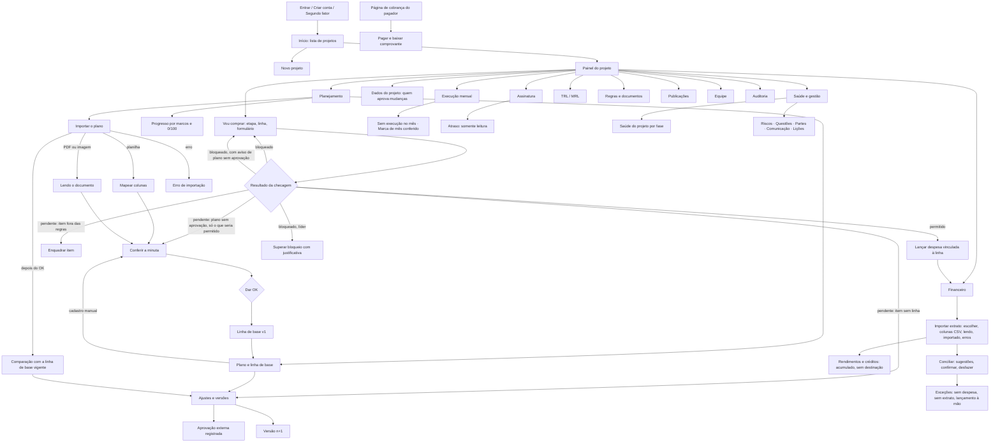

# GestProjet: guia de UX e interface

Versão: 0.4 · Data: 25/11/2026 · Status: alinhado ao PRD v0.2.1 aprovado (T-022c) e à decisão T-023b (símbolo da castanheira, grafia GestProjet); os tokens e as telas aprovados em 25/11/2026 foram preservados, as mudanças são aditivas · Autor: designer
Fontes: `docs/00-briefing.md`, `docs/01-prd.md` v0.2.1 (aprovado em 25/11/2026), `CLAUDE.md` (identidade de partida). Protótipo navegável: `design/index.html` (abrir no navegador; todos os dados são fictícios e marcados como EXEMPLO). Verificação de contraste: `design/verificar-contraste.py`.

**[NOVO v0.2.2] [PROPOSTA — T-024, Q-50 em aberto]** Visibilidade do responsável em plano (T05), progresso (T38) e execução mensal (T37); meta com responsável opcional (padrão: líder). Nada disto está aprovado: a v0.2.1 continua sendo a versão aprovada; as seções 0.0 a 0.1 abaixo são histórico.

Este guia não decide nada que esteja em "Questões em aberto" do PRD (as decisões já tomadas pelo dono estão na seção 8). Onde o desenho depende de uma delas, o ponto está marcado com **(Q-xx)** ou **(T-xxx)** e a seção 8 mostra o efeito de cada resposta. Nenhuma regra de edital é inventada: todo edital, cláusula, página, código e valor do protótipo é fictício.

## 0.0 O que mudou da v0.3 para a v0.4 (T-023, parte UX)

| # | Mudança | Onde |
|---|---|---|
| 1 | **Grafia oficial GestProjet**, com "P" maiúsculo, em documentação, agentes, skills e protótipo; a citação histórica da decisão em `TASKS.md` mantém a grafia antiga como registro, com nota de resolução. | 2.1, protótipo |
| 2 | **Símbolo da castanheira com castanhas** no lugar do arco "G" com frasco do marcador provisório (decisão T-023b). Cinco SVGs vetoriais derivados da v2 em `design/assets/`; o protótipo usa o símbolo inline e o favicon em `data:image/svg+xml,...`, sem referência externa. | 2.1, protótipo |
| 3 | **SEG-266 tornada visível no protótipo:** a origem da minuta é distinguida e há simulação planilha × IA. Minuta lida por IA exige **100% das linhas, uma a uma**; planilha e cadastro manual mantêm risco + 5 maiores + 20%. A leitura por IA continua desligada (Q-24). | 5.5, 5.6, 8.3, protótipo |

## 0. O que mudou da v0.2 para a v0.3 (T-022c, parte UX)

O dono aprovou o PRD v0.2.1 em 25/11/2026. Nada do visual aprovado foi trocado: os tokens de cor são os mesmos (nenhum novo), as telas anteriores continuam, e tudo abaixo é acréscimo ou correção de texto.

| # | Mudança | Onde |
|---|---|---|
| 1 | **Extrato bancário (OFX ou CSV)**: telas de importar (escolher, indicar colunas do CSV, lendo, importado, erros), **conciliação** (sugestão com motivos; confirmar, recusar, desfazer com motivo; vários-para-um; dois-débitos-iguais), **exceções** (lançamento sem despesa, despesa sem extrato com justificativa, lançamento à mão), **rendimentos vindos do extrato** ("acumulado, sem destinação"), **saldo do extrato × saldo calculado** com a diferença explicada. Financeiro ganha abas. | 3.1, 3.3 (T42 a T49), 4.4, 4.7, 5.12 a 5.15 |
| 2 | **Marca de fechamento do mês** ("conferido", "reaberto, com pendência"), que não trava nada. | 4.3, 5.8 |
| 3 | Campo **"quem aprova mudanças"** nos dados do projeto (padrão: o líder; só informação). Nova tela "Dados do projeto". | 3.1, 3.3 (T03), 5.16 |
| 4 | **Conferência da minuta por risco + 5 maiores valores + amostra**, com o resumo "conferi N de M linhas". A caixa "Li a minuta inteira" saiu. | 5.6 |
| 5 | **Nova importação depois do OK = comparação** com a linha de base vigente; só vira rascunho de ajuste o que o líder confirmar. | 5.5, 5.17 |
| 6 | **Leitura por IA desligada**: PDF e imagem aparecem indisponíveis e explicados, com saída para planilha e cadastro à mão. Arquivo recusado pela verificação de segurança. | 5.5 |
| 7 | **Remoção de linha com despesas é recusada** (só zerar por ajuste); **resumo mensal substituído** por despesas detalhadas, com aviso. | 5.7, 5.8 |
| 8 | **Checagem (T13), D25 decidida pelo dono (Q-38):** item vedado, cotações, limite ou vigência = **BLOQUEADO** mesmo sem OK do plano, com o aviso "plano sem aprovação"; "pendente: plano sem aprovação" só para o que seria permitido. Nova variante de resultado. | 5.1, 5.2 |
| 9 | **TRL de 1 a 9 e MRL de 1 a 10**, marca "critério a validar", aviso "proposta baseada em critérios ainda a validar"; o selo "Oficial" virou "Confirmado pelo líder". | 4.5 |
| 10 | **Papéis:** membro "registra" sem edição de datas de etapa nem de valores da linha de base, sem importar extrato nem conciliar. O protótipo ganhou "Simular membro". | 3.1, 5.7 |
| 11 | **Assinatura:** teste de 30 dias, atraso = **somente leitura** (nunca apagar dados), tela de atraso e aviso global. O protótipo ganhou "Simular assinatura em atraso". | 3.3 (T25), 5.18 |
| 12 | Checklist de saúde: conciliação deixa de ser "não verificável"; "não verificável sem checagem" (D24). Seção 8 corrigida: T-012, T-019 e as decisões a a d estão resolvidas; entram Q-35 a Q-48. | 4.6, 8 |
| 13 | Contraste recalculado: 61 pares × 2 temas = 122 verificações, 0 falhas. | 2.3 |

## 0.1 O que mudou da v0.1 para a v0.2 (T-020, parte UX), histórico

| # | Mudança | Onde |
|---|---|---|
| 1 | Plano de trabalho passa a ser **Meta → Etapa → Linha** (classificação da despesa, objeto previsto, valor aprovado). "Rubrica" vira "classificação da despesa" em toda a interface (RN-026). | 3, 4, 5, protótipo |
| 2 | Telas novas: **importar o plano** (escolha, mapeamento de colunas, leitura, erros), **conferir a minuta** (origem ao lado de cada linha, OK), **plano e linha de base**, **ajustes e versões**, **execução mensal**, **progresso por marcos e 0/100**, **saúde do projeto**, **registros de gestão** (riscos, questões, partes interessadas, comunicação, lições). | 3, 5 |
| 3 | **Vou comprar** compara com a **linha** do plano (etapa, linha, objeto previsto, classificação, saldo da linha); 8 verificações; novos resultados "pendente: plano sem aprovação" e "pendente: item sem linha". RF-062 mantido. | 5.1 a 5.3 |
| 4 | O **selo "ISO 21500" sai**. Entra uma nota de referência neutra: "Baseado nas práticas ISO 21500, 21502 e 21512" (texto proposto, Q-32). | 2.6 |
| 5 | Menu lateral: "Planejamento" ganha plano, progresso, importação, conferência e ajustes; entram "Execução mensal" e "Saúde e gestão". | 3.1 |
| 6 | Acabamento: o resultado e as linhas de verificação deixam de usar barra colorida só de um lado e passam a ter borda inteira (contínua ou tracejada); o item ativo do menu usa contorno inteiro. Os tokens `accent-text` e `accent-soft` foram removidos (só serviam ao selo). | 2.2, 2.5, 6 |
| 7 | Contraste recalculado: 55 pares × 2 temas = 110 verificações, 0 falhas. | 2.3 |

## 1. Princípios

1. **Uma tela, uma pergunta.** O usuário é o pesquisador líder: ocupado, muitas vezes fora do escritório, sem ser especialista em software. Cada tela responde a uma pergunta ("posso comprar isto?", "quanto sobra nesta linha?", "o que falta para dar o OK?", "o que precisa da minha atenção?").
2. **Antes de gastar vem primeiro.** A checagem "Vou comprar" é a ação mais importante do produto (RF-060 a RF-066). Fica a 1 clique de qualquer tela, em verde, no menu e no cabeçalho das telas principais, e fixa no rodapé do celular.
3. **Situação do projeto sempre visível:** vigência, linha de base em uso (v2 ou "plano sem OK"), execução, progresso e pendências no painel; nome do projeto, financiador, vigência e versão da linha de base no cabeçalho de todas as telas.
4. **Dinheiro sem ambiguidade:** valores à direita, `R$ 1.234,56`, números tabulares, aprovado × executado × saldo lado a lado; saldo negativo com sinal de menos (U+2212), ícone e texto "Acima do aprovado", nunca só cor (RN-009, RNF-14). Totais sempre calculados (RN-025).
5. **Nunca só cor.** Todo estado combina **cor + ícone de forma própria + palavra + borda** (contínua ou tracejada). A barra de estouro ainda tem listras. Teste de aceite: a tela em tons de cinza continua dizendo a mesma coisa.
6. **Evidência e fonte a um clique:** toda verificação mostra a fonte da regra (documento, cláusula, página); toda linha da minuta mostra o trecho do documento de origem; todo número de TRL/MRL leva à evidência; todo painel diz de onde vem o dado.
7. **IA identificada, pessoa decide:** saída de IA aparece com o rótulo "Sugestão da IA", a origem (página e região) e a confiança; nada vale antes do OK ou do aceite (RN-014, RN-030). Sem IA, planilha e cadastro manual funcionam (RF-091).
8. **Resultado antes de detalhe.** Na checagem, primeiro a resposta em uma palavra, depois o que fazer, depois as verificações. Na conferência da minuta, primeiro "o que falta para o OK", depois as linhas.
9. **Botão que não pode ser usado diz por quê.** O "Dar OK e liberar a execução" fica visivelmente indisponível (contorno tracejado, ícone de cadeado) e a frase ao lado lista o que falta. Nunca fica só cinza.
10. **Acessibilidade WCAG 2.2 AA e português do Brasil** (RNF-08, RNF-11): contraste mínimo, foco visível, teclado, rótulos, alvos de 44 px, datas `DD/MM/AAAA`, moeda `R$`, termos do meio (classificação da despesa, objeto previsto, linha de base, edital, termo de outorga, cotação).
11. **A plataforma sugere, a pessoa confirma.** Conciliação, tipo de crédito, enquadramento, nível TRL/MRL e OK são sempre decisão do líder; a sugestão vem rotulada e com o motivo, e nunca vale sozinha (RN-014, RN-040).
12. **Sem IA, tudo funciona.** A leitura de PDF e imagem por IA está desligada até haver contrato e avaliação de impacto (RF-153): a interface diz isso com clareza e sempre oferece planilha, extrato ou cadastro à mão. Nenhuma tela depende de IA.
13. **Somente leitura nunca apaga.** Em atraso, o projeto fica em somente leitura: o que muda dados fica pausado, com a razão escrita, e nada é apagado.

**Tom de voz:** direto, frases curtas, sem jargão de software ("Não compre ainda: 2 motivos impedem esta compra", e não "Validação falhou"). Fala com "você". Diz o que aconteceu e o que fazer. Nunca culpa. **Sobre as normas** (RN-021): usa "baseado nas práticas ISO 21500, 21502 e 21512" ou "alinhado às práticas das ABNT NBR ISO 21500:2021, 21502:2021 e 21512:2026"; a interface **nunca** usa as palavras "conformidade", "conforme a norma", "certificado", "selo", nem "nota", "pontuação" ou percentual de saúde para o checklist; nunca cita a ISO 21500:2012. Para dizer que a plataforma não substitui decisão, usa "as normas orientam; quem decide e aprova é você, o financiador ou a instituição".

## 2. Identidade visual

### 2.1 Personalidade e logotipo

- **Três adjetivos:** confiável (lida com dinheiro público), clara (decisão rápida), científica (laboratório, evidência).
- **Cores de partida (CLAUDE.md):** azul-marinho como principal e verde como acento. O azul é a base do menu, dos botões comuns e da aba selecionada; o verde marca só a ação-chave ("Vou comprar", e "Dar OK" quando ativo) e o sucesso.
- **Logotipo (decisão T-023b; v0.4):** o símbolo é uma **castanheira com castanhas** — substitui o carvalho e o fruto do cacau das decisões anteriores e o arco "G" com frasco do marcador provisório. A assinatura é **GestProjet**, com "P" maiúsculo, sempre; nunca com "p" minúsculo. A arte entregue é **derivada da versão 2 aprovada pelo dono** (`design/assets/logo-gestprojet-v2-composicao.webp`) e é **proposta provisória**: um profissional deve refinar o conjunto, e os **direitos autorais da foto de fundo precisam ser verificados antes de qualquer registro de marca**. Por isso a composição vetorial usa formas geométricas discretas de floresta e lavoura, sem fotografar nem reaproveitar a imagem de referência.
- **Arquivos da marca (`design/assets/`):** `logo-gestprojet-v2-composicao.svg` (fundo claro), `logo-gestprojet-v2-composicao-escuro.svg`, `logo-gestprojet-v2-horizontal.svg`, `logo-gestprojet-v2-horizontal-escuro.svg` e `logo-gestprojet-v2-icone.svg`. Todos vetoriais, sem fontes, imagens ou links externos; os motivos pequenos da v2 (engrenagem, frasco e barras) aparecem só na composição e no horizontal, e o ícone isolado traz apenas a árvore e as castanhas, para continuar legível em 24 px. No protótipo a marca é inline com `currentColor`, e o favicon é um `data:image/svg+xml,...`.
- **Uso, tamanho mínimo e respiro:** a **composição** serve para capas, apresentações e documentos; o **horizontal** para cabeçalhos, assinaturas e menu; o **ícone** só onde o símbolo aparece sozinho (menu do celular e favoritos). Mínimo de **24 px de altura para o ícone** e **120 px de largura para o horizontal**; abaixo disso, use somente o ícone. **Respiro de metade da altura do símbolo** em todos os lados, sem cortar as castanhas. Não distorcer, não trocar a árvore por outro fruto, não recolorir as castanhas para vermelho ou amarelo, não usar sobre fundo sem contraste e não reintroduzir a foto sem verificar direitos.
- **Temas:** sobre fundo claro, árvore e assinatura em azul-marinho `#0B2A5B` e acento verde `#0A6B41`; sobre fundo escuro, árvore em azul-claro `#8DB4FF`, assinatura em branco e acento verde-claro `#4FD08F`. Os pares usados na interface seguem os tokens da seção 2.2 e passam pela verificação de contraste (2.3).
- **Ícones:** traço de 2 px, cantos arredondados, sempre com texto; decorativos para leitor de tela (`aria-hidden`). O conjunto do protótipo ganhou: interrogação em círculo (não verificável), lápis (aguardando resposta), cadeado (travado ou indisponível), setas circulares (verificado pela plataforma), pessoa (respondido por você), seta para cima (oportunidade), subir arquivo, camadas (versões), pulso (saúde), grade (execução).

### 2.2 Tokens de cor

Valores do protótipo (`design/index.html`, variáveis `--c-*`); fonte única para a implementação (T-107). Tema claro é o padrão; o escuro segue o sistema e pode ser alternado (botão "Tema escuro").

| Token | Função | Claro | Escuro |
|---|---|---|---|
| `bg` | fundo da página | `#F4F7FB` | `#0A1120` |
| `surface` | cartões, campos | `#FFFFFF` | `#111B30` |
| `surface-2` | superfície sutil, origem do documento, linhas de meta | `#EAF0F8` | `#18253F` |
| `border` | divisores decorativos | `#C9D4E3` | `#2A3A57` |
| `border-strong` | borda de campos, botões e caixas (UI) | `#6A7B95` | `#7D8DA8` |
| `text` | texto principal | `#0E1A33` | `#E8EEF8` |
| `text-muted` | texto secundário | `#475671` | `#A6B4CC` |
| `primary` / `on-primary` / `primary-hover` | azul-marinho: botão comum, aba selecionada | `#0B2A5B` / `#FFFFFF` / `#143E82` | `#8DB4FF` / `#0A1B3D` / `#B3CDFF` |
| `link` | links | `#0B4FA8` | `#9CC0FF` |
| `accent` / `on-accent` / `accent-hover` | verde: ação-chave | `#0A6B41` / `#FFFFFF` / `#07583A` | `#4FD08F` / `#04210F` / `#7BE0AE` |
| `ok-fg` / `ok-bg` / `ok-bd` | permitido, atendido, resolvido | `#075E3A` / `#E1F4EA` / `#075E3A` | `#6FE0A3` / `#0F2E22` / `#6FE0A3` |
| `warn-fg` / `warn-bg` / `warn-bd` | pendente, alerta, faixa EXEMPLO | `#734000` / `#FFF0CC` / `#9A5B00` | `#FFCB66` / `#33260A` / `#C98A1B` |
| `err-fg` / `err-bg` / `err-bd` | bloqueado, impedimento, estouro | `#9E1717` / `#FDE8E8` / `#9E1717` | `#FF9B9B` / `#3A1414` / `#FF9B9B` |
| `info-fg` / `info-bg` / `info-bd` | informação, proposta, sugestão da IA, nota sobre normas | `#12508F` / `#E4EEFA` / `#12508F` | `#8CC2FF` / `#10243F` / `#8CC2FF` |
| `nav-bg` / `nav-text` / `nav-muted` | menu lateral | `#0B2A5B` / `#FFFFFF` / `#C4D2EA` | `#070D1A` / `#FFFFFF` / `#B4C3DD` |
| `nav-active` | fundo do item ativo (branco translúcido) | 14% | 12% |
| `focus` / `focus-nav` | anel de foco; foco e contorno ativo no menu | `#0B57D0` / `#8FE3B5` | `#8DB4FF` / `#8FE3B5` |
| `bar-fill` / `bar-track` / `bar-over` | barras de progresso | `#0B4FA8` / `#D5DEEB` / `#9E1717` | `#8DB4FF` / `#26354F` / `#FF9B9B` |

Semântica fixa: verde = permitido/atende/resolvido; vermelho = bloqueado/impede/estouro; âmbar = pendente/atenção/baixa confiança; azul = informação/proposta/sugestão da IA; neutro = não se aplica, não verificável, prevista.

### 2.3 Contraste verificado (WCAG 2.2 AA)

Cálculo da luminância relativa (fórmula da WCAG 2.x, sRGB) sobre as variáveis do próprio `design/index.html`, nos dois temas, inclusive a composição do item ativo do menu (branco a 14% e 12% sobre o fundo do menu). **61 pares × 2 temas = 122 verificações, 0 falhas.** Mínimos: 4,5:1 para texto (1.4.3) e 3:1 para componentes e objetos gráficos (1.4.11). Menor razão de texto: 6,30:1 (claro) e 6,99:1 (escuro). Menor razão de componente: 3,17:1 (claro) e 3,67:1 (escuro, contorno da barra). O menor corpo de texto do produto é 14 px. Texto de espaço reservado (`::placeholder`) usa `text-muted`. Quem alterar um token repete o cálculo (7.5).

| Par (primeiro plano sobre fundo) | Mínimo | Claro | Escuro |
|---|---|---|---|
| Texto sobre fundo da página (`text` sobre `bg`) | 4,5:1 | 16,10:1 | 16,17:1 |
| Texto sobre cartão (`text` sobre `surface`) | 4,5:1 | 17,29:1 | 14,73:1 |
| Texto sobre superfície sutil (`text` sobre `surface-2`) | 4,5:1 | 15,09:1 | 13,10:1 |
| Texto secundário sobre cartão (`text-muted` sobre `surface`) | 4,5:1 | 7,40:1 | 8,19:1 |
| Texto secundário sobre fundo da página (`text-muted` sobre `bg`) | 4,5:1 | 6,89:1 | 9,00:1 |
| Texto secundário sobre superfície sutil (origem, linha de nível meta) (`text-muted` sobre `surface-2`) | 4,5:1 | 6,46:1 | 7,29:1 |
| Rótulo secundário dentro de linha destacada em erro (tabela em cartões) (`text-muted` sobre `err-bg`) | 4,5:1 | 6,30:1 | 7,77:1 |
| Botão primário e aba selecionada (texto) (`on-primary` sobre `primary`) | 4,5:1 | 14,03:1 | 8,17:1 |
| Botão primário em hover (`on-primary` sobre `primary-hover`) | 4,5:1 | 10,29:1 | 10,58:1 |
| Link sobre cartão (`link` sobre `surface`) | 4,5:1 | 7,78:1 | 9,32:1 |
| Link sobre fundo da página (`link` sobre `bg`) | 4,5:1 | 7,24:1 | 10,23:1 |
| Link sobre superfície sutil (`link` sobre `surface-2`) | 4,5:1 | 6,79:1 | 8,29:1 |
| Botão verde de ação-chave (texto), inclusive Vou comprar e OK ativo (`on-accent` sobre `accent`) | 4,5:1 | 6,58:1 | 8,74:1 |
| Botão verde em hover (`on-accent` sobre `accent-hover`) | 4,5:1 | 8,52:1 | 10,67:1 |
| Permitido, atendido: texto sobre fundo (`ok-fg` sobre `ok-bg`) | 4,5:1 | 6,86:1 | 8,97:1 |
| Pendente, alerta, faixa EXEMPLO: texto sobre fundo (`warn-fg` sobre `warn-bg`) | 4,5:1 | 7,55:1 | 9,83:1 |
| Bloqueado, impedimento, estouro: texto sobre fundo (`err-fg` sobre `err-bg`) | 4,5:1 | 6,91:1 | 8,07:1 |
| Informação, proposta, nota sobre as normas: texto sobre fundo (`info-fg` sobre `info-bg`) | 4,5:1 | 6,97:1 | 8,38:1 |
| Permitido: texto sobre cartão (`ok-fg` sobre `surface`) | 4,5:1 | 7,86:1 | 10,52:1 |
| Pendente: texto sobre cartão (`warn-fg` sobre `surface`) | 4,5:1 | 8,53:1 | 11,43:1 |
| Bloqueado e saldo negativo: texto sobre cartão (`err-fg` sobre `surface`) | 4,5:1 | 8,11:1 | 8,51:1 |
| Bloqueado: texto sobre fundo da página (`err-fg` sobre `bg`) | 4,5:1 | 7,55:1 | 9,35:1 |
| Saldo negativo em linha de nível meta ou etapa (`err-fg` sobre `surface-2`) | 4,5:1 | 7,08:1 | 7,57:1 |
| Texto principal sobre fundo Permitido (`text` sobre `ok-bg`) | 4,5:1 | 15,10:1 | 12,56:1 |
| Trecho destacado na origem da linha (mark) (`text` sobre `warn-bg`) | 4,5:1 | 15,31:1 | 12,67:1 |
| Texto principal sobre linha destacada em erro (`text` sobre `err-bg`) | 4,5:1 | 14,73:1 | 13,97:1 |
| Texto principal sobre fundo de informação (`text` sobre `info-bg`) | 4,5:1 | 14,75:1 | 13,38:1 |
| Menu lateral: texto (`nav-text` sobre `nav-bg`) | 4,5:1 | 14,03:1 | 19,42:1 |
| Menu lateral: texto secundário (`nav-muted` sobre `nav-bg`) | 4,5:1 | 9,19:1 | 10,90:1 |
| Menu lateral: texto do item ativo (branco translúcido sobre o menu) (`white` sobre `nav-active-eff`) | 4,5:1 | 9,20:1 | 14,37:1 |
| Borda de campos e botões sobre cartão (UI) (`border-strong` sobre `surface`) | 3:1 | 4,30:1 | 5,11:1 |
| Borda de campos sobre fundo da página (UI) (`border-strong` sobre `bg`) | 3:1 | 4,00:1 | 5,61:1 |
| Borda de campos e caixas sobre superfície sutil (UI) (`border-strong` sobre `surface-2`) | 3:1 | 3,75:1 | 4,54:1 |
| Marca de caixa de seleção e botão de opção sobre cartão (UI) (`primary` sobre `surface`) | 3:1 | 14,03:1 | 8,26:1 |
| Anel de foco sobre cartão (UI) (`focus` sobre `surface`) | 3:1 | 6,39:1 | 8,26:1 |
| Anel de foco sobre fundo da página (UI) (`focus` sobre `bg`) | 3:1 | 5,94:1 | 9,07:1 |
| Anel de foco e contorno do item ativo no menu (UI) (`focus-nav` sobre `nav-bg`) | 3:1 | 9,24:1 | 12,78:1 |
| Contorno tracejado do botão de simulação no menu (UI) (`nav-muted` sobre `nav-bg`) | 3:1 | 9,19:1 | 10,90:1 |
| Borda do selo Permitido (UI) (`ok-bd` sobre `ok-bg`) | 3:1 | 6,86:1 | 8,97:1 |
| Borda do selo Pendente e da faixa de aviso (UI) (`warn-bd` sobre `warn-bg`) | 3:1 | 4,80:1 | 5,02:1 |
| Borda do selo Bloqueado (UI) (`err-bd` sobre `err-bg`) | 3:1 | 6,91:1 | 8,07:1 |
| Borda do selo Informação (UI) (`info-bd` sobre `info-bg`) | 3:1 | 6,97:1 | 8,38:1 |
| Borda do item Atende sobre cartão (UI) (`ok-bd` sobre `surface`) | 3:1 | 7,86:1 | 10,52:1 |
| Borda do item Bloqueia e da linha com impedimento sobre cartão (UI) (`err-bd` sobre `surface`) | 3:1 | 8,11:1 | 8,51:1 |
| Borda tracejada do item Pendente e da linha com alerta sobre cartão (UI) (`warn-bd` sobre `surface`) | 3:1 | 5,43:1 | 5,83:1 |
| Borda tracejada do item aguardando resposta sobre cartão (UI) (`info-bd` sobre `surface`) | 3:1 | 8,17:1 | 9,22:1 |
| Borda de faixa Permitido sobre o fundo da página (UI) (`ok-bd` sobre `bg`) | 3:1 | 7,32:1 | 11,55:1 |
| Borda de faixa de aviso sobre o fundo da página (UI) (`warn-bd` sobre `bg`) | 3:1 | 5,05:1 | 6,40:1 |
| Borda de faixa de erro sobre o fundo da página (UI) (`err-bd` sobre `bg`) | 3:1 | 7,55:1 | 9,35:1 |
| Borda de faixa de informação sobre o fundo da página (UI) (`info-bd` sobre `bg`) | 3:1 | 7,61:1 | 10,12:1 |
| Preenchimento da barra sobre a trilha (UI) (`bar-fill` sobre `bar-track`) | 3:1 | 5,74:1 | 5,93:1 |
| Preenchimento da barra sobre cartão (UI) (`bar-fill` sobre `surface`) | 3:1 | 7,78:1 | 8,26:1 |
| Barra de estouro sobre cartão (UI) (`bar-over` sobre `surface`) | 3:1 | 8,11:1 | 8,51:1 |
| Contorno da barra sobre a trilha (UI) (`border-strong` sobre `bar-track`) | 3:1 | 3,17:1 | 3,67:1 |
| Número sobre nível alcançado (escala TRL/MRL) (`surface` sobre `bar-fill`) | 4,5:1 | 7,78:1 | 8,26:1 |
| Contorno de campos e do bloco "desfazer" dentro do aviso de conciliado (UI) (`border-strong` sobre `ok-bg`) | 3:1 | 3,76:1 | 4,36:1 |
| Contorno de campos dentro de aviso de informação (UI) (`border-strong` sobre `info-bg`) | 3:1 | 3,67:1 | 4,64:1 |
| Contorno de caixas de seleção em linha de comparação alterada (UI) (`border-strong` sobre `warn-bg`) | 3:1 | 3,81:1 | 4,39:1 |
| Texto secundário em aviso verde (`text-muted` sobre `ok-bg`) | 4,5:1 | 6,46:1 | 6,99:1 |
| Texto secundário em aviso âmbar e linha de comparação alterada (`text-muted` sobre `warn-bg`) | 4,5:1 | 6,55:1 | 7,05:1 |
| Texto secundário em aviso azul e linha de comparação nova (`text-muted` sobre `info-bg`) | 4,5:1 | 6,31:1 | 7,44:1 |

Observações:
- `warn-bd` é mais escuro que o âmbar usual de propósito, para passar 3:1 sobre o fundo do selo, o cartão e a página.
- Verde e vermelho diferem em luminância além de matiz, e cada estado tem ícone e palavra próprios: o par continua distinguível para daltonismo de vermelho e verde.
- Botão indisponível (o "Dar OK" antes da hora): texto `text-muted` sobre `surface-2` (6,46:1 e 7,29:1), contorno tracejado `border-strong` sobre `surface-2` (3,75:1 e 4,54:1). Controles desativados são isentos pela WCAG, mas o texto continua legível porque a explicação está nele e na frase ao lado.
- Sem token novo na v0.2 nem na v0.3: todas as telas novas usam os tokens existentes. A v0.3 só acrescentou 6 pares (contorno e texto secundário dentro de avisos coloridos e de linhas de comparação).

### 2.4 Tipografia

- **Família:** pilha do sistema, `system-ui, -apple-system, "Segoe UI", Roboto, "Helvetica Neue", Arial, "Noto Sans", sans-serif`. Sem fonte externa (RNF-03, sem envio de dado a terceiros, boa cobertura de acentos). Fonte de marca, se o dono quiser: troca-se só o token `--font`.
- **Escala** (base 16 px, razão ~1,2): 14 (apoio, rótulos, legendas) · 16 (corpo) · 18 (subtítulo) · 20 (título de cartão) · 24 (título de tela) · 30 · 36 (palavra do resultado). Em 360 px o título de tela cai para 20.
- **Pesos:** 400 corpo, 600 ênfase e rótulos, 700 títulos e botões, 800/900 só números grandes, palavra do resultado e aba selecionada.
- **Números:** `font-variant-numeric: tabular-nums` em todo valor monetário, percentual e data em tabela; alinhados à direita. Códigos de classificação da despesa (ex.: `339030`) são texto, nunca número: preservam zeros à esquerda (RF-121).
- **Linha:** 1,5 no corpo e 1,25 nos títulos; medida máxima de 62 caracteres em texto corrido.

### 2.5 Espaçamento, raios, sombras, estados

- **Espaçamento (base 4 px):** 4 · 8 · 12 · 16 · 24 · 32 · 48 · 64. Cartão com 24 px (16 px no celular); 16 px entre cartões.
- **Raios:** 6 (selos pequenos), 10 (botões, campos, linhas da minuta), 16 (cartões, resultado), 999 (selos, barras).
- **Sombras:** só uma elevação suave nos cartões e outra no menu deslizante e no aviso rápido. Hierarquia vem de borda e espaço. Elevação declarada uma vez: cartão = borda + sombra suave (a borda é decorativa).
- **Alvo de toque:** 44 × 44 px no mínimo (caixas de seleção ficam em 24 px, mas o rótulo inteiro é clicável com 44 px de altura).
- **Foco:** anel de 3 px com deslocamento de 2 px (`focus`; `focus-nav` no menu).
- **Movimento:** transições de 200 ms só no menu do celular; esqueleto de carregamento anima; tudo desligado com `prefers-reduced-motion`.
- **Sem barra colorida de um lado só.** O estado de um bloco aparece em borda inteira: contínua (atende, bloqueia, impede), **tracejada** (pendente, alerta, aguardando) ou **pontilhada** (não verificável).

**Linguagem dos estados (cor + forma + palavra):**

| Estado | Palavra | Ícone | Cor | Borda do bloco |
|---|---|---|---|---|
| Permitido / Atende / Resolvido / Atendido | PERMITIDO · Atende · Resolvido · Atendido | círculo com visto | verde | contínua |
| Bloqueado / Bloqueia / Impede o OK | BLOQUEADO · Bloqueia · Impede o OK | octógono com X | vermelho | contínua, grossa |
| Pendente / Sem decisão | PENDENTE · Sem decisão · Pendente | relógio em círculo | âmbar | **tracejada** |
| Alerta (exige "ciente"), baixa confiança | Possível duplicidade, Baixa confiança: 0,74 | triângulo de alerta | âmbar | tracejada |
| Aguardando sua resposta | Aguardando sua resposta | lápis | azul | tracejada |
| Não verificável | Não verificável | interrogação em círculo | neutro | **pontilhada** |
| Não se aplica | Não se aplica | círculo com traço | neutro | contínua, cinza |
| Informação / Proposta / Sugestão da IA | Proposta, Sugestão da IA | círculo com "i" | azul | tracejada (proposta, IA) |
| Acima do aprovado (estouro) | Acima do aprovado | triângulo de alerta | vermelho | barra com listras, sinal de menos |
| Minuta: não vale | Minuta: não vale | relógio | âmbar | tracejada |
| Versão vigente × anterior | Vigente · Anterior, só consulta | visto · camadas | verde · neutro | contínua |

### 2.6 Nota de referência às normas (substitui o selo "ISO 21500")

**Problema do selo antigo:** um selo verde com visto e a frase "Estrutura alinhada à ISO 21500" lia-se como certificação, e a ISO 21500:2012 foi cancelada (RN-021).

**Desenho novo:** não é selo. É uma nota recolhível (`details`), em azul de informação, com ícone de livro (não de visto), colocada onde a estrutura aparece (card de progresso do painel, plano, saúde do projeto). Recolhida mostra só o texto curto; aberta mostra a redação completa.

- **Texto curto (proposta, Q-32):** "Baseado nas práticas ISO 21500, 21502 e 21512".
- **Texto completo (proposta):** "Estrutura alinhada às práticas das ABNT NBR ISO 21500:2021, 21502:2021 e 21512:2026, em versão enxuta. As normas orientam; quem decide e aprova é você, o financiador ou a instituição."
- **Regras:** nunca "conformidade", "conforme a norma", "certificado", "selo", "auditado pela norma"; nunca a ISO 21500:2012; nunca cor verde nem visto; nunca ligada a pontuação. Rubrica, cotação, prestação de contas, TRL/MRL e regras de financiador não são atribuídas às normas (a nota da tela de saúde diz isso).
- **Onde não aparece:** TRL/MRL (não vem das normas). O cabeçalho da tela de maturidade deixou de ter selo.
- A redação definitiva depende da resposta à Q-32 (seção 8).

## 3. Arquitetura de informação

### 3.1 Navegação

**Menu lateral** (desktop a partir de 1024 px; no celular e no tablet vira gaveta aberta pelo botão "Menu"). Sempre se refere ao **projeto atual**; o cabeçalho traz o nome, o financiador, a vigência, a **versão da linha de base em uso ou "plano sem OK"** e o seletor de projeto.

| Ordem | Item | O que abre | Observação |
|---|---|---|---|
| 0 | **Vou comprar** (botão verde) | checagem antes da compra | também no cabeçalho das telas principais e fixo no rodapé do celular |
| 1 | Painel do projeto | dashboard do projeto | entrada padrão |
| 1b | **Dados do projeto** | cadastro do projeto, com **"quem aprova mudanças"** (padrão: o líder) | só o líder altera; o membro vê sem botões |
| 2 | **Planejamento** | **plano e linha de base**; progresso por marcos e 0/100; **importar o plano**; **conferir a minuta**; **ajustes e versões** | navegação interna em abas: Plano e linha de base · Progresso · Importar plano · Conferir minuta · Ajustes e versões. Importar, conferir e ajustar: só o líder |
| 3 | **Execução mensal** | previsto × executado por linha, etapa, meta e projeto; mês e trimestre; fechar o mês | disponível depois do OK do plano |
| 4 | **Saúde e gestão** | saúde do projeto por fase; riscos; questões; partes interessadas; comunicação; lições aprendidas | abas: Saúde do projeto · Riscos · Questões · Partes interessadas · Comunicação · Lições aprendidas |
| 5 | TRL / MRL | cards, evidências, proposta, histórico | |
| 6 | Financeiro | painel financeiro, **importar extrato, conciliar, exceções, rendimentos e créditos** | navegação interna em abas: Painel financeiro · Importar extrato · Conciliar · Exceções · Rendimentos e créditos. Importar, conciliar e exceções: só o líder; o membro vê só Painel financeiro e Rendimentos, sem botões de confirmar |
| 7 | Regras e documentos | edital e termo anexados; regras do projeto com fonte; versões | só o líder edita |
| 8 | Publicações | palavras-chave e resultados da busca | |
| 9 | Equipe | membros e níveis de acesso | só o líder altera |
| 10 | Auditoria | trilha imutável | só o líder vê |
| 11 | Assinatura | situação (**em teste de 30 dias, ativa, em atraso: somente leitura**), vencimentos, pagamentos, exportação | só o líder; todos veem o aviso de atraso no topo |

- **Por que Execução fica fora de Financeiro:** o líder abre "quanto executei neste mês e quanto sobra por linha" com frequência (tarefa 2 do líder); um item próprio leva a 1 clique. Financeiro mantém a conta, os rendimentos e os lançamentos.
- **Início** (no logotipo e no seletor de projeto): lista de projetos (RF-002).
- **Conta:** menu do usuário no cabeçalho (perfil, segundo fator, sair, direitos do titular).
- **Fora do menu da 1ª versão:** Prestação de contas e Relatórios (2ª versão). Não aparecem, para não prometer o que não há.
- **Membro "visualiza":** vê as telas sem botões de edição e sem "Vou comprar". **Membro "registra":** vê "Vou comprar", registra despesas, riscos, questões, lições, comunicações e marcos concluídos. **Nenhum membro** vê importar plano ou extrato, conferir, OK, ajustes, conciliar, exceções, "sem execução no mês", marca de mês conferido, confirmar tipo de crédito nem responde itens do líder no checklist (matriz do PRD). O membro "registra" também **não edita datas de início e prazo das etapas nem valores da linha de base** (RN-050): vê as datas e o plano, atualiza situação, andamento, entregas e tarefas. **Pagador:** só a página de cobrança.

### 3.2 Mapa de telas

### 3.3 Inventário de telas da 1ª versão

Persona: **L** líder, **M** membro (R = registra, V = visualiza), **G** pagador. ★ = no protótipo. **Novo** e **Alterado** referem-se à v0.2.

| # | Tela | Persona | RFs |
|---|---|---|---|
| T01 | Entrar, criar conta, recuperar senha, segundo fator | L, M | RF-110, RF-111 |
| T02 | Início: lista de projetos | L, M | RF-002, RF-001 |
| T03 ★ | Novo projeto e **Dados do projeto** (alterado: campo "quem aprova mudanças") | L (M lê) | RF-001, RF-151 |
| T04 ★ | Painel do projeto (alterado: progresso, linha de base, plano aguardando OK, ajuste pendente, execução) | L, M | RF-003, RF-013, RF-024, RF-064, RF-083 |
| T05 ★ | **Plano e linha de base** (novo; substitui o plano plano): Meta → Etapa → Linha · `[PROPOSTA v0.2.2]` responsável visível (RF-154, RN-054, Q-50) | L, M(R lê) | RF-010, RF-120, RF-121, RF-122 |
| T06 | Detalhe da tarefa (andamento, entrega) | L, M(R) | RF-012 |
| T07 ★ | **Saúde do projeto** por fase (novo; substitui "Fases e checklist ISO 21500") | L, M | RF-020, RF-138 |
| T08 ★ | **Registros de gestão**: riscos, questões, partes interessadas, comunicação, lições (novo; amplia "Riscos e partes interessadas") | L, M(R) | RF-021, RF-022, RF-133, RF-134, RF-137 |
| T09 | Equipe: lista e convite. `[NOVO v0.2.2] [PROPOSTA]` o cadastro de equipe **não muda** (RF-030 a RF-034) e é a fonte dos responsáveis exibidos; nenhum campo novo de dado pessoal | L, M | RF-030 a RF-032, RF-034 |
| T10 | Regras e documentos: anexos do edital e do termo | L, M | RF-040 |
| T11 | Regras do projeto: lista, edição com fonte, versões, regras sem fonte | L (M lê) | RF-041 a RF-043 (Q-01) |
| T12 ★ | **Vou comprar: formulário** (alterado: etapa, linha, objeto, saldo da linha, declaração) | L, M(R) | RF-060, RF-067 |
| T13 ★ | **Vou comprar: resultado** (alterado: 8 verificações; **6 variantes**, com "bloqueado e aviso de plano sem aprovação") | L, M(R) | RF-061 a RF-064, RF-063, RN-043 |
| T14 | Superar bloqueio com justificativa e anexo | L | RF-065 (Q-10) |
| T15 | Enquadrar item pendente | L | RF-066 |
| T16 | Histórico de checagens | L, M | RF-064 |
| T17 | Financeiro: orçamento por classificação da despesa (alterado: vem das linhas) | L, M | RF-050, RF-053 |
| T18 ★ | Financeiro: painel (aprovado, realizado, saldo, rendimentos) (alterado) | L, M | RF-053, RF-054 |
| T19 | Lançamentos da conta, lançar despesa (com linha ou "sem linha"), estorno; origem e situação de conciliação em cada lançamento | L, M(R despesas) | RF-051, RF-055 |
| T20 | Comprovantes da despesa | L, M(R) | RF-055 |
| T21 ★ | TRL / MRL: escala 1 a 9 e 1 a 10, "critério a validar", proposta, confirmação, histórico | L, M | RF-070 a RF-074, RN-052 |
| T22 | Ligar evidência a critério | L, M(R) | RF-071 |
| T23 | Publicações | L, M | RF-080 a RF-083 (Q-06) |
| T24 | Auditoria (ganha os eventos de importação, OK, ajuste, execução) | L | RF-112 |
| T25 ★ | **Assinatura**: em teste de 30 dias, ativa, **em atraso (somente leitura)** | L | RF-100, RF-103 a RF-106 (T-801) |
| T26 | Contratar assinatura | L | RF-100 |
| T27 | Página de cobrança do pagador | G | RF-101, RF-102 (Q-18) |
| T28 | Minha conta | L, M, G | RF-113 |
| T29 | Encerrar e arquivar projeto (mostra itens de encerramento não atendidos, sem impedir) | L | RF-004, RF-137 |
| T30 ★ | Estados: vazio, carregando, erro (padrão; ganha plano, tabela grande e OK) | todos | RNF-01, RF-091 |
| T31 ★ | **Importar o plano: escolher o arquivo** (planilha; PDF e imagem **indisponíveis, IA desligada**; limites; cadastro manual) | L | RF-122 a RF-124, RF-153, RNF-15 |
| T32 ★ | **Importar: mapear colunas** (planilha) | L | RF-123 |
| T33 ★ | **Importar: lendo o documento** (só com IA ligada) e **erros** (limite, IA indisponível, recusado pela verificação) | L | RF-124, RF-125, RNF-16 |
| T34 ★ | **Conferir a minuta** (origem ao lado, validações, **risco + 5 maiores valores + amostra**, resumo "conferi N de M", OK) | L | RF-125 a RF-128, RNF-17, RNF-21 |
| T35 | Histórico de minutas e arquivo de origem | L, M(V) | RF-125 |
| T36 ★ | **Ajustes e versões da linha de base** (pedido, justificativa, decisor, aprovação externa, comparação de versões, **remoção recusada**) | L | RF-129, RN-027, RN-028, RN-047 |
| T37 ★ | **Execução mensal: previsto × executado** (mês e trimestre; versão da linha de base; **resumo substituído**; **mês conferido**) · `[PROPOSTA v0.2.2]` responsável visível (RF-154, RN-054, Q-50) | L, M | RF-130, RF-131, RF-152 |
| T38 ★ | **Progresso por marcos e 0/100** (medida por etapa; definir medida; marcos) · `[PROPOSTA v0.2.2]` responsável visível (RF-154, RN-054, Q-50) | L, M(R marca marcos) | RF-011, RF-132 |
| T39 | Marcos e prazos (lista e edição) | L | RF-011 |
| T40 | Justificativa, resultado e benefício esperado (revisão por fase) | L | RF-136 |
| T41 | Critério de aceitação e aceite da entrega | L, M(R anexa) | RF-135 |
| T42 ★ | **Importar o extrato: escolher o arquivo** (OFX ou CSV; banco; limites; segurança) | L | RF-052, RNF-22, RNF-23 |
| T43 ★ | **Importar o extrato: indicar as colunas do CSV** (formato de data e número, prévia, linhas com erro) | L | RF-146 |
| T44 ★ | **Importar o extrato: lendo, importado, repetido, erros** | L | RF-052, RN-041, RNF-24 |
| T45 ★ | **Conciliar** (saldo do extrato × calculado; sugestões com motivo; vários-para-um; desfazer com motivo) | L (M vê o resultado) | RF-147, RN-040 |
| T46 ★ | **Exceções** (lançamento sem despesa, despesa sem extrato, lançamento à mão) | L | RF-148 |
| T47 ★ | **Rendimentos e créditos** (tipo do crédito; acumulado, sem destinação; rendimento à mão) | L, M(V) | RF-149, RF-054, RN-042 |
| T48 ★ | **Comparar nova importação do plano com a linha de base** | L | RF-150, RN-045 |
| T49 ★ | Aviso global de **somente leitura** (assinatura em atraso) | todos | RF-104 |

Cobertura: todo RF Must da 1ª versão tem tela, inclusive RF-120 a RF-132, RF-138 e RF-146 a RF-149; os Should RF-150 a RF-152 também. T35, T39, T40 e T41 têm o desenho descrito na seção 5 e **não estão no protótipo** desta rodada. RF-090 e RF-091 são regras transversais (seção 6). A camada seguinte (RF-139 a RF-145) não tem tela.

### 3.4 As 3 tarefas mais frequentes por persona e o caminho mais curto

| Persona | Tarefa | Caminho a partir do Início | Cliques |
|---|---|---|---|
| Líder | 1. Conferir uma compra | Projeto → Vou comprar → Conferir | 3 (1 de qualquer tela do projeto para abrir o formulário) |
| Líder | 2. Ver quanto executou e quanto sobra por linha | Projeto → Execução mensal | 2 |
| Líder | 3. Ver o que precisa de atenção | Projeto → Painel (pendências, plano aguardando OK, ajuste pendente, TRL/MRL) | 1 a 2 |
| Líder | 4. Importar o plano e dar o OK (uma vez por projeto) | Projeto → Planejamento → Importar plano → (ler) → Conferir minuta → Dar OK | 4 a 5, mais a conferência. O painel e o "Vou comprar" levam direto à conferência quando o plano não tem OK |
| Líder | 5. Importar o extrato e conciliar (todo mês) | Projeto → Financeiro → Importar extrato → Conciliar | 3 (a aba Conciliar fica a 1 clique do Financeiro; o painel mostra "7 lançamentos aguardam conciliação" com link) |
| Membro (registra) | 1. Pedir checagem antes de comprar | Projeto → Vou comprar | 2 |
| Membro (registra) | 2. Atualizar tarefa ou marcar marco | Projeto → Planejamento → etapa | 3 |
| Membro (registra) | 3. Anexar comprovante ou evidência | Projeto → Financeiro → despesa → Anexar | 3 |
| Pagador | 1. Pagar a cobrança · 2. Baixar comprovante · 3. Ver situação e vencimento | Link do e-mail | 1 · 1 · 0 |

A tarefa 4 do líder é rara (uma vez por projeto) e por isso pode passar de 3 cliques; as 3 mais frequentes ficam em até 3. Com um único projeto (Q-08), o Início leva direto ao Painel.

## 4. Dashboards

Todos mostram, no rodapé de cada cartão, a **fonte do dado** e só aparecem a quem o PRD permite. Valores em `R$ 1.234,56`, datas `DD/MM/AAAA`. **Nada vale antes do OK do plano (RN-030):** sem linha de base, os painéis de previsto, saldo e execução mostram "Aguardando OK" no lugar do número e um aviso com o botão "Conferir o plano e dar o OK".

### 4.1 Início: lista de projetos (portfólio da 1ª versão)

- **Pergunta:** em qual dos meus projetos preciso agir hoje?
- **Indicadores por projeto (cartão):** título, financiador, vigência com tempo restante, execução (% e barra com número), pendências, **plano: "linha de base v2" ou "aguardando OK"**, assinatura (só o líder, RF-002).
- **Fonte:** dados de cada projeto. **Quem vê:** só os projetos em que a pessoa é líder ou membro ativo (RN-022).
- **Variação por Q-08:** 1 projeto leva ao painel; poucos, cartões; mais de 6, tabela ordenável por pendências e vencimento.

### 4.2 Painel do projeto ★ (líder e membros)

- **Pergunta:** como está o projeto e o que precisa da minha atenção agora?
- **Faixa de situação (4 indicadores):** vigência restante; execução financeira (% e valor, com a versão da linha de base; "Aguardando OK" sem plano aprovado); **progresso do plano** (média das metas por marcos e 0/100, etapas sem medida, tarefas atrasadas); checagem prévia (meta O3).
- **Cartões:** Pendências (plano aguardando conferência e OK; linha com saldo negativo; despesa comprada com checagem bloqueada ou sem linha; checagem pendente; ajuste aguardando aprovação do financiador; etapa sem medida de progresso; regras sem fonte; tarefa atrasada; risco alto sem revisão; questão vencida; comprovante faltando; cada uma com link), Próximos prazos (marcos, tarefas e relatórios do calendário), progresso do projeto com a nota "Baseado nas práticas ISO 21500, 21502 e 21512", **previsto × executado por classificação da despesa** (e aviso por linha: uma classificação pode ter saldo positivo com uma linha estourada), Maturidade (TRL e MRL atual → meta), Publicações novas, Atualização do plano.
- **Fonte:** plano, linha de base, execução, regras, checagens, lançamentos, registros de gestão, avaliações TRL/MRL e busca. **Quem vê:** líder e membros; "visualiza" sem botões de edição; assinatura só ao líder.
- **Ordem de importância:** "Vou comprar" → aviso de plano sem OK (se houver) → faixa de situação → pendências.

### 4.3 Execução mensal ★ (líder e membros)

- **Pergunta:** quanto foi aprovado e quanto foi executado, em cada linha, etapa, meta e no projeto, neste mês ou trimestre?
- **Controles:** "Ver por" (mês ou trimestre), período e **versão da linha de base** (v2 vigente; v1 e anteriores só para consulta). Trimestre é só soma de três meses de calendário (Q-22).
- **Indicadores:** executado no período, acumulado (e % do aprovado), saldo do projeto, número de linhas acima do aprovado.
- **Tabela Meta → Etapa → Linha:** aprovado, no período, acumulado, saldo, % executado (barra com número só nas linhas). Totais de etapa, meta e projeto calculados na hora (RN-025). Linha acima do aprovado: fundo destacado, selo "Acima do aprovado", sinal de menos no saldo, barra com listras; não bloqueia lançamentos (RN-038). A referência externa da linha aparece na tela do plano; na execução fica a um clique (a confirmar na implementação, RF-130).
- `[NOVO v0.2.2] [PROPOSTA, Q-50]` Na tabela de meta e etapa, acrescenta-se **Responsável** como texto ao lado do nome (RF-154, RN-054); a linha repete o responsável da etapa. Totais, saldo, resumo, conferência do mês e Q-22/Q-28/Q-41 não mudam.
- **Linhas sem execução no mês** (antes chamado "Fechar o mês"): lista das linhas sem execução, cada uma com "Sem execução neste mês"; "Lançar executado do mês (resumo)" é uma **proposta ainda não decidida (Q-28)**. Quando a primeira despesa detalhada entra na mesma linha e mês, um **aviso de "resumo substituído"** mostra antes e depois (RN-046).
- **Conferência do mês (fechamento do período, RF-152):** uma lista de meses com a marca **Conferido**, **Reaberto, com pendência** ou **Ainda não conferido**. Reaberto mostra o que mudou desde a conferência (executado, saldo, lançamentos do banco sem conciliação). Texto fixo: a marca **não trava lançamentos**; só o líder marca. Proposta ainda não decidida pelo dono (Q-45).
- **Fonte:** valor aprovado da versão escolhida e despesas lançadas por linha, no mês da data da despesa (RN-032). **Quem vê:** líder e membros; só o líder lança resumo e marca "sem execução".
- **Desempenho (RNF-19):** com até 2.000 linhas e 60 meses, os totais carregam primeiro e as linhas por partes (estado de carregamento da tela "Estados").

### 4.4 Financeiro ★ (líder e membros)

- **Pergunta:** quanto gastei, quanto sobra em cada classificação da despesa e quanto rendeu a conta?
- **Indicadores:** orçamento aprovado (soma das linhas), realizado, saldo das linhas, saldo da conta **calculado, com o saldo do extrato e a diferença explicada ao lado**.
- **Tabela por classificação da despesa:** aprovado, realizado, saldo, % executado (código em texto, ex.: `339030`). Sem OK: aviso no lugar do aprovado.
- **Rendimentos:** por mês e acumulado, **com a origem (extrato ou manual)**, separados; "**acumulado, sem destinação**", e "não entram no saldo de nenhuma classificação nem linha" (RN-011, RN-042). Link para os créditos a classificar.
- **Últimos lançamentos:** descrição, data, **linha do plano ("sem linha" antes do OK)**, valor, situação da checagem, **origem e conciliação** (despesa sua conciliada, sugestão pronta, manual sem extrato justificado, extrato confirmado como rendimento).
- **Fonte:** soma das linhas da linha de base e lançamentos da conta; saldo = aprovado − realizado, ao centavo (RN-010). **Quem vê:** líder e membros; só o líder cria crédito e rendimento. Dado financeiro nunca aparece ao pagador (RN-019).

### 4.5 Maturidade TRL/MRL ★ (líder e membros)

- **Escala (T-019, decidida):** TRL de **1 a 9** (referência ISO 16290) e MRL de **1 a 10** (escala de 10 níveis do DoD, EUA). Um cartão "Escala usada neste projeto" mostra as duas e diz que **os textos dos critérios estão "a validar"**: são provisórios e nenhum é apresentado como texto oficial da norma ou do DoD (RN-052). O número de níveis vem da configuração; o protótipo desenha 9 e 10 segmentos.
- Cartões com nível atual × meta, escala em segmentos numerados (cheio = alcançado, contorno grosso = atual, listrado = proposta, tracejado = meta). A marca de nível passou de "Oficial" para **"Confirmado pelo líder"**, para não parecer oficial da norma.
- **Proposta:** rotulada "Proposta, ainda não confirmada" (e "Sugestão da IA" quando houver IA), com o aviso **"Proposta baseada em critérios ainda a validar"** e, em cada critério, o selo **"Critério a validar"**. O líder pode confirmar o nível mesmo assim; a plataforma registra junto "confirmado com critérios ainda a validar". Nível fora da escala é recusado (TRL 10 e MRL 11).
- **Não leva a nota sobre as normas**: TRL/MRL não vem delas. Só o líder confirma (RN-016). O painel traz "Critérios a validar" no cartão de maturidade.

### 4.6 Saúde do projeto ★ (líder e membros)

- **Pergunta:** o que está em dia e o que pede atenção, fase por fase?
- **Conteúdo:** as cinco fases (iniciação, planejamento, execução, controle, encerramento) com a atual destacada (borda grossa e "Fase atual"; execução e controle aparecem juntas); contagens por fase em palavras ("1 atendido · 4 pendentes · 1 não verificável · 1 aguardando você"); lista de itens por fase, com **origem** (Plataforma verifica ou Você responde) e **situação** (Atendido, Pendente, Não verificável, Aguardando sua resposta).
- **Itens "Você responde":** botão "Responder" abre sim, não ou não se aplica, nota; a resposta guarda quem, quando e a nota.
- **Itens "não verificável":** mostram o motivo (Q-30 no desvio acima do limite; Q-12 no prazo de guarda) ou **"não verificável sem checagem"** (D24: despesa sem checagem não tem dado de cotação). Não contam como atendidos nem como falha. **A conciliação deixou de ser "não verificável":** é verificada com base no extrato (RF-147, RF-148), e "mês conferido" é um item [A].
- **Sem nota, sem percentual, sem selo, sem cor de "semáforo" geral** (RN-034): só contagens e lista. Completar o checklist não muda o estado de nada, e a tela diz isso no topo.
- **Fonte:** plano, lançamentos, ajustes, registros de gestão e respostas do líder. **Quem vê:** líder e membros; só o líder responde.

### 4.7 Conciliação e conta do projeto ★ (líder; membro vê o resultado no Financeiro)

- **Pergunta:** o que o banco mostra bate com o que eu registrei, e o que sobra?
- **Indicadores:** débitos conciliados (N de M, com barra e número), saldo final do extrato, saldo calculado e **a diferença com o que a explica** (despesa sem extrato soma, débito do banco sem despesa subtrai, "sem explicação: R$ 0,00").
- **Fonte:** lançamentos do extrato importado, despesas registradas e conciliações confirmadas. **Quem vê:** líder e membros veem os números no Financeiro; só o líder abre o arquivo original, importa e concilia.

### 4.8 Prestação de contas (2ª versão)

Fora da 1ª versão. Quando entrar: checklist por exigência do edital e comprovantes faltantes. A 1ª versão já alimenta com comprovantes (RF-055), checagens e a trilha de ajustes.

## 5. Fluxos principais

Convenção de estados em todas as telas de dados: **vazio** (diz o que falta e dá a ação), **carregando** (esqueleto com `aria-busy` e texto em `role="status"`; passando de 10 s, "Tentar de novo"), **erro** (linguagem simples, diz se algo foi registrado, dá o que fazer; `role="alert"`). A tela "Estados" do protótipo traz os três padrões e os de plano, tabela grande e OK.

### 5.1 Checagem antes da compra (prioridade máxima)

**Objetivo:** em poucos segundos, antes de gastar, saber se pode comprar, em que linha entra e por quê (RF-060 a RF-066, RNF-01: até 3 s; RNF-07: 360 px com foto da cotação).

**Passo a passo**

1. **Abrir:** botão verde "Vou comprar".
2. **Preencher (T12):** item, categoria (das regras confirmadas, com "Não encontrei a categoria"), **etapa do plano**, **linha do plano** (só as linhas da etapa, mais "Não encontrei linha para este item"), quantidade, valor estimado, data prevista, fornecedor, cotações.
   - Ao escolher a linha, um quadro ao lado mostra **a linha, a classificação da despesa, o objeto previsto, o aprovado, o executado e o saldo da linha** (saldo negativo com sinal de menos e "Acima do aprovado").
   - Caixa de declaração: "Declaro que este item corresponde ao objeto previsto da linha escolhida. A plataforma não confere isso sozinha: registra a sua declaração." (RF-063.3; sem leitura automática de equivalência).
   - Com o plano sem OK, o quadro diz "Plano sem OK: a linha, o objeto previsto e o saldo só aparecem depois do OK do plano" e uma faixa avisa antes de conferir.
   - Cada cotação mostra fornecedor, valor, data e "Válida" ou o motivo (RN-008). "Anexar cotação" aceita arquivo ou câmera.
3. **Conferir:** "Conferir antes de comprar" (muda para "Conferindo…" e desativa).
4. **Resultado (T13):** ver 5.2. A checagem fica registrada e imutável (RF-064), com versão das regras **e da linha de base**.
5. **Agir:**
   - *Permitido:* "Compre dentro do valor checado" → "Comprei: lançar despesa com esta checagem" (vincula checagem e linha).
   - *Bloqueado:* corrigir (cotações, linha, item) e conferir de novo. Se comprar mesmo assim, a despesa fica "comprada com checagem bloqueada", vai às pendências e à auditoria (RN-012). "Superar bloqueio" só existe para o líder e depende de Q-10.
   - *Pendente: item fora das regras:* o líder enquadra (T15).
   - *Bloqueado, com aviso de plano sem aprovação (D25, decidida):* o bloqueio tem precedência. Item vedado, cotações, limite ou vigência bloqueiam mesmo sem OK do plano; uma faixa âmbar diz "plano sem aprovação: linha, classificação e saldo da linha não foram verificados" e que isso não muda o resultado. Se comprar mesmo assim, a despesa fica "comprada com checagem bloqueada" e "sem linha".
   - *Pendente: plano sem aprovação:* só para o que seria permitido. "Conferir o plano (líder)"; membro vê "peça ao líder". Se a pessoa decidir comprar, a despesa fica "sem linha" até o OK (RN-029).
   - *Pendente: item sem linha:* escolher outra etapa, **pedir ajuste do plano** (só o líder, T36) ou desistir. Pendente e não bloqueado enquanto Q-31 estiver aberta.

**Estados:** *vazio:* sem regra confirmada, a tela não deixa achar que "não há bloqueio" e mostra "Cadastrar regras" (líder) ou "Avisar o líder"; *sem plano:* idem para o plano ("Importar o plano"). *Carregando:* esqueleto e "Conferindo as regras do edital…". *Erro:* "Não foi possível conferir agora. Nada foi registrado…"; nunca mostra "permitido" por falha. *IA indisponível:* a checagem funciona sem a sugestão de categoria e linha (RF-067).

### 5.2 Anatomia do resultado da checagem

Ordem fixa:

1. **Bloco de resultado** (região nomeada): ícone grande de forma própria + **palavra** em 36 px + frase. Borda de 3 px, contínua (permitido, bloqueado) ou **tracejada** (pendente).

   | Resultado | Palavra | Frase |
   |---|---|---|
   | Permitido | PERMITIDO | "Pode comprar: todas as verificações foram atendidas." |
   | Bloqueado | BLOQUEADO | "Não compre ainda: N motivos impedem esta compra." |
   | Pendente: item fora das regras | PENDENTE | "Ainda não dá para decidir: o item não está nas regras do projeto." |
   | **Pendente: plano sem aprovação** (só o que seria permitido) | PENDENTE | "Plano sem aprovação: nenhuma verificação bloqueia esta compra, mas o plano de trabalho ainda não tem o seu OK, então a plataforma não decide linha, classificação nem saldo." |
   | **Bloqueado, com aviso de plano sem aprovação** | BLOQUEADO | "Não compre ainda: N motivos impedem esta compra." + faixa "Aviso: plano sem aprovação… Isso não muda o resultado." |
   | **Pendente: item sem linha** | PENDENTE | "Ainda não dá para decidir: o item não é objeto previsto de nenhuma linha desta etapa." |

2. **O que fazer / Próximo passo:** lista numerada com a ação para cada motivo e os botões.
3. **Verificações (8, sempre as mesmas, RF-063):** **Plano · Item · Linha e objeto · Classificação da despesa · Saldo da linha · Cotações · Limites · Vigência.** Cada linha: ícone, nome, selo (**Atende / Bloqueia / Sem decisão / Não se aplica**), motivo em linguagem simples e fonte da regra (documento, cláusula, página, versão). Primeiro as que bloqueiam, depois as pendentes, depois as que atendem. Borda inteira por estado (contínua verde ou vermelha, tracejada âmbar).
   - Com plano sem OK: **Plano** = "Sem decisão: existe a minuta 1, mas ela ainda não recebeu o OK do líder. Nada da minuta vale", com link para a conferência; **Linha e objeto, Classificação e Saldo da linha** = **"Não verificada: plano sem aprovação"** (âmbar tracejado); **Item, Cotações, Limites e Vigência continuam decididos e visíveis** e são eles que podem bloquear (RF-063.1, RN-043).
4. **O que você informou** (inclui linha, etapa, classificação e objeto previsto) e **Registro** (número, quem, quando, versão das regras e da linha de base, aviso de imutabilidade).
5. Regras aguardando confirmação: a linha afetada diz "Há N regras aguardando confirmação do líder; elas não foram usadas nesta checagem".

**Sem depender de cor:** palavra em maiúsculas + ícone + borda (contínua ou tracejada) + posição + frase. Em tons de cinza ou por leitor de tela, o sentido é o mesmo.

### 5.3 O caso RF-062 desenhado (mantido)

Regras confirmadas: "Material X" **vedado** (cláusula e página) e faixa de valor com **3 cotações**. A pessoa pede a checagem com **1 cotação**, escolhendo a linha 2.1.1 (protótipo, `#/comprar/bloqueado`).

- **BLOQUEADO com dois motivos:** (1) **Item, Bloqueia:** "Item vedado pelo edital…", fonte: cláusula e página. (2) **Cotações, Bloqueia:** "Cotações anexadas: 1 de 3 exigidas. Faltam 2."
- **Atendem:** Plano (v2 vigente), Linha e objeto (declaração registrada), Classificação (339030), Saldo da linha (R$ 3.200,00 cabem em R$ 3.649,60), Vigência; Limites não se aplica.
- **O que fazer:** escolher outro item ou obter autorização; anexar 2 cotações, lembrando que **anexar cotações não libera item vedado** (critério 2).
- **Depois de anexar 2 cotações:** continua BLOQUEADO, agora com um só motivo; Cotações passa a "Atende: 3 de 3".
- **Lançar mesmo assim:** "Comprada com checagem bloqueada" (critério 3). **Variante do critério 4:** item permitido com 2 de 3 cotações bloqueia só por Cotações.
- **Precedência (RN-006, RN-043, decidida pelo dono, Q-38):** bloqueio vence pendência, **com ou sem OK do plano**; a verificação pendente continua visível. O caso real nunca vira "pendente" por causa do plano: sem OK, o material X vedado com 1 cotação continua BLOQUEADO, com os dois motivos e o aviso de plano sem aprovação (protótipo: `#/comprar/bloqsemok`).

### 5.4 Cadastro de regras do edital (líder)

Sem mudança de fluxo: anexar edital e termo (PDF até 25 MB); cadastrar regras com documento, cláusula e página (RF-041); com IA (Q-01) cada proposta vem como "Sugestão da IA" com trecho e página; regra sem fonte entra nas pendências; regra não confirmada não é usada; alterar cria versão. As classificações da despesa admitidas vêm do plano (RF-121); os valores vêm das linhas, não do cadastro de regras. Estados: vazio, leitura "Lendo o PDF: página X de Y", erro com o manual como saída.

### 5.5 Importar o plano e dar o OK (líder; uma vez por projeto)

**Objetivo:** levar o plano aprovado do documento do financiador (planilha, PDF, imagem) para a plataforma, conferido e travado como linha de base v1, em até 60 minutos para 100 linhas (O5).

1. **Escolher o arquivo (T31).** **Planilha** (XLSX, CSV; "leitura direta, sem IA") é a opção ativa. **PDF com texto** e **PDF escaneado ou foto** aparecem como cartões **indisponíveis** (borda tracejada, selo "Indisponível agora" com cadeado, explicação por escrito; não são botões desligados mudos). Faixa âmbar: "A leitura de PDF e imagem por IA está desligada. Nenhum conteúdo do projeto é enviado a provedor externo de IA. A equipe da GestProjet só liga a leitura quando houver contrato com o provedor e a avaliação de impacto à proteção de dados (RIPD) estiver concluída; você não precisa fazer nada. Enquanto isso, planilha e cadastro à mão cobrem o fluxo inteiro… Só tem o PDF? Copie os dados para uma planilha ou use o cadastro à mão." Quem liga é a operação, nunca o líder (RF-153). Os limites de PDF e imagem continuam escritos "para quando a leitura for ligada"; limites sempre marcados "a confirmar (Q-23)". Todo arquivo só é guardado depois da verificação de segurança. Alternativa sempre presente: **"Cadastrar o plano à mão"**. Botão: "Enviar e ler o arquivo".
2. **Mapear colunas (T32, planilha).** Uma linha por coluna, com o cabeçalho, uma amostra e a lista "É: Meta, Etapa, Classificação da despesa, Objeto previsto, Valor aprovado, Períodos, Ignorar". Avisos nas colunas com problema ("Período repetido e períodos faltando"; "Referência quebrada: o total do documento será marcado ilegível"). "Lembrar este mapeamento". Em 360 px cada coluna vira um bloco empilhado (sem tabela larga).
3. **Lendo (T33, PDF e imagem; só aparece com a IA ligada, com a faixa "esta tela só aparece quando a equipe liga a leitura por IA").** `role="status"`: "Lendo o PDF: página 12 de 38" e barra `progressbar` com percentual em texto; quatro passos com ícone e palavra (Feito, Em andamento, Aguardando). Informa até 3 minutos (RNF-16) e que dá para sair da tela. Rótulo "Leitura por IA: sugestão, ainda não vale". "Cancelar a leitura". **Ao gerar a minuta, a conferência passa a exigir 100% das linhas, uma a uma, antes do OK (SEG-266)**; planilha e cadastro à mão seguem com amostra.
4. **Erros (T33):** *arquivo acima do limite* ("Este PDF tem 72 páginas e o limite é 50. Nada foi enviado nem guardado"; saídas: outro arquivo, planilha, à mão); *IA indisponível por falha temporária* ("O arquivo foi guardado. Nenhuma minuta foi criada…"; saídas: tentar de novo, planilha, à mão); *arquivo recusado pela verificação de segurança* ("O arquivo não foi guardado como original… vale para qualquer arquivo, com ou sem IA"; saídas: outro arquivo, à mão). Foto pouco nítida não é erro: a leitura termina e as linhas de baixa confiança vêm destacadas.
5. **Conferir a minuta (T34),** descrita a seguir. A minuta de exemplo do protótipo vem de planilha (`plano-exemplo.xlsx`, sem IA); um seletor na tela permite **simular** uma minuta lida por IA para mostrar a diferença de regra. **SEG-266:** com planilha ou cadastro manual, a conferência continua por risco + 5 de maior valor + amostra de 20%; com minuta lida por IA, **100% das linhas, uma a uma**, antes do OK — sem amostra, sem atalho e sem alterar os dados do exemplo.
6. **Dar o OK** e **linha de base v1.**
7. **Novo arquivo depois do OK:** abre a **comparação** (5.17), nunca altera a linha de base.

### 5.6 Conferir a minuta (T34)

**Pergunta:** o que está escrito aqui é o que o documento diz, e estou de acordo em travar isto como linha de base?

**Estrutura da tela, de cima para baixo**

1. **Cabeçalho:** por padrão "Minuta 1, lida de plano-exemplo.xlsx (aba &quot;Plano&quot;), sem IA", selos "Minuta: não vale" e "Origem: planilha/cadastro manual · amostra". Na simulação de IA, o texto passa a "Minuta 1, lida de plano-exemplo.pdf (PDF escaneado) por IA" e o selo a "Sugestão da IA · 100% das linhas" (para cadastro manual, sem selo de IA). Uma faixa e botões com `aria-pressed` dizem a origem e a regra aplicada.
2. **O que falta para o OK** (três blocos, lado a lado no desktop e empilhados no celular):
   - **Impedem o OK (N):** classificação fora da lista (RF-121) e valor ausente, zero, negativo ou texto (RF-127 b e c). Cada item liga à linha e mostra "Pendente" ou "Resolvido". **Só se resolve corrigindo a linha**; não há "ciente" para estes (Q-34).
   - **Exigem "ciente" com justificativa (N):** soma divergente (com a diferença em reais), classificação inconsistente (RN-037), linha duplicada, períodos inconsistentes, total do documento ilegível. Cada item tem a caixa "Ciente" e um campo de justificativa obrigatório. A justificativa e o decisor ficam registrados.
   - **Conferir uma a uma (N de M):** (a) **linhas de risco**: baixa confiança (limiar 0,80, RNF-17), alerta de validação, valor ou classificação corrigidos; (b) **as 5 de maior valor** (as que já eram de risco não contam duas vezes); (c) **uma amostra** de 20% das demais, no mínimo 5 (todas, se forem menos de 5), sorteada pela plataforma. Cada grupo é listado com link para as linhas. Contagem "x de N conferidas". No exemplo de 10 linhas, 7 são de risco, 3 entram pelos maiores valores e a amostra é 0. **Com minuta lida por IA (SEG-266), o bloco passa a exigir 100% das linhas:** no mesmo exemplo, 10 de 10, uma a uma, sem seleção de risco, 5 maiores ou amostra; mudam só o resumo e o que falta para o OK, nunca os impedimentos, os "ciente", as justificativas ou a regra de atraso.
3. **Linhas da minuta,** agrupadas por **Meta** e **Etapa**, com o total de cada grupo calculado pela soma das linhas e, quando existir, o total impresso no documento ao lado.
4. **Dar o OK.**

**A linha com a origem ao lado (RF-126):** cada linha é um bloco de duas colunas no desktop e no tablet (a partir de 720 px), com **a linha à esquerda** e **a origem à direita**; **em 360 px a origem vem logo abaixo da linha**.
- *Esquerda:* número da linha, selo de confiança (Confiança 0,97 em verde; **Baixa confiança: 0,74** em âmbar tracejado; ambos com ícone e número), classificação da despesa com código em texto, objeto previsto, valor aprovado, **alertas da linha** (cada um com ícone, texto em negrito e a explicação), **"Corrigir esta linha"** (edição em linha: classificação, valor, objeto; abre sozinho nas linhas com impedimento; mostra "Valor lido: R$ …" e informa que valor lido e corrigido ficam guardados) e **"Conferi esta linha"** nas linhas que exigem conferência. A borda diz o estado: contínua vermelha (impede o OK), tracejada âmbar (alerta ou baixa confiança), fina (sem alerta).
- *Direita (origem):* título "Página 7 · tabela de despesas" (ou "Aba Plano, célula D14" para planilha), um **miniatura esquemática da página** com a região marcada por contorno grosso (decorativa, `aria-hidden`), o **trecho lido em texto**, com a parte usada destacada (`mark`: fundo âmbar claro e contorno tracejado, então não depende só de cor), e "Lido pela IA: R$ 40.000,00 · confiança 0,74" com a observação do problema ("o '0' do valor pode ser a letra O"). O texto do trecho é o que o leitor de tela lê; a miniatura não tem informação que não esteja em texto.
- Na versão final, a miniatura é substituída pelo recorte real da página, com o mesmo texto alternativo; abrir a página inteira é um link.

**O botão "Dar OK e liberar a execução" (RN-030, RF-128)**
- **Só está ativo** quando: nenhum impedimento; todos os "ciente" marcados com justificativa; todas as linhas de conferência marcadas; e marcada a caixa **"Confirmo este resumo: conferi N de M linhas: R de risco e A de amostra; as outras Z não foram conferidas uma a uma"**. **Não existe mais a confirmação única "li a minuta inteira"** (DP-07). O resumo aparece em uma caixa acima (com "Até agora: você conferiu x de M" enquanto falta) e vai para a auditoria. Um `details` mostra como fica num plano de 100 linhas: 6 de risco + 5 maiores valores novas = 11 de risco, amostra de 20% das outras 89 = 18 (arredondado para cima, a confirmar), "conferi 29 de 100; as outras 71 não foram conferidas uma a uma". Proposta ainda não decidida pelo dono (Q-46). **Com minuta lida por IA (SEG-266),** o resumo vira "conferi N de M linhas (100% do plano lido por IA, uma a uma)", só fecha com N = M, e a frase do que falta marca "(100% exigido)".
- **Indisponível não é só cinza:** fundo de superfície sutil, **contorno tracejado**, **ícone de cadeado**, texto mais discreto e `aria-disabled="true"` (continua focável e anunciado), e ligado por `aria-describedby` à frase ao lado: "Ainda não dá para dar o OK. Falta: 2 impedimentos; 4 'ciente' com justificativa; 10 linhas para conferir; a confirmação do resumo da conferência." Clicar nele indisponível leva o foco a essa frase.
- **Ativo:** verde, ícone de visto, frase "Tudo pronto: você pode dar o OK". Ao clicar, abre uma confirmação na própria tela (não é janela modal): "Você está travando a linha de base v1 com o que está nesta tela, já com as suas correções. Depois disso, a linha de base não pode ser editada; só mudada por ajuste. Nada é enviado ao financiador." com "Sim, dar o OK" e "Voltar". Depois, "OK registrado: linha de base v1 criada com o arquivo original, o seu nome, a data e os totais. A execução e a checagem por linha estão liberadas."
- Membro: o botão não existe (a tela de conferência nem aparece no menu dele).
- **Erro ao dar o OK:** "A linha de base não foi criada. Nada foi travado e a minuta continua como estava."

**Outros estados:** *Vazio:* sem minuta, a tela leva a "Importar o plano" e "Cadastrar à mão". *Carregando:* esqueleto das linhas ("Conferindo somas, classificações, duplicidades e períodos…"). *Nova importação:* cria nova minuta; as anteriores ficam no histórico (T35) com a indicação de qual recebeu o OK.

### 5.7 Plano, linha de base e ajustes (T05, T36)

- **Plano (T05):** cabeçalho com "Linha de base v2 vigente" (ou "Minuta: não vale"), cartão da linha de base (versão, decisor, versão anterior, arquivo de origem com hash curto, ajuste pendente) e cartão "A soma fecha" (soma das linhas × valor total do projeto, diferença em reais). Árvore **Meta → Etapa → Linha** em tabela: classificação, objeto previsto, valor aprovado, referência externa; meta e etapa em linhas de nível (fundo sutil e negrito) com o total **calculado**. Não existe campo para digitar total (RF-120). Depois do OK a tabela é somente leitura; o botão leva a "Pedir ajuste".
- `[NOVO v0.2.2] [PROPOSTA, RF-154/RN-054/Q-50]` **Responsável na árvore:** coluna ou texto auxiliar "Responsável" em meta, etapa e linha, com o nome sempre em texto (nunca só por cor). Meta sem escolha mostra **"Líder (padrão)"**; etapa e linha mostram a pessoa (a linha repete a etapa). Se o membro saiu, o item mostra **"sem responsável ativo"** com pendência de reatribuição: membro "registra" vê e não altera, e vê a ação "Pedir ao líder" (indisponível no protótipo); o botão de reatribuir é só do líder, que troca com registro em `plano.item_alterado`. A troca não muda o aceite da entrega, que continua só do líder (RF-135).
- **Ajustes (T36):**
  1. **Versões:** lista com v3 (pendente, ainda não vale), v2 (vigente), v1 (anterior, só consulta), cada uma com a razão, a data, o decisor e a aprovação externa registrada.
  2. **Caminho do ajuste:** Rascunho → Pendente de aprovação externa → Vigente (versão n+1), ou Recusado, ou Cancelado, com o estado atual marcado em texto ("você está aqui").
  3. **Comparação:** tabela da versão vigente × proposta, com a diferença em reais com sinal (+ ou −) e o **total do projeto com "sem mudança"** ou a diferença destacada em reais (RF-129). Efeito na execução em uma frase ("o saldo da linha 2.1.2 passa de −R$ 1.200,00 para R$ 0,00").
  4. **Registrar a resposta do financiador:** data, referência, anexo; "Registrar aprovação e criar a versão 3", "Registrar recusa", "Cancelar o ajuste". Texto fixo: "A plataforma não envia o pedido ao financiador nem recebe a resposta. Você registra aqui o que aconteceu fora dela."
  5. **Pedir novo ajuste:** o que muda (mover valor entre linhas, mudar classificação, objeto ou valor, criar, remover), linhas de origem e destino, valor, **justificativa obrigatória** (erro junto do campo e `aria-invalid`), caixa "O financiador precisa aprovar este ajuste (regra do edital)", decisor (você). Avisa quando o ajuste deixa uma linha abaixo do já executado e exige "ciente" com justificativa.
  6. **Remover uma linha:** se a linha tem despesas ligadas, a tela **recusa**: "Remoção recusada: a linha 2.1.2 tem 3 despesas ligadas. Ela só pode ser zerada por ajuste", lista as 3 despesas com valor e total, e oferece "Zerar a linha por ajuste" e "Pedir ajuste para mover as despesas". Zerada, a linha continua visível com R$ 0,00 e as despesas seguem ligadas, com saldo negativo e pendência. Sem despesas, a remoção é aceita para pedido, com justificativa (RN-047; proposta, Q-42).
- **Membro:** vê o plano e as versões, sem "Pedir ajuste", sem editar datas de etapa nem valores (RN-050; Q-47).
- *Vazio:* "Nenhum ajuste ainda. O plano está como foi aprovado (v1)." *Erro:* "Não foi possível salvar o ajuste. Nada mudou."

### 5.8 Execução mensal (T37)

1. Execução mensal → escolher mês ou trimestre e a versão da linha de base → ler a tabela (4.3).
   - `[NOVO v0.2.2] [PROPOSTA, Q-50]` A tabela previsto × executado passa a mostrar **Responsável** em meta e etapa (RF-154, RN-054), em texto; a linha repete o responsável da etapa. Sem responsável ativo, aparece "sem responsável ativo" e a pendência de reatribuição. Nada muda em totais, saldo, resumo, conferência do mês ou Q-22/Q-28/Q-41.
2. **Linhas sem execução no mês:** marcar "Sem execução neste mês" nas linhas sem despesa (só o líder). O item do checklist "executado do mês lançado" depende disso (RF-130).
3. Despesas continuam sendo lançadas pelo Financeiro ou pelo resultado da checagem, sempre ligadas a uma linha (ou "sem linha" antes do OK). **Despesa acima do aprovado não é impedida:** a linha ganha saldo negativo, destaque e pendência (RN-038).
4. **Resumo × detalhe:** ao lançar a primeira despesa detalhada numa linha e mês que têm resumo, um aviso âmbar diz que o resumo será substituído, com antes e depois ("o saldo diminui só R$ 250,00, nunca R$ 850,00"); o resumo fica no histórico como "substituído".
5. **Conferência do mês:** o líder marca o mês como conferido (4.3). A marca não trava nada.
- *Vazio:* "Nenhuma despesa neste período." *Sem OK:* aviso e botão para a conferência. *Carregando:* totais primeiro, linhas depois. *Erro:* "Não foi possível montar o painel. Os lançamentos estão guardados."

### 5.9 Saúde do projeto e registros de gestão (T07, T08)

- **Saúde:** 4.6. Fluxo do item "Você responde": Responder → sim, não ou não se aplica + nota → Salvar → o item muda para "Atendido" ou "Pendente" e registra quem e quando. Uma resposta "não" mantém o item pendente até nova resposta.
- **Registros de gestão:** cada um é **uma lista e um formulário**, sem gráfico nem pontuação.
  - **Riscos:** separados em **Ameaças** (ícone de triângulo, selo "Ameaça") e **Oportunidades** (ícone de seta para cima, selo "Oportunidade"), em duas listas, para a diferença não depender de cor. Campos: tipo, descrição, probabilidade e impacto (baixa, média, alta), responsável, resposta planejada, situação (aberto, tratado, ocorrido, encerrado), data da última revisão. Risco com probabilidade e impacto altos vai às pendências e fica com borda contínua; risco aberto há mais de 30 dias sem revisão mostra "Sem revisão há N dias".
  - **Questões:** descrição, responsável, prazo, situação (aberta, em resolução, resolvida), decisão tomada, quem registrou e quando. Sem responsável ou vencida vai às pendências (borda tracejada e selo).
  - **Partes interessadas:** nome, papel, expectativa em uma frase, contato, forma e frequência. Nota: contatos são dado pessoal. Sem matriz de poder e interesse.
  - **Comunicação (calendário):** o que, para quem, data, responsável, situação (Prevista, Feita, **Atrasada**, com ícone e palavra); comprovante de envio ao marcar "feita". Texto fixo: "A plataforma avisa as datas, mas não envia relatório nem mensagem ao financiador."
  - **Lições aprendidas:** "O que aconteceu" e "O que fazer diferente"; aparecem na revisão do encerramento.
  - *Vazios:* "Nenhum risco registrado. Registre o que pode atrapalhar ou ajudar o projeto." (e equivalentes). *Erro de salvar:* "Não foi possível salvar. O que você digitou foi mantido."

### 5.10 Progresso por marcos e 0/100 (T38)

- **Pergunta:** quanto do plano está pronto, medido de forma objetiva?
- **Tabela:** meta e etapa; **medida** (Marcos, 0/100, Percentual estimado ou **Sem medida definida**); como foi calculado ("3 de 4 marcos concluídos"; "0% até ser concluída"; "Estimado pelo líder em 10/11/2026"); progresso (barra com o número em texto; o estimado traz "(estimado)"). Rodapé: projeto = média das metas, com a conta escrita.
- `[NOVO v0.2.2] [PROPOSTA, Q-50]` A tabela de meta e etapa passa a mostrar **Responsável** em texto ao lado do nome (RF-154, RN-054); a linha da etapa sem responsável ativo diz "sem responsável ativo", com a pendência de reatribuição. Medida, cálculo, marcos, rodapé e a suposição Q-29 não mudam.
- **Etapa sem medida:** não entra na média, vai às pendências e tem a ação "Definir a medida". Mudar a medida depois que a etapa começou exige motivo.
- **Marcos da etapa:** lista com data, situação (Concluído, Prevista) e quem marcou; membro "registra" marca marcos; só o líder escolhe a medida.
- **IA:** não calcula nem altera progresso nesta camada. Média simples é suposição (Q-29).

### 5.12 Importar o extrato (T42 a T44; líder)

**Objetivo:** trazer os lançamentos do banco para a plataforma, sem duplicar nada, para depois conciliar (RF-052, RF-146, RNF-22, RNF-24).

1. **Escolher (T42).** "Que tipo de extrato você tem?" **OFX** ("colunas já definidas") ou **CSV** ("você indica as colunas"). Banco da conta: **Banco do Brasil, Caixa Econômica Federal** ou **"Outro banco: indicar as colunas à mão"**, com o aviso "os formatos de cada banco ainda não foram verificados com extratos reais (Q-35)". Conta do projeto mostrada **mascarada** (só os últimos dígitos). Limites escritos: até 5 MB e 20.000 lançamentos, "a confirmar (Q-35)". Faixas: "importar o mesmo extrato duas vezes não duplica nada" e "cuidado com os dados do extrato" (número de conta e dados de terceiros; só o líder vê o original; verificação antes de guardar; célula que começa com "=" é lida como texto; **a leitura não usa IA**). Saída sempre presente: **"Lançar à mão, sem extrato"**.
2. **Indicar as colunas (T43, só CSV).** Formato do arquivo (separador, codificação, **formato da data**, **formato dos números**), **as primeiras linhas como vieram**, "o que é cada coluna" (data, descrição, débito, crédito ou valor com sinal, saldo opcional, identificador opcional, ignorar) e **"como a plataforma vai ler as primeiras linhas"**, com **Entrada/Saída em palavra e valor com sinal** (−R$ 1.850,00, +R$ 98,40). **Linhas com problema:** data inválida (escolher entre corrigir o mapeamento e ignorar a linha, que fica listada) e célula com "=" (lida como texto). "Lembrar este mapeamento para o próximo extrato deste banco". O exemplo é genérico: **nenhum layout, nome de coluna ou logotipo de banco é copiado**.
3. **Lendo (T44).** `role="status"` com "Lendo os lançamentos: 3.200 de 5.000", barra com percentual em texto, quatro passos (arquivo verificado e guardado; lendo; procurando repetidos; preparando sugestões) e a meta "até 30 segundos para 5.000 lançamentos". Pode sair da tela.
4. **Importado (T44).** Arquivo, período coberto, **lançamentos novos (entradas e saídas), repetidos ignorados, linhas com erro, soma de entradas e de saídas, saldo final do extrato** e a frase "confere com o arquivo, ao centavo". Dois exemplos de importar de novo: "**Extrato já importado: 0 novos lançamentos**" e "extrato com período sobreposto: 23 novos; os 18 repetidos foram ignorados e contados". Próximos passos: "Conciliar agora (7 débitos aguardam)" e "Classificar 3 créditos".
5. **Erros (T44).** Acima do limite de tamanho; lançamentos demais; formato não reconhecido; arquivo recusado pela verificação (não guardado, na auditoria); linhas com data inválida. Cada um diz **o que não aconteceu** ("nada foi enviado nem guardado") e **o que fazer**, inclusive lançar à mão.
- *Vazio:* "Nenhum extrato importado ainda." *Carregando e erro:* tela "Estados". **Membro:** a tela diz "só o líder importa o extrato".

### 5.13 Conciliar (T45; líder)

**Pergunta:** o que o banco mostra bate com o que eu registrei? **Regra:** a plataforma sugere, a pessoa confirma; conciliar só liga os dois registros e não muda valor nem data de nenhum (RN-040).

1. **Resumo:** débitos conciliados "31 de 38" (barra e número), saldo final do extrato, saldo calculado, e o cartão **"Saldo do extrato × saldo calculado"** com a diferença em reais e **o que a explica**, item a item e com sinal, mais "sem explicação: R$ 0,00". Selo "A diferença está explicada" ou, quando sobra, "R$ X sem explicação" em âmbar.
2. **Sugestões.** Cada uma é um bloco de borda tracejada azul, "Sugestão da plataforma", com **dois lados** (lançamento do banco e despesa que você registrou; valor com sinal e a palavra "saída") e **"Por que a plataforma sugere este par"** em lista com ícone e palavra: "mesmo valor", "mesma data", "fornecedor parecido". Quando algo não bate, a divergência não é escondida: borda âmbar, selo "Confira: descrição diferente" e a frase **"valor e data conferem; descrição diferente"**. Botões: **Confirmar** e **Não é esta**. Depois de confirmar, o bloco vira verde com quem e quando, e **"Desfazer com motivo"** (motivo obrigatório, erro junto do campo); recusar leva o par às exceções e permite "voltar atrás".
3. **Dois débitos iguais, uma despesa:** a despesa é sugerida para os dois, mas só dá para ligar a um: o líder escolhe qual (botão de opção) e o botão "Confirmar o débito escolhido" fica indisponível, com cadeado e frase, até escolher; depois diz que **o outro continua sem despesa** e leva às exceções.
4. **Um débito, várias despesas:** o líder marca as despesas e uma caixa mostra "**A soma fecha**" (verde, visto) ou "**A soma não fecha**" (vermelho, alerta, com quanto falta ou passa); o botão só fica ativo se a soma fechar ao centavo (proposta, Q-48).
5. **Já conciliados:** lista de pares com quem confirmou e quando, e "Desfazer" com motivo.
6. **Fora desta lista:** link para as exceções. Critérios (janela de 5 dias, tolerância) escritos como "a confirmar (Q-48)".
- **Membro:** vê "só o líder concilia" e o resultado no Financeiro.

### 5.14 Exceções da conciliação (T46; líder)

Nada se resolve sozinho (RF-148). Três grupos:
- **Lançamentos do banco sem despesa** (tarifa, débito não reconhecido): **Criar despesa a partir do lançamento** (nasce com valor e data do banco, já conciliada, "sem checagem" e "sem linha"), **Ligar a uma despesa existente** ou **Justificar** (motivo e frase obrigatória; o lançamento do banco não é alterado). Ficam nas pendências até resolver.
- **Despesas sem lançamento no extrato:** "Justificada: pagamento em dinheiro" (sai das pendências, motivo visível) ou "**Sem extrato há 58 dias**" (passou de 30 dias, sem motivo): **Registrar o motivo** ou **Corrigir a data da despesa**. Se um extrato mais novo trouxer o débito, a plataforma sugere a conciliação.
- **Lançamento à mão:** tipo (saída ou entrada), data, valor, descrição e **por que não vem do extrato**. Fica "manual, sem extrato" até ser conciliado ou justificado, e a plataforma sugere a conciliação quando o extrato trouxer o débito, sem duplicar (Q-36).

### 5.15 Rendimentos e créditos do extrato (T47)

- **Créditos a classificar (líder):** cada crédito traz a **sugestão da plataforma** ("parece rendimento", "parece parcela recebida" ou "sem sugestão: a descrição não diz o tipo"), três botões de opção (rendimento, parcela recebida, outro crédito) e "Confirmar o tipo". Sem confirmação, o crédito fica "a classificar" e **não entra em rendimentos**.
- **Rendimentos confirmados:** tabela por mês com origem (extrato, manual) e **"Acumulado, sem destinação"**, com cadeado e a frase "nenhum saldo de linha ou classificação inclui estes valores; importar o mesmo extrato de novo não dobra o acumulado". A distribuição para atividades, com autorização formal, é 2ª versão e a tela diz isso.
- **"O extrato não trouxe o rendimento?"** Registrar rendimento à mão (origem "manual").
- **Membro:** vê só os rendimentos confirmados.

### 5.16 Dados do projeto e "quem aprova mudanças" (T03)

Campos do RF-001 e, em destaque, **"Quem aprova mudanças neste projeto?"**: "Eu mesmo, o líder (padrão)" ou "Outra pessoa do financiador ou da instituição, como informação" (nome e papel). Texto de apoio: vale para ajustes, regras e mudança de classificação; **é só informação, essa pessoa não ganha acesso e não muda quem dá o OK**; o nome de pessoa externa é dado pessoal. O campo alimenta o item do checklist de saúde (que mostra "quem aprova mudanças: o líder (padrão)"). Membro vê sem o botão de salvar (Q-43).

### 5.17 Nova importação do plano depois do OK: comparação (T48)

Quando o líder envia outro arquivo depois da linha de base, a tela abre como **comparação** (RF-150): faixa "**A linha de base não mudou**", quatro contagens (iguais, alteradas, novas, ausentes), tabela com versão vigente, arquivo novo e **diferença em reais com sinal**, cada diferença com situação em palavra e ícone (Alterada, Nova), caixa **"Aproveitar"** por linha e o total do projeto com a diferença. O botão "Criar rascunho de ajuste com as diferenças marcadas" fica **indisponível** (cadeado e frase "nenhuma diferença marcada") até marcar alguma; o rascunho **ainda não vale** e segue as regras do ajuste (justificativa, decisor, aprovação externa). "Descartar a comparação" não muda nada e a minuta fica no histórico. Sem OK, a tela diz que um novo arquivo cria nova minuta, não comparação. Proposta, Q-39.

### 5.18 Assinatura: teste, ativa e atraso (T25, T49)

- **Em teste de 30 dias:** "Restam 25 dias", barra com "5 de 30 dias", e o que acontece no fim. **Escolha a avaliar:** se não houver contratação até o fim do teste, o projeto passa a somente leitura, como no atraso (suposição do design; T-802 só definiu teste e atraso).
- **Ativa:** valor, próximo vencimento, quem paga, pagamentos com comprovante, exportar os dados, cancelar. Meios: Pix, boleto ou cartão; a empresa processadora ainda será definida (T-801).
- **Em atraso:** bloco "SOMENTE LEITURA" (cadeado, borda tracejada) com "você continua vendo tudo; o que muda dados fica pausado; **nada foi apagado e nada será apagado por causa do atraso**"; a cobrança (valor, vencimento, dias de atraso); "Pagar agora" e "Enviar o link ao pagador"; **"O que continua funcionando"** (ver tudo, auditoria, exportar, pagar) e **"O que fica pausado"** (nova checagem, lançar, importar, conciliar, dar OK, pedir ajuste, editar regras e equipe), cada item com palavra e ícone; "volta ao normal em até 5 minutos depois da confirmação, sem perda de dados".
- **Aviso global:** em qualquer tela, uma faixa no topo, e os botões que gravam ficam com contorno tracejado, `aria-disabled` e, ao clicar, uma mensagem dizendo que está em somente leitura. **Escolha a avaliar:** "Vou comprar" também fica pausado em atraso (nova checagem grava registro); a alternativa é manter a checagem ativa como proteção.

### 5.19 Lançar despesa, TRL/MRL, equipe, pagador

- **Lançar despesa:** campos descrição, data, valor, **linha do plano** (lista das linhas com saldo ao lado; "Sem linha" permitido e marcado), checagem vinculada, anexos. Salvar sem checagem avisa "Despesa lançada sem checagem. Ela aparece nas pendências do líder" (não bloqueia, RN-012). Correção só por estorno ou nova versão com motivo.
- **TRL/MRL:** ver 4.5. **Equipe, pagador:** sem mudança em relação à v0.1.

### 5.20 Portão de acesso de teste (somente no protótipo)

- **Tela de apoio, fora do fluxo do produto:** o protótipo publicado começa numa tela cheia, "GestProjet — acesso de teste", com os campos E-mail e Senha e o botão Entrar. A aplicação fica invisível e fora da ordem de foco até o ingresso; não há "flash" de conteúdo ao carregar.
- **Fluxo Entrar/Sair:** ao acertar, a interface aparece, a rota por hash continua funcionando e o botão **Sair** no cabeçalho devolve à tela de acesso. A sessão vale só para a aba atual.
- **Ressalva visível no portão:** é um portão de demonstração; qualquer pessoa com a URL e as credenciais entra. Para produção, use autenticação real (T-104). O portão **não substitui a T-104** e não altera regras de produto, papéis ou autorizações: dados, telas e simuladores seguem fictícios.
- **Implementação:** credenciais de participantes do teste com hashes no HTML (`crypto.subtle`, SHA-256) e senhas guardadas em arquivo local fora do repositório. A verificação é **client-side**: não é segurança de produção e não deve ser reutilizada na plataforma.

## 6. Componentes

Todos existem no protótipo, em CSS puro com os tokens da seção 2, salvo onde dito.

| Componente | Descrição e regras |
|---|---|
| **Botão** | Primário (azul-marinho), ação-chave (verde, só "Vou comprar" e o "Dar OK" ativo), secundário (contorno), grande (52 px). Mínimo 44 px; rótulo é verbo. **Indisponível:** `aria-disabled`, contorno tracejado, ícone de cadeado e explicação visível ligada por `aria-describedby`; continua focável. |
| **Selo de estado** | Ícone + palavra + cor + borda (contínua ou tracejada). Variantes: ok, warn, err, info, neutral; "tracejado" para pendente e IA. Novos textos: "Critério a validar", "Confirmado pelo líder", "Não verificada" (plano sem aprovação), "Não verificável sem checagem", "Sugestão da plataforma". |
| **Bloco de resultado da checagem** | Ver 5.2. Três variantes de cor e cinco de conteúdo. |
| **Linha de verificação** | Ícone, nome, selo, motivo, fonte. **Borda inteira** na cor do estado (contínua; tracejada para pendente). |
| **Cartão de indicador (KPI)** | Rótulo, valor grande tabular, dica em texto. |
| **Barra de progresso** | Sempre com o valor em texto; contorno de 3:1; estouro com listras, ícone e texto; `role="img"` com `aria-label` (ou `role="progressbar"` com `aria-valuenow` na leitura do arquivo). |
| **Tabela em árvore (Meta → Etapa → Linha)** | Linhas de meta (fundo sutil, negrito), etapa (negrito, recuo) e linha (recuo maior); valores à direita; totais calculados; cabeçalho com `scope`; no celular **vira lista de cartões** com o rótulo de cada coluna e sem células vazias. Linha em erro com fundo `err-bg` mais selo. `[NOVO v0.2.2] [PROPOSTA]` a coluna **Responsável** tem rótulo textual em todas as larguras, inclusive no cartão mobile (`data-label`), sem depender de cor e sem e-mail completo: usa a identificação curta já do protótipo ("Líder (exemplo)", "Bia (exemplo)", "Caio (exemplo)") ou "sem responsável ativo". |
| **Linha da minuta com origem** | Ver 5.6: dois blocos (linha e origem), borda por estado, confiança como selo, alertas, edição em linha e "Conferi esta linha". Em 360 px, empilha. |
| **Origem do documento** | Título (página e região, ou aba e célula), miniatura esquemática decorativa, **trecho em texto com `mark`**, valor lido e confiança. |
| **Painel "o que falta para o OK"** | Três colunas (impedem, ciente, conferir) com contagem no título, itens com status por texto, caixa "Ciente" e justificativa obrigatória. |
| **Caixa de decisão do OK** | Botão (indisponível ou ativo) + frase de status em `role="status"` + confirmação na própria tela. |
| **Escolha de arquivo** | Botões de opção em cartões (marcado = borda grossa e ponto do botão de opção), campo de arquivo nativo com limites escritos, faixa sobre IA. Sem arrastar (2.5.7). |
| **Mapeamento de colunas** | Lista de blocos: cabeçalho, amostra, aviso e lista "É…". |
| **Versão da linha de base** | Selo "Vigente" (verde, visto) ou "Anterior, só consulta" (neutro, camadas) e "Pendente de aprovação externa" (âmbar tracejado). |
| **Comparação de versões** | Tabela com versão A, versão B e diferença em reais com sinal e total do projeto ("sem mudança" em texto). |
| **Fases** | Cinco blocos em lista ordenada; atual com borda grossa e "Fase atual"; próxima tracejada; cada um com contagens em texto. |
| **Item de checklist** | Ícone, título, selos de **situação** e de **origem** (Plataforma verifica, Você responde), explicação e link; borda por estado (contínua verde, tracejada âmbar ou azul, pontilhada neutra). "Responder" abre sim, não, não se aplica e nota. |
| **Registro enxuto** | Lista de itens com selo de tipo (ex.: Ameaça, Oportunidade) e de situação, metadados em texto e formulário simples ao lado. |
| **Nota sobre as normas** | `details` azul com ícone de livro e o texto curto; aberta, o completo (2.6). |
| **Faixa (banner)** | Ícone e texto (info, aviso tracejado, erro, ok). Importantes usam `role="status"` ou `role="alert"`. |
| **Aviso rápido (protótipo)** | `role="status"`, some em 4,5 s; no produto, mensagens de sucesso ou erro ficam no local, sem sumir sozinhas quando exigem ação. |
| **Seletor de cotação, rubrica→linha** | O seletor de rubrica da v0.1 passa a **seletor de etapa e de linha**: lista com código da classificação, objeto previsto e **saldo atual da linha** ao lado; linha sem saldo mostra aviso, não some. |
| **Campo de cotação, upload, painel de sugestão da IA, linha do tempo, trilha de auditoria** | Como na v0.1. A sugestão da IA ganha a origem (página e região) e a confiança na minuta; "Aceitar, Editar, Rejeitar" na minuta se resumem a **corrigir a linha e conferir**, porque nada vale antes do OK. |
| **Estados vazio, carregando, erro** | Bloco tracejado (vazio), esqueleto (carregando), bloco vermelho com ícone (erro), sempre com a ação seguinte. |
| **Menu lateral e gaveta** | Item ativo com **contorno inteiro** e negrito (`aria-current="page"`). Gaveta com `aria-expanded`, fecha com Esc. Abas internas (`nav` com `aria-current`) para Planejamento e Saúde e gestão. |
| **Seletor de tema** | Botão com `aria-pressed`; segue o sistema. |
| **Cartão indisponível** (leitura por IA desligada) | Mesma forma do cartão de escolha, com borda tracejada, fundo sutil, selo "Indisponível agora" com cadeado e explicação por escrito; não é controle desligado mudo e não recebe foco como botão (`role="group"` com `aria-describedby`). |
| **Par de conciliação** | Dois lados ("Lançamento do banco" e "Despesa que você registrou"), valor com sinal e a palavra entrada ou saída, e a lista "por que a plataforma sugere este par" com ícone e palavra. Bloco de borda tracejada azul (âmbar quando algo não bate). |
| **Caixa de soma** | Mostra marcado × débito e a diferença; verde com visto quando fecha, vermelho com alerta quando não fecha, com quanto falta ou passa; `role="status"`. |
| **Desfazer com motivo** | `details` com campo obrigatório e erro junto do campo; o desfazer fica na auditoria. |
| **Linha de comparação** | Linha de tabela com situação em palavra e ícone (Alterada, Nova), diferença com sinal e caixa "Aproveitar"; fundo sutil âmbar ou azul, nunca só a cor. |
| **Marca de mês** | Selo Conferido (verde, visto), Reaberto, com pendência (âmbar tracejado, alerta) ou Ainda não conferido (neutro tracejado), com o que mudou desde a conferência. |
| **Resumo da conferência** | Caixa com "Até agora: você conferiu x de M" e, completo, "conferi N de M linhas: R de risco e A de amostra; …", mais a caixa de confirmação. |
| **Prévia do CSV** | Tabela das primeiras linhas e tabela "como a plataforma vai ler"; em 360 px as duas viram cartões, sem rolagem horizontal. |
| **Faixa de somente leitura** | Faixa âmbar com cadeado no topo de todas as telas e botões que gravam em contorno tracejado com `aria-disabled`. |

## 7. Acessibilidade e responsividade

### 7.1 Critérios (WCAG 2.2 AA, RNF-08)

- **Contraste:** texto 4,5:1 e componentes 3:1 nos dois temas (2.3).
- **Não só cor (1.4.1):** estados com ícone, palavra e borda; estouro com listras, sinal de menos e texto; baixa confiança com número; trecho de origem com contorno tracejado além da cor; ameaça e oportunidade em listas separadas com ícones diferentes; botão indisponível com contorno tracejado, cadeado e razão por escrito. `[NOVO v0.2.2] [PROPOSTA]` o responsável de meta/etapa/tarefa segue a mesma regra: nome em texto em qualquer largura, inclusive no cartão de 360 px; sem e-mail completo e sem cor como único sinal.
- **Teclado (2.1.1, 2.4.7, 2.4.11):** tudo operável por teclado; foco de 3 px; ordem de foco = ordem visual; link "Pular para o conteúdo"; ao mudar de tela o foco vai ao título; links "Ir" da conferência levam o foco à linha.
- **Rótulos e erros (1.3.1, 3.3.1, 3.3.2):** todo campo tem `label` visível; ajuda por `aria-describedby`; erro em texto junto do campo (`aria-invalid`); formatos de exemplo (`1.234,56`, `DD/MM/AAAA`). Justificativa obrigatória sinalizada em texto, não só por asterisco.
- **Tabelas grandes (1.3.1, 1.4.10):** `caption` (oculta visualmente, lida por leitor de tela) com o período e a versão, `th scope`, linha de total em `tfoot`; o recuo da árvore é visual, e o nível é dito no primeiro texto da célula ("Meta 1 ·", "Etapa 1.1 ·", "Linha 1.1.1 ·"), então a hierarquia existe sem depender do recuo. Em 360 px viram cartões.
- **Origem ao lado:** cada bloco tem `aria-label` ("Origem da linha 2.1.2 no documento"); a miniatura é `aria-hidden` e o trecho é texto; o leitor de tela lê linha e origem em sequência (linha primeiro). Cada linha é `article` com título.
- **Botão indisponível:** `aria-disabled` e `aria-describedby`, e a frase de status em `role="status"` (anunciada quando muda).
- **Progresso da leitura:** `role="progressbar"` com `aria-valuenow` e texto "página X de Y" em `role="status"`.
- **Alvo de toque (2.5.8):** 44 × 44 px (caixas de seleção de 24 px com rótulo clicável de 44 px).
- **Reflow e zoom (1.4.4, 1.4.10):** sem rolagem horizontal da página em 360 px nem em 320 px (testado, ver 7.6); nenhuma tabela depende de rolagem interna no celular.
- **Semântica:** `main`, `nav` com nome, `header`, listas, títulos em ordem (as linhas da minuta usam um nível abaixo da etapa), `details` para conteúdo recolhível, ícones `aria-hidden`, barras e escalas com `aria-label`.
- **Movimento (2.3.3):** respeita `prefers-reduced-motion`. **Alto contraste:** `forced-colors` mantém bordas. **Idioma:** `lang="pt-BR"`; moeda e data nos formatos do RNF-11.
- **Conciliação e extrato:** sinal e palavra em todo valor (−R$ e "saída", +R$ e "entrada"); a soma que fecha ou não fecha tem ícone e texto; botão indisponível com cadeado e frase em `role="status"`; sugestão sem divergência escondida. Conta e agência mascaradas.
- **Papéis e somente leitura:** o que o membro não vê é removido (não fica desabilitado sem explicação) e a tela diz "só o líder"; em atraso, o que grava fica `aria-disabled`, com contorno tracejado e a razão na faixa do topo.
- **Arrastar (2.5.7):** nenhuma ação depende de arrastar (envio de arquivo por botão, não por soltar).
- **Autenticação (3.3.8):** sem teste de memória ou quebra-cabeça.
- **Superfícies do navegador:** `::placeholder` em `text-muted`, `::selection` no azul da marca, cursor de texto na cor do texto.

### 7.2 Pontos de quebra (a partir de 360 px, RNF-07)

| Faixa | Layout |
|---|---|
| **360 a 719 px** | Coluna única; menu em gaveta; "Vou comprar" fixo no rodapé; tabelas viram cartões; **linha da minuta: a origem vem logo abaixo da linha**; mapeamento de colunas empilhado; resultado com ícone sobre a palavra; fases em lista. |
| **720 a 1023 px** | Grades de 2 colunas; menu em gaveta; **linha e origem lado a lado (1,5 : 1)**; resumo "o que falta para o OK" em 1 coluna; fases em 3 colunas. |
| **1024 px ou mais** | Menu fixo de 272 px; painéis em 2 a 4 colunas; resumo do OK em 3 colunas; conteúdo com largura máxima de 1180 px. |

### 7.3 Celular e campo

- Formulário de checagem utilizável com uma mão; teclado numérico para valor, quantidade e data; anexo por câmera; mensagem clara sem conexão; rascunho guardado. Resultado cabe na primeira tela.
- **Importar e conferir no celular:** possível, mas a tela de conferência foi pensada para computador (muitas linhas e a origem ao lado). No celular funciona uma linha por vez, com a origem abaixo; para planos longos, a recomendação é o computador. Fotografar o plano com o celular é um caminho de **entrada** (imagem), não de conferência.

### 7.4 Desempenho percebido

RNF-03 (até 2 s no 4G): sem fonte externa nem biblioteca; o protótipo é um arquivo único. RNF-01: o botão muda para "Conferindo…" na hora. RNF-19: tabelas grandes com totais primeiro (4.3) e, em produção, linhas por partes. RNF-16: a leitura mostra progresso e permite sair da tela.

### 7.5 Como o contraste foi verificado

`python3 design/verificar-contraste.py` lê as variáveis `--c-*` do `design/index.html` (tema claro, escuro por preferência do sistema e escuro por botão), confere que os dois blocos escuros são idênticos, compõe o fundo translúcido do item ativo do menu e calcula a razão de cada par. `--tabela` imprime a tabela em Markdown da seção 2.3. Sai com código 1 se houver falha. Resultado desta versão: **61 pares, 122 verificações, 0 falhas.** Repetir antes de aprovar qualquer mudança de token.

### 7.6 Outras validações feitas no protótipo

- **Largura:** as 40 rotas do protótipo (painel, Vou comprar e os 6 resultados, plano, progresso, 5 estados de importação do plano, conferência, ajustes, execução, saúde, 5 registros, financeiro, maturidade, estados, **5 estados do extrato, conciliação, exceções, rendimentos, dados do projeto, 3 situações da assinatura**) foram abertas por script num navegador sem interface em 360 px e 1280 px, nos modos normal, plano sem OK, **membro**, **assinatura em atraso** e tema escuro, e em 320 px no modo normal: **nenhuma tem rolagem horizontal da página** e o console não registrou erro de JavaScript.
- **Números:** o painel e o financeiro usam os mesmos valores das linhas (total aprovado R$ 100.000,00; executado R$ 59.230,40; saldo R$ 40.769,60); a tela de execução calcula os totais a partir de dados por mês, em centavos. Na conciliação, a diferença de R$ 374,20 entre o extrato (R$ 41.399,30) e o calculado (R$ 41.025,10) é a soma dos quatro itens que a explicam (+300,00 +180,00 −15,90 −89,90). Os valores das exceções e do extrato são fictícios e independentes dos totais da execução.
- **Sem referência externa:** o arquivo não contém endereço de internet, fonte nem script de terceiros.
- **Ainda não feito:** teste com leitor de tela real (NVDA, VoiceOver), teste com líder em campo, extrato real de banco (Q-35) e revisão dos textos por um líder (seção 8).

## 8. Questões em aberto

Atualizada para o PRD v0.2.1 (25/11/2026). O desenho funciona com qualquer resposta às questões abertas; esta é a diferença.

### 8.1 Decididas pelo dono (não estão mais em aberto)

| Decisão | Efeito na interface |
|---|---|
| **T-012 = b** (extrato OFX ou CSV; lançamento manual como alternativa; integração bancária fora) | Telas de extrato, conciliação, exceções e rendimentos (5.12 a 5.15). Q-02 resolvida. |
| **T-019**: TRL de 1 a 9 e MRL de 1 a 10 | 4.5. Os **textos dos critérios** continuam "a validar" (Q-37). |
| **(a) Q-38**: item vedado = bloqueado mesmo sem plano aprovado | Resultado "bloqueado, com aviso de plano sem aprovação" (5.2). |
| **(b) Q-34 e Q-40**: classificação inválida e valor ausente, zero, negativo ou texto impedem o OK; o resto exige "ciente" | Os três blocos da conferência (5.6) ficam como estavam. |
| **(c) Q-26 e Q-27**: só o líder dá o OK; o financiador só aprova ajustes, registrados | Botão do OK só do líder; aprovação externa só nos ajustes. |
| **(d) Q-31**: item sem linha = "pendente", com saída de pedir ajuste | Variante "pendente: item sem linha" mantida (5.2). |
| **T-802 (parcial), Q-05**: teste de 30 dias; em atraso, somente leitura, nunca apagar dados | 5.18. Cancelamento e prazo de exportação seguem abertos. |
| Aprovação do PRD v0.2.1 e do protótipo e da identidade visual | Visual preservado; mudanças aditivas. |
| Q-32 (redação sobre as normas): o selo saiu | Nota "Baseado nas práticas ISO 21500, 21502 e 21512" (2.6). |

### 8.2 Em aberto: questões novas da v0.2.1

| Questão (PRD) | Onde afeta a interface, e o efeito de cada resposta |
|---|---|
| **Q-35** (banco e formato do extrato do piloto) | T42 e T43. Hoje: Banco do Brasil, Caixa e "outro banco" (colunas à mão), **sem modelo verificado**. *Extrato real recebido:* o modelo do banco vem preenchido na etapa das colunas e o aviso "ainda não verificado" sai para aquele banco; limites de tamanho podem mudar. *Só CSV:* a etapa de colunas fica sempre visível. |
| **Q-36** (lançamento manual: casos e motivo obrigatório) | T46. Hoje o motivo é um campo da lista ("pagamento em dinheiro", "ainda não compensou", "outro"). *Motivo só aviso:* o campo passa a opcional. |
| **Q-37** (documento de critérios TRL/MRL) | 4.5. Enquanto não vier, todo critério mostra "critério a validar" e a proposta traz o aviso. *Critérios validados:* o selo sai dos validados e o aviso só aparece nos que faltam. *Escala por financiador:* camada seguinte. |
| **Q-39** (nova importação depois do OK = comparação) | 5.17. *Não aprovada:* a importação depois do OK passa a criar nova minuta, como antes do OK. |
| **Q-41 e Q-28** (resumo mensal substituído; permitir resumo) | T37. Hoje o botão de resumo está ativo como proposta e o aviso de substituição existe. *Só despesas detalhadas (Q-28):* o botão e o aviso saem. *Resumo com comprovante obrigatório:* o campo de anexo é obrigatório. |
| **Q-42** (linha com despesas só zerada) | 5.7. *Não aprovada:* a remoção de linha com despesas passa a pedir, na mesma tela, para onde mover as despesas. |
| **Q-43** (campo "quem aprova mudanças") | 5.16. *Não aprovada:* o campo sai do cadastro e do item do checklist. |
| **Q-44** (item [A] sem dado = "não verificável sem checagem") | 4.6. *Não aprovada:* a despesa sem checagem passa a contar como falha no item. |
| **Q-45 e QS-17** (marca de mês conferido; trava?) | 4.3. Hoje **não trava**. *Se o dono quiser travar:* aparece "mês fechado" com cadeado, lançamentos naquele mês pedem "reabrir" com motivo, e o texto "não trava" sai. |
| **Q-46** (conferência por risco e amostra) | 5.6. *Conferir 100%:* o grupo "amostra" some e o resumo vira "conferi M de M". *Percentual ou mínimo diferentes:* só os números do texto. O arredondamento da amostra (para cima) também está a confirmar. |
| **Q-47** (membro e datas) | 5.7 e T38. Hoje o membro não edita datas de etapa nem valores da linha de base. *Interpretação contrária:* volta o botão "Alterar as datas das etapas" para o membro "registra". |
| **Q-48** (critérios da conciliação: janela de 5 dias, tolerância, vários-para-um, 30 dias) | 5.13 e 5.14. A janela e a tolerância estão escritas como "a confirmar". *Sem vários-para-um:* o bloco 4 da conciliação sai. *Outro prazo para "despesa sem extrato":* só o número do selo. |
| **QS-11 a QS-18** (segurança) | **QS-12 e QS-15** afetam a faixa da leitura por IA quando ela for ligada (declaração do líder, máscara de CPF e e-mail). **QS-13**: quem vê a minuta e baixa o original (hoje só o líder). **QS-14**: descarte de importações abandonadas (texto do histórico). **QS-16**: rigor do registro de aprovação externa. **QS-17**: ver Q-45. **QS-18**: documentos reais só anonimizados até haver contrato, o que vale para o piloto. |

### 8.3 Em aberto: questões anteriores que ainda afetam a interface

| Questão (PRD) | Onde afeta a interface, e o efeito de cada resposta |
|---|---|
| **Q-24** (provedor de IA e contrato; o dono indicou o Claude, sem contrato) | T31. A leitura segue **desligada**. *Contrato e RIPD prontos e chave ligada:* os dois cartões voltam a ser escolhas, a faixa passa a mostrar provedor e retenção e as telas "lendo" e a conferência por IA passam a existir; *consentimento explícito (QS-12):* entra uma caixa "Estou ciente" antes de "Enviar e ler". **SEG-266:** com minuta lida por IA, a conferência só vale com 100% das linhas conferidas uma a uma; planilha e cadastro manual mantêm a amostra (risco + 5 maiores + 20%). O protótipo mostra a diferença por simulação, sem ligar a leitura. |
| **Q-23** (formatos e limites; HEIC, ODS) | T31 e T42. Limites vêm escritos e "a confirmar". |
| **Q-22** (período mensal; trimestre) | T37. *Trimestre contado da vigência:* os rótulos mudam; a tabela não. |
| **Q-25** (classificações de partida) | T34 e T05. *Listas-modelo:* a conferência valida contra elas. *Vazias:* a lista nasce do plano importado. |
| **Q-29** (peso do progresso) | T38. *Ponderada:* o rodapé mostra a conta ponderada e entra uma coluna "Peso". |
| **Q-30** (limite de desvio) | T07 e T37. Hoje "não verificável: depende de Q-30". |
| **Q-12** (retenção) | T07: "documentos arquivados pelo prazo de guarda" é "não verificável: depende de Q-12"; define também por quanto tempo extratos e minutas ficam visíveis. |
| **Q-04, T-801** (empresa de pagamento, nota fiscal) | T25 e T27: texto dos meios (Pix, boleto, cartão) e nota fiscal. |
| **Q-05** (restante): cancelamento e prazo de exportação | T25: o texto do cancelamento e da exportação após o fim. |
| **Q-06, T-701** (fontes da busca) | T23: o texto de "fontes consultadas". |
| **Q-01** (regras do edital por IA) | T11: com IA, painel de sugestão; sem IA, só o formulário. A checagem não muda. |
| **Q-08, Q-09, Q-10, Q-15, Q-18, Q-19, Q-20** | Como na v0.1: Início (Q-08); botões por nível de membro (Q-09); "Superar bloqueio" só se Q-10 mantiver RF-065 (o protótipo **não** mostra o botão); linha "Vigência" vira "Aviso" se Q-15 mudar; T27 (Q-18); "Saldo da linha" mostra "reservado" se Q-19 reservar saldo; textos de prazo (Q-20). |

### 8.4 Pendências do próprio design (não são questões do PRD)

- **Logotipo definitivo:** as cinco versões vetoriais derivadas da v2 (2.1) são **proposta provisória**, a refinar por profissional; os direitos autorais da foto de referência precisam ser verificados antes de registrar a marca. Até lá, a composição entregue não usa foto. Grafia oficial: GestProjet.
- **Recorte real da página** no lugar da miniatura esquemática (T34), quando a leitura por IA ou o leitor de PDF existirem.
- **Telas sem protótipo:** histórico de minutas (T35), marcos e prazos (T39), justificativa e benefício (T40), critério de aceitação (T41) e o pedido de ajuste a partir do resultado "sem linha".
- **Escolhas de design a avaliar:** (1) "Vou comprar" pausado em atraso (5.18) — **segue em aberto**: é uma decisão menor do dono ainda não confirmada; o protótipo mantém o comportamento atual, sem mudança; (2) fim do teste sem contratação = somente leitura (5.18).
- **Teste com líderes reais:** a conferência da minuta e a conciliação são as telas mais densas; testar com o extrato e o plano reais anonimizados (T-306).
- **Leitor de tela real** e **revisão dos textos** de erro e vazio por um líder.

## 9. Lista de verificação (uxdesign-builder)

- [x] **Toda persona chega às suas 3 tarefas mais frequentes em até 3 cliques a partir do início** (3.4). Líder: 3, 2 e 1 a 2 cliques (e importar extrato e conciliar, em 3); membro: no máximo 3; pagador: 1. A tarefa rara "importar e dar o OK" passa de 3 de propósito.
- [x] **Cores testadas para contraste nos dois temas** (2.3 e 7.5): 61 pares, 122 verificações, 0 falhas, por cálculo.
- [x] **Todo dashboard declara fonte do dado e quem pode vê-lo** (seção 4, inclusive a conciliação, 4.7). Prestação de contas está declarada como 2ª versão.
- [x] **Estados vazio, carregando e erro definidos para as telas principais** (seção 5 e tela "Estados" do protótipo, inclusive plano, tabela grande, OK, extrato, conciliação, IA desligada e somente leitura).
- [x] **Conteúdo de IA sempre identificado e revisável** (princípios 7 e 12; "Sugestão da IA" na minuta; sugestão de conciliação e de tipo de crédito rotuladas "Sugestão da plataforma"; nada vale antes da confirmação; sem IA, tudo funciona).
- [x] **Redação sobre normas conforme RN-021** (2.6): sem "conformidade", "certificado" ou selo; sem a ISO 21500:2012. Nenhum texto de critério TRL/MRL apresentado como oficial (RN-052).
- [x] **Nunca só cor:** saldo, soma, estado de conciliação, mês conferido, comparação e somente leitura têm palavra, ícone e borda própria.
- [x] **Membro "registra":** sem importar extrato, conciliar, editar datas de etapa ou valores da linha de base (3.1, 5.7, protótipo "Simular membro").
- [x] **Nada em aberto foi decidido** (seção 8 separa o decidido do aberto).
- [x] **Próximo passo indicado:** revisão do dono; `docs/04-workflows.md` (analista-produto) e `docs/06-seguranca.md` (seguranca) em paralelo nesta rodada; depois `spec-builder` (T-013).
