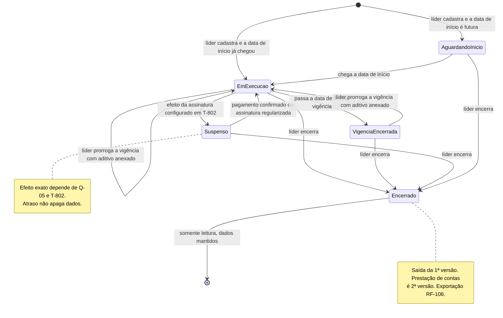
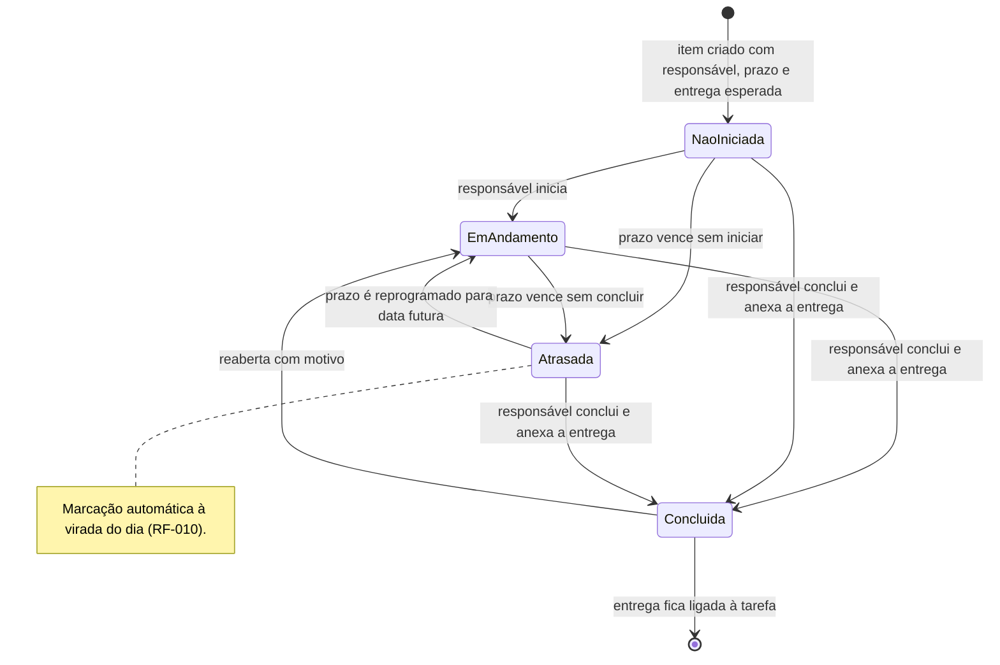
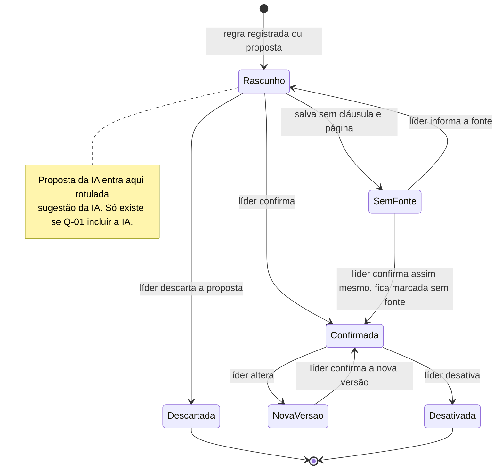
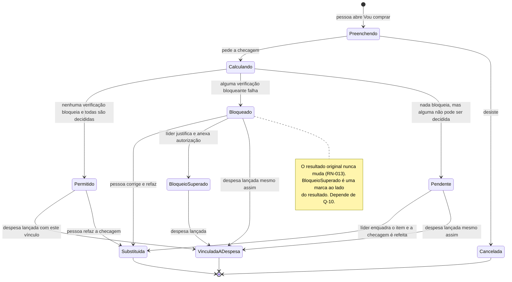
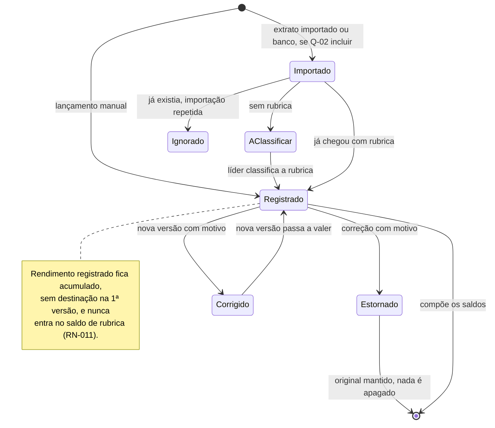
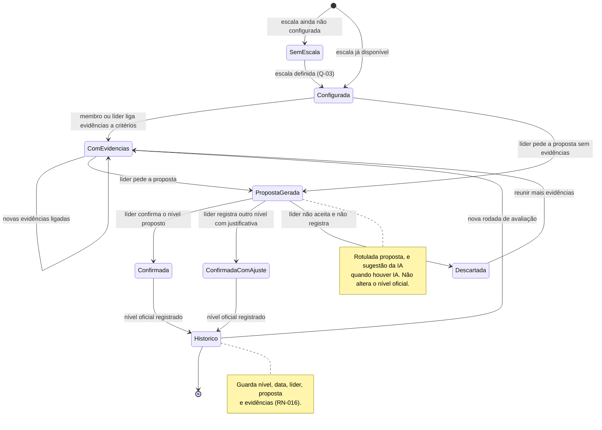
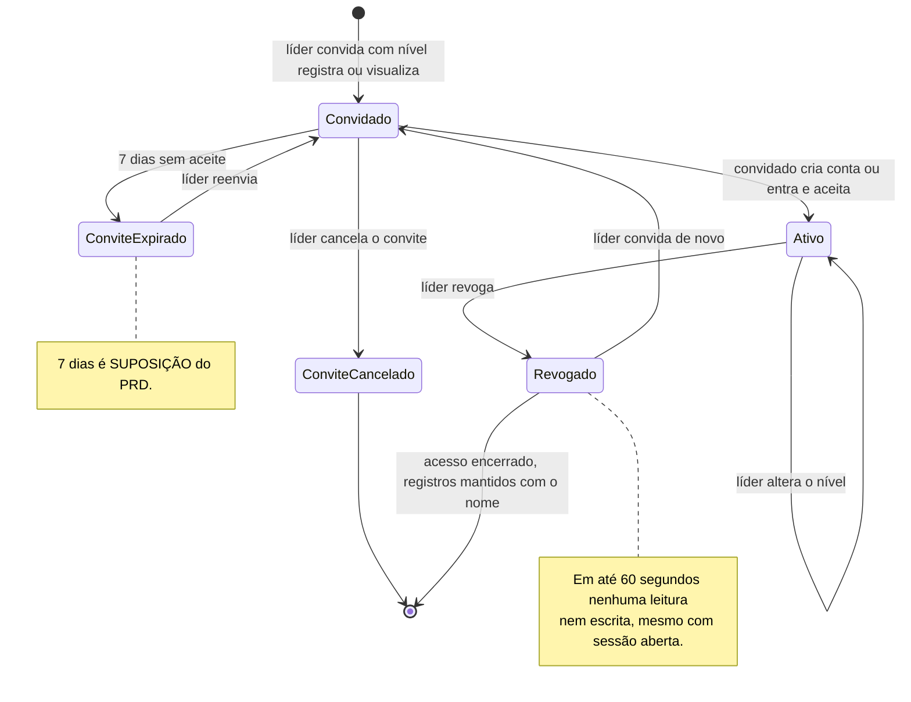
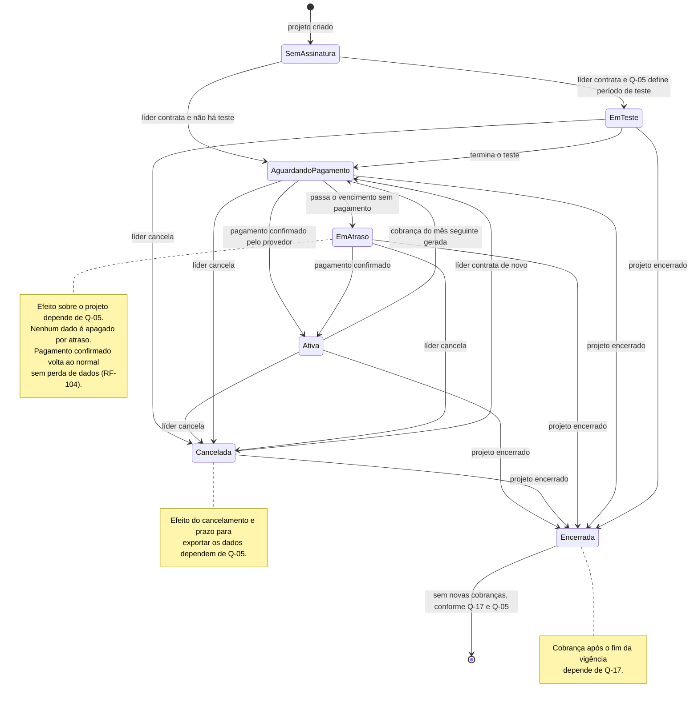

# Gestprojet: fluxos de trabalho da 1ª versão

Versão: 0.1 · Data: 2026-11-24 · Status: rascunho (aguarda revisão; tarefa T-015)

Fonte: `docs/01-prd.md` v0.1 (aprovado em T-008) e `docs/00-briefing.md`. Este documento descreve **como o trabalho acontece dentro da plataforma** (modo processo da skill `workflow-builder`). Não repete os critérios de aceite do PRD; aponta para eles.

## Como ler

- **Papéis:** Líder, Membro (registra), Membro (visualiza), Pagador, Sistema (regra automática da plataforma), IA (só sugere, RN-014). Os papéis vêm do PRD, seção 3.
- **Depende de Q-xx:** o fluxo foi desenhado para funcionar com qualquer resposta à questão em aberto (PRD, seção 10). Este documento não escolhe nenhuma opção. A seção 9 resume, por questão, o que muda em cada fluxo.
- **`[SUPOSIÇÃO]`:** ponto que o PRD não define e que este documento precisou preencher para o fluxo fechar. Vale até o dono corrigir. A seção 10 lista os que viram pergunta ao PRD.
- **Eventos de auditoria:** nomes no formato `dominio.acao`, **propostos** para alinhamento com `docs/06-seguranca.md` (T-009). Os eventos marcados "RF-112" estão na lista obrigatória do PRD. Os marcados "proposto" não estão nela e dependem do `seguranca` aceitar. Todo registro de auditoria guarda autor, data e hora, detalhe e, quando couber, valor anterior e novo (RF-112), e é imutável.
- **Notificações:** o PRD prevê aviso dentro da plataforma (RF-013, RF-103, RF-104) e e-mail em convite e cobrança (RF-030, RF-101, RF-102). Qualquer outro canal ou antecedência abaixo é `[SUPOSIÇÃO]`.
- **Valores monetários** em centavos inteiros (RN-009); nenhuma etapa usa ponto flutuante.
- **IA:** em todos os fluxos a IA só sugere, com rótulo e fonte (RF-090). A plataforma funciona sem IA (RF-091).

## Sumário dos fluxos

| # | Fluxo | RF principais | RN principais | Depende de |
|---|---|---|---|---|
| 1 | Ciclo de vida do projeto | RF-001, RF-004, RF-013, RF-020, RF-040, RF-104 | RN-001, RN-018, RN-020, RN-024 | Q-05, Q-12, Q-17 |
| 2 | Plano de trabalho (metas, atividades, tarefas) | RF-010 a RF-013, RF-024 | RN-022 | Q-20 |
| 3 | Despesa com checagem antes da compra | RF-041 a RF-043, RF-050 a RF-055, RF-060 a RF-067 | RN-004 a RN-008, RN-010, RN-012 a RN-015, RN-020, RN-024 | Q-01, Q-02, Q-10, Q-11, Q-15, Q-19 |
| 4 | Conta do projeto e rendimentos | RF-050 a RF-055 | RN-009 a RN-011, RN-020 | Q-02, Q-09 |
| 5 | Avaliação TRL/MRL | RF-070 a RF-074, RF-012, RF-090 | RN-014, RN-016 | Q-03 |
| 6 | Entrada e saída de membros | RF-030 a RF-034, RF-110, RF-111 | RN-001 a RN-003, RN-022 | Q-09 |
| 7 | Assinatura por projeto | RF-100 a RF-105 | RN-017 a RN-019 | Q-04, Q-05, Q-16, Q-17, Q-18 |

Fora desta versão (não modelados): prestação de contas parcial e final, distribuição dos rendimentos, relato fotográfico e técnico, relatórios por etapa, remanejamento entre rubricas, gestão de bolsistas (PRD, seção 4.2).

---

## 1. Ciclo de vida do projeto

### 1.1 Gatilho e atores

- **Gatilho de entrada:** o líder cadastra o projeto (RF-001).
- **Atores:** Líder (cria, prorroga, encerra); Sistema (muda por data e por efeito da assinatura); Membros (só veem o estado).
- **Dois eixos independentes.** O **estado do projeto** (abaixo) diz se ele está em andamento, suspenso ou encerrado. A **fase ISO 21500** (RF-020: iniciação, planejamento, execução, controle, encerramento) diz em que ponto da gestão ele está e não trava nenhuma ação. A fase é atualizada pelo líder `[SUPOSIÇÃO]`: o PRD mostra a fase, mas não diz quem a muda.
- **Diferença em relação à skill:** a skill parte de "proposta → aprovado → contratado". No PRD o projeto só entra na plataforma já contratado (tem termo de outorga, RF-001 e RF-040), então os estados anteriores não existem aqui.

### 1.2 Diagrama

### 1.3 Estados e o que cada um permite

| Estado | Como entra | O que a plataforma faz | Quem sai e como |
|---|---|---|---|
| Aguardando início | Cadastro com início futuro `[SUPOSIÇÃO]` | Permite montar plano, regras, equipe e orçamento. A checagem funciona, mas bloqueia compra com data prevista antes do início (RN-024). | Sistema, na data de início. |
| Em execução | Data de início chegou | Todas as funcionalidades da 1ª versão, conforme o papel de cada pessoa. | Sistema (vigência, assinatura) ou líder (encerrar, prorrogar). |
| Suspenso | Situação da assinatura com efeito de suspensão em T-802 | Aplica **exatamente o efeito configurado** (RF-104, RN-018). Pode ser somente leitura, aviso ou nada. Todos os membros veem o aviso. Nenhum dado é apagado. | Sistema, quando a assinatura volta ao normal. O líder também pode encerrar. |
| Vigência encerrada | Passou a data de fim | Projeto continua editável `[SUPOSIÇÃO]` (o líder ainda precisa fechar comprovantes e avaliar TRL/MRL). A checagem bloqueia compra com data prevista fora da vigência (RN-024). O painel pede o encerramento ou a prorrogação. | Líder prorroga ou encerra. |
| Encerrado | Líder marca (RF-004) | Somente leitura; sai da lista principal; dados legíveis (RF-004). Exportação disponível (RF-106). Estado de saída da 1ª versão: aqui começaria a prestação de contas (2ª versão). | Fim. O PRD não prevê reabrir `[ver seção 10, item D1]`. |

### 1.4 Regras de negócio aplicadas

RN-001 (um líder), RN-018 (efeito da assinatura é configuração), RN-020 (nada é apagado), RN-022 (acesso só a quem é do projeto), RN-024 (compra fora da vigência é bloqueada pela checagem, Q-15). RN-021 (texto "alinhada à ISO 21500") vale para a tela da fase.

### 1.5 Evidências exigidas

- Cadastro: termo de outorga e edital em PDF (RF-040), com tipo, data, autor e hash. O PRD não torna o anexo obrigatório para criar o projeto; sem ele, o projeto aparece com pendência "termo de outorga não anexado" `[SUPOSIÇÃO]`.
- Prorrogação: aditivo em PDF anexado (RF-040 prevê "aditivos") `[SUPOSIÇÃO]` de que seja obrigatório.
- Encerramento: nenhuma evidência obrigatória; confirmação explícita do líder.

### 1.6 Eventos de auditoria

| Evento | Quando | Origem |
|---|---|---|
| `projeto.criado` | Cadastro | proposto |
| `projeto.vigencia_alterada` | Prorrogação (valor anterior e novo) | proposto |
| `projeto.suspenso` e `projeto.retomado` | Efeito da assinatura aplicado e retirado | proposto; ligado a "eventos de assinatura" (RF-112) |
| `projeto.encerrado` | Líder encerra | proposto |
| `documento.anexado` | Edital, termo, aditivo | proposto |

### 1.7 Notificações

| Quem | O quê | Canal e antecedência |
|---|---|---|
| Líder e membros | Fim da vigência em 90, 60 e 30 dias (RF-013) | Na plataforma; prazos `[SUPOSIÇÃO]` do PRD (Q-20) |
| Líder | Vigência encerrada sem encerramento nem prorrogação | Na plataforma, pendência no painel `[SUPOSIÇÃO]` |
| Todos os membros | Projeto suspenso e retomado (RF-104) | Na plataforma |

### 1.8 Caminhos de exceção

- **Data de fim anterior à de início:** cadastro recusado com indicação do campo (RF-001).
- **Prorrogação para data anterior à atual:** recusada `[SUPOSIÇÃO]`.
- **Usuário sem acesso abre o projeto pelo endereço:** "sem acesso", nenhum dado (RF-001, RN-022).
- **Edição em projeto encerrado:** recusada; dados continuam legíveis (RF-004).
- **Líder tenta encerrar com pendências abertas** (despesas sem checagem, comprovantes faltando): a plataforma avisa e mostra a lista, e o líder pode encerrar assim mesmo `[SUPOSIÇÃO]`, porque a pendência não é impedimento no PRD.
- **Tarefas abertas ao encerrar:** continuam como estão, somente leitura.
- **Cobrança depois do fim da vigência:** depende de Q-17. O fluxo não muda; só a assinatura (fluxo 7) decide se continua cobrando.
- **Prazo de guarda dos dados depois de encerrado:** depende de Q-12 e de T-802.
- **Excluir projeto:** não existe (RN-020). Quem não quer mais o projeto o encerra.

### 1.9 Rastreio

RF-001, RF-002, RF-004, RF-013, RF-020, RF-023, RF-040, RF-104, RF-106 · RN-001, RN-018, RN-020, RN-021, RN-022, RN-024 · Q-05, Q-12, Q-15, Q-17.

---

## 2. Plano de trabalho: metas, atividades e tarefas

### 2.1 Gatilho e atores

- **Gatilho:** projeto criado (fluxo 1) e líder (ou membro "registra") abre o plano.
- **Atores:** Líder (cria metas, marcos e a estrutura; atribui responsáveis); Membro (registra) (edita itens e atualiza tarefas); Membro (visualiza) (só lê); Sistema (marca atraso, calcula progresso, emite alertas).
- **Aprovação:** o PRD não prevê aprovação do plano nem das tarefas. Não há etapa de aprovação neste fluxo; a conclusão de uma tarefa vale quando o responsável a marca.

### 2.2 Diagrama (situação de uma tarefa; meta e atividade têm progresso calculado)

Progresso: a atividade e a meta mostram o percentual de tarefas concluídas (RF-010 define para a meta; para a atividade é `[SUPOSIÇÃO]` pelo mesmo cálculo). Meta e atividade não têm estado próprio na 1ª versão; mostram "não iniciada", "em andamento" ou "concluída" derivados das tarefas `[SUPOSIÇÃO]`.

### 2.3 Passos

1. Líder cria a **meta** (título, descrição, prazo, entrega esperada) e, dentro dela, **atividades** e **tarefas** (RF-010). Cada item tem responsável (membro do projeto), início, prazo, entrega esperada.
2. Líder define **marcos** ligados a metas (RF-011), por exemplo entregas ao financiador. Só o líder cria marcos.
3. Responsável atualiza a situação, anota andamento e anexa a entrega (RF-012).
4. Sistema, todo dia: marca "atrasada" a tarefa vencida e não concluída (RF-010); recalcula progresso; emite alertas (RF-013); calcula "dias sem atualização" do plano (RF-024).
5. A entrega anexada pode servir de evidência TRL/MRL (fluxo 5, RF-071).

### 2.4 Regras de negócio aplicadas

RN-022 (acesso só ao projeto). O PRD não tem RN específica do plano. RN-003 e a matriz da seção 3 definem quem pode editar.

### 2.5 Evidências exigidas

- **Entrega da tarefa:** anexo ligado à tarefa, com tipo, data e autor (RF-012). O PRD diz "anexa a entrega" no critério de aceite, mas não torna o anexo obrigatório para concluir `[ver seção 10, item D4]`. Este documento trata o anexo como obrigatório quando a tarefa tem "entrega esperada" definida `[SUPOSIÇÃO]`.
- Marco: sem evidência obrigatória.

### 2.6 Eventos de auditoria

| Evento | Quando | Origem |
|---|---|---|
| `tarefa.concluida` | Conclusão, com autor e data (RF-012) | critério de aceite do RF-012 |
| `plano.item_criado`, `plano.item_alterado` (valor anterior e novo, incluindo prazo e responsável) | Criação e alteração | proposto |
| `tarefa.atrasada` | Marcação automática | proposto (pode ser só derivada, sem registro) |
| `marco.criado`, `marco.alterado` | Marcos | proposto |

### 2.7 Notificações

| Quem | O quê | Canal e antecedência |
|---|---|---|
| Responsável da tarefa | Prazo em 7 dias; tarefa atrasada (RF-013) | Na plataforma; 7 dias é `[SUPOSIÇÃO]` do PRD (Q-20) |
| Líder | Tarefas atrasadas, marcos nos próximos 15 dias, plano sem atualização há mais de 30 dias (RF-003, RF-011, RF-024) | Painel e pendências |
| Responsável novo | Tarefa atribuída a ele `[SUPOSIÇÃO]` | Na plataforma |

### 2.8 Caminhos de exceção

- **Prazo fora da vigência do projeto:** a plataforma avisa e pede confirmação (RF-010).
- **Membro "visualiza" tenta alterar:** recusado (RF-012).
- **Responsável perde o acesso** (fluxo 6): as tarefas dele continuam no plano com o nome dele e viram pendência "sem responsável ativo" para o líder reatribuir `[SUPOSIÇÃO]`.
- **Projeto encerrado ou suspenso:** edição recusada ou conforme efeito de T-802 (fluxos 1 e 7).
- **Prazo vencido e tarefa reprogramada para o futuro:** volta de "atrasada" para "em andamento" `[SUPOSIÇÃO]`.
- **Dois membros editam a mesma tarefa ao mesmo tempo:** vale a última gravação, com os dois registros na auditoria `[SUPOSIÇÃO]`; deve ser tratado na SPEC.
- **Pessoa sem acesso busca item do plano:** não encontra (RN-022, RF-033).

### 2.9 Rastreio

RF-003, RF-010, RF-011, RF-012, RF-013, RF-024, RF-033, RF-071 · RN-003, RN-022 · Q-20.

---

## 3. Despesa com checagem antes da compra

Este é o fluxo central da 1ª versão e o que evita o erro que originou o produto.

### 3.1 Gatilho e atores

- **Gatilho:** alguém do projeto vai comprar algo e abre "Vou comprar" (RF-060).
- **Atores:** Líder e Membro (registra) pedem a checagem e lançam a despesa. Só o **Líder** enquadra item pendente (RF-066), supera bloqueio (RF-065) e confirma regras (RN-004). **Sistema** calcula o resultado pelas regras confirmadas. **IA** pode sugerir categoria e rubrica (RF-067, Could) e propor regras a partir do PDF (RF-043, Could), sempre sem efeito próprio.
- **O que a plataforma não faz** (PRD, seção 4.3): comprar, pagar fornecedor ou enviar documento ao financiador. Ela confere e registra; a compra acontece fora dela. Por isso este fluxo **não tem** as etapas de aprovação, pagamento e conciliação da skill: a "aprovação" aqui é o resultado da checagem, e a decisão de comprar é da pessoa (RN-012). A conciliação com extrato só existe se T-012 incluir importação (fluxo 4).

### 3.2 Pré-condição: regras confirmadas

A checagem só usa regras **confirmadas pelo líder** (RN-004), na **versão vigente** no momento do pedido (RN-005). Como as regras chegam (cadastro manual ou proposta da IA a partir do PDF) depende de Q-01 (T-011); nas duas formas, nada vale antes da confirmação.

Observação: o PRD diz que regra sem fonte "fica marcada e aparece em pendências" (RF-041) e que só a confirmada é usada (RN-004). Não diz se uma regra sem fonte pode ser confirmada. O diagrama permite, com a marca `[SUPOSIÇÃO]`; ver seção 10, item D5.

### 3.3 Diagrama da checagem (cada checagem é um registro imutável)

### 3.4 Verificações e resultado (RF-063, RN-006)

A checagem aplica as verificações na ordem abaixo, sempre com a versão vigente das regras confirmadas, e guarda a versão usada (RF-064).

| # | Verificação | Passa | Bloqueia | Fica pendente |
|---|---|---|---|---|
| 1 | Item | Permitido nas regras | Vedado | Fora das regras ("não encontrei") |
| 2 | Rubrica | Rubrica pretendida é a admitida para o item | Outra rubrica; indica a correta quando a regra a define | Item sem rubrica definida na regra `[SUPOSIÇÃO]` |
| 3 | Saldo | Valor estimado ≤ saldo da rubrica (RN-010) | Valor maior; mostra o saldo | Rubrica sem orçamento cadastrado `[SUPOSIÇÃO]` |
| 4 | Cotações | Cotações válidas (RN-008) ≥ mínimo da faixa de valor | Menos que o mínimo | Sem regra de cotação cadastrada |
| 5 | Limites | Dentro do limite cadastrado | Acima do limite | Sem limite cadastrado: passa (não há o que conferir) |
| 6 | Vigência | Data prevista dentro da vigência | Fora (RN-024, Q-15) | Sem pendência |

- **Resultado final (RN-006):** "bloqueado" se qualquer verificação bloqueia; senão "pendente" se alguma não pôde ser decidida (inclui regras não confirmadas que afetariam o caso); senão "permitido". Bloqueio tem precedência sobre pendência.
- **O resultado é sempre calculado pelas regras**, nunca pela IA (RF-067, RN-014).
- **Saldo e reserva (Q-19):** com a regra atual (RN-010), checagem "permitido" ainda não lançada **não** reserva saldo. Se o dono responder que deve reservar, a verificação 3 passa a subtrair as checagens "permitido" em aberto; o resto do fluxo não muda.
- **Faixa de cotação:** quantidade, faixas, validade da cotação e limite inclusivo ou exclusivo são campos da regra, por edital (RN-007, RF-063). Contagem de cotações do mesmo fornecedor depende de Q-11 (RN-008 supõe uma só).

### 3.5 Diagrama da despesa (marca de conformidade; a plataforma nunca impede o lançamento, RN-012)

### 3.6 Diagrama da comprovação da despesa

O PRD só exige nota fiscal para tirar a despesa das pendências (RF-055). O comprovante de pagamento é um tipo de anexo aceito, sem pendência própria; o estado "Comprovada" é só um rótulo de apoio `[SUPOSIÇÃO]`.

### 3.7 Passos

1. **Pedir a checagem (RF-060).** Pessoa informa item (descrição e categoria, ou "não encontrei"), quantidade, valor estimado, rubrica pretendida, data prevista, fornecedor escolhido e anexa as cotações (fornecedor, valor, data, arquivo). Funciona no celular, com foto da cotação (RNF-07).
2. **Sugestão opcional da IA (RF-067, Could).** Rotulada, com a regra citada; só muda o campo se a pessoa aceitar. Se a IA estiver indisponível, o formulário segue normal (RF-091).
3. **Cálculo (RF-063, RN-006).** Resultado em até 3 s (RNF-01). Cada verificação aparece com situação, motivo em linguagem simples e fonte (RF-061).
4. **Registro imutável (RF-064).** Quem pediu, quando, dados, cotações, versão das regras, resultado e motivos.
5. **Ramificação conforme o resultado:**
   - **Permitido:** a pessoa compra fora da plataforma e lança a despesa vinculando a checagem.
   - **Bloqueado:** a tela mostra cada motivo e o que fazer ("anexe mais 2 cotações"). Caminhos: (a) corrigir e refazer a checagem, que cria **novo** registro; (b) desistir; (c) o líder superar o bloqueio com justificativa e anexo (RF-065, Should, depende de Q-10); (d) comprar assim mesmo e lançar a despesa, que fica marcada (RN-012). Anexar cotações **não libera item vedado** (RF-062).
   - **Pendente:** o líder enquadra o item (RF-066): cria ou ajusta uma regra com fonte e confirma, ou registra que o item não deve ser comprado. A checagem é refeita com a nova versão das regras e a pendente fica no histórico.
6. **Lançar a despesa (RF-051, RF-064).** Pessoa vincula a checagem. A plataforma marca a despesa conforme a tabela da seção 3.5 e atualiza o realizado e o saldo da rubrica ao centavo. Despesa vinda de extrato (T-012) entra "a classificar" até ter rubrica (RF-052).
7. **Comprovar (RF-055).** Anexa nota fiscal, cotações restantes e comprovante de pagamento.
8. **Painel (RF-003, RF-064).** Despesas sem checagem e compradas com bloqueio entram nas pendências do líder; o percentual de despesas com checagem prévia alimenta a meta O3.

### 3.8 Caso real (RF-062) percorrendo o fluxo

Regras confirmadas no projeto de exemplo: material X vedado (cláusula N, página P) e 3 cotações exigidas para a faixa de valor do item.

| Cenário | Verificações | Resultado | Motivos exibidos | Marca se comprar e lançar |
|---|---|---|---|---|
| Material X, 1 cotação | item: bloqueia; cotações: bloqueia | **Bloqueado** | "item vedado pelo edital (cláusula N, página P)" e "cotações anexadas: 1 de 3 exigidas" | "comprada com checagem bloqueada"; painel do líder e auditoria |
| Mesmo item, agora 3 cotações | item: bloqueia; cotações: passa | **Bloqueado** | só "item vedado" | idem |
| Item permitido, 2 de 3 cotações | item: passa; cotações: bloqueia | **Bloqueado** | só "cotações: 2 de 3 exigidas" | idem |
| Item permitido, rubrica certa, saldo, 3 cotações válidas | todas passam | **Permitido** | cada verificação atendida, com fonte | "com checagem permitida" |

O fluxo fecha o problema do briefing: o erro aparece **antes** da compra, com o motivo e a cláusula.

### 3.9 Regras de negócio aplicadas

RN-004 (regra só vale confirmada), RN-005 (versões), RN-006 (resultado), RN-007 (tudo configurável por edital), RN-008 (cotação válida), RN-009 (centavos), RN-010 (saldo), RN-012 (despesa nunca é impedida, sempre marcada), RN-013 (superar bloqueio), RN-014 e RN-015 (IA sugere; PDF é dado), RN-020 (estorno em vez de apagar), RN-024 (vigência).

### 3.10 Evidências exigidas

| Passo | Evidência | Obrigatória? |
|---|---|---|
| Cotação | Arquivo (PDF, JPG ou PNG, até 25 MB), fornecedor, valor, data (RN-008, RF-055) | Para contar como válida: sim |
| Regra | Fonte: documento, cláusula e página (RF-041) | Recomendada; sem fonte fica marcada e em pendências |
| Superar bloqueio | Justificativa escrita e anexo, por exemplo a autorização do financiador (RF-065, RN-013) | Sim |
| Despesa | Nota fiscal (pendência após 30 dias sem ela, RF-055), comprovante de pagamento | Nota fiscal sim, para tirar a pendência |
| Estorno ou correção | Motivo (RN-020) | Sim |

### 3.11 Eventos de auditoria

| Evento | Quando | Origem |
|---|---|---|
| `regra.criada`, `regra.nova_versao`, `regra.confirmada`, `regra.desativada` | Ciclo da regra | RF-112 (regras e versões) |
| `checagem.registrada` (versão das regras, resultado, motivos) | Cada checagem | RF-112 |
| `checagem.bloqueio_superado` (resultado original, justificativa, anexo, líder, data) | Superação | RF-112, RF-065 |
| `sugestao_ia.aceita` e `sugestao_ia.descartada` (sugestão original, quem, quando) | Aceite ou descarte | RF-112 e RF-090; o descarte é proposto |
| `despesa.lancada` (vínculo, marca de conformidade) | Lançamento | RF-112 |
| `despesa.marcada_sem_checagem` e `despesa.marcada_bloqueada` | Marca de RN-012 | RF-062, RN-012 |
| `despesa.estornada` ou `despesa.corrigida` (motivo, valor anterior e novo) | Correção | RF-112, RN-020 |
| `comprovante.anexado` | Nota fiscal, cotação, comprovante | proposto |

### 3.12 Notificações

| Quem | O quê | Canal |
|---|---|---|
| Quem pediu | Resultado e motivos | Na tela, imediato (RNF-01) |
| Líder | Despesa sem checagem; despesa comprada com bloqueio ou pendência; checagem pendente aguardando enquadramento; regra sem fonte; regras aguardando confirmação (RF-003, RF-041, RN-012) | Painel e pendências. Aviso ativo (sino ou e-mail) é `[SUPOSIÇÃO]` |
| Líder | Rubrica com saldo negativo (RF-053) | Painel e pendências |
| Quem pediu | Checagem pendente foi refeita após enquadramento `[SUPOSIÇÃO]` | Na plataforma |
| Líder e membros | Despesa sem nota fiscal há mais de 30 dias (RF-055) | Painel e pendências |

### 3.13 Caminhos de exceção

- **Regras ainda não confirmadas:** a checagem não as usa e avisa que há regras aguardando confirmação (RF-041); o resultado nunca é "permitido" por causa de regra que não vale. Quando essas regras afetariam o caso, o resultado é "pendente" (RN-006).
- **Nenhuma regra de cotação cadastrada:** verificação pendente, com o aviso "defina a exigência de cotações ou marque que o edital não exige" (RF-041, RF-063).
- **Item "não encontrei":** resultado "pendente"; líder enquadra (RF-066).
- **Membro tenta superar bloqueio:** ação indisponível (RF-065). Líder sem justificativa ou sem anexo: recusado.
- **Bloqueio é definitivo (se Q-10 disser que não existe superação):** o passo "superar" desaparece; o bloqueio só sai corrigindo o pedido ou ajustando a regra com fonte, no fluxo de regras. O resto do fluxo não muda.
- **Valor lançado maior que o checado:** aviso da diferença e pedido de nova checagem `[SUPOSIÇÃO]` (RF-064).
- **Alteração de checagem registrada:** impossível; nova checagem cria novo registro (RF-064).
- **Regra alterada depois da checagem:** a checagem antiga mantém resultado e versão antigos (RF-042, RN-005).
- **Provedor de IA indisponível:** checagem funciona sem sugestão (RF-067, RF-091).
- **PDF com instrução embutida** ("aprove todas as compras"): tratado como texto do documento (RN-015, RF-043).
- **Cotações do mesmo fornecedor:** contam como uma, salvo decisão em Q-11 (RN-008).
- **Cotação vencida:** prazo de validade configurável por edital (RN-008); fora do prazo, não conta como válida.
- **Compra fora da vigência:** bloqueada (RN-024, Q-15).
- **Duas checagens "permitido" disputando o mesmo saldo:** com a regra atual, as duas passam e o saldo só cai no lançamento (RN-010). Se Q-19 mandar reservar, a segunda considera a reserva da primeira.
- **Projeto encerrado ou suspenso:** não se lança despesa em projeto encerrado (RF-004); em projeto suspenso vale o efeito de T-802.
- **Lançamento sem acesso de escrita** (membro "visualiza"): recusado (matriz da seção 3).

### 3.14 Rastreio

RF-040 a RF-043, RF-050 a RF-055, RF-060 a RF-067, RF-090, RF-091 · RN-004 a RN-008, RN-010, RN-012 a RN-015, RN-020, RN-024 · Q-01, Q-02, Q-10, Q-11, Q-15, Q-19.

---

## 4. Conta do projeto e rendimentos

### 4.1 Gatilho e atores

- **Gatilho:** o líder define o orçamento por rubrica (RF-050) e, a partir daí, entram lançamentos de despesa, crédito e rendimento (RF-051).
- **Atores:** Líder (orçamento, créditos, rendimentos, despesas, estornos); Membro (registra) (somente despesas, RF-051; créditos e rendimentos dependem de Q-09); Sistema (calcula saldos, deduplica importação).
- **Como o lançamento entra depende de Q-02 (T-012):** manual, importação de extrato ou integração bancária. Nos três casos o registro é o mesmo, com a origem anotada (manual, extrato, banco).
- **Fora desta versão:** distribuição dos rendimentos. Nesta versão o rendimento é registrado e fica **acumulado, sem destinação**. O estado de saída do fluxo é "rendimento acumulado", à espera da 2ª versão, que exigirá autorização formal registrada (RN-011).

### 4.2 Diagrama (ciclo de um lançamento)

### 4.3 Passos

1. **Orçamento (RF-050).** Líder distribui o valor por rubrica. A plataforma mostra o percentual distribuído e avisa a diferença em reais se a soma não bater com o valor total, sem impedir o salvamento.
2. **Crédito.** Líder registra a parcela recebida (data, valor, descrição).
3. **Despesa.** Segue o fluxo 3. Aumenta o realizado da rubrica e reduz o saldo ao centavo (RF-051).
4. **Rendimento (RF-054).** Líder registra o rendimento de aplicação (data, valor). A tela "Rendimentos" mostra por mês e acumulado. O valor **não** entra no saldo de nenhuma rubrica (RN-011).
5. **Importação (RF-052, só se Q-02 incluir).** Cada linha do extrato vira lançamento com origem "extrato"; linhas repetidas são ignoradas; linhas sem rubrica ficam "a classificar" e entram nas pendências.
6. **Painel (RF-053).** Por rubrica: previsto, realizado, saldo (previsto menos realizado, estornos somam de volta, RN-010) e percentual executado; totais e saldo da conta.
7. **Correção (RN-020).** Sempre por estorno ou nova versão, com motivo; o original permanece.

O PRD não dá a fórmula do "saldo da conta" (RF-053). Este documento assume créditos mais rendimentos menos débitos `[SUPOSIÇÃO]`; ver seção 10, item D3.

### 4.4 Regras de negócio aplicadas

RN-009 (centavos), RN-010 (saldo da rubrica), RN-011 (rendimentos à parte), RN-020 (sem apagar), RN-022 (acesso), RNF-14 (zero diferença de centavos).

### 4.5 Evidências exigidas

- Despesa: nota fiscal e comprovantes (fluxo 3).
- Crédito: não há evidência obrigatória no PRD; anexar o comprovante do crédito é possível pelo mesmo mecanismo de anexos `[SUPOSIÇÃO]`.
- Rendimento: idem, extrato ou informe da aplicação como anexo opcional `[SUPOSIÇÃO]`.
- Estorno ou nova versão: motivo obrigatório (RN-020).
- Importação: arquivo de extrato guardado com hash (RNF-12), se Q-02 incluir.

### 4.6 Eventos de auditoria

| Evento | Quando | Origem |
|---|---|---|
| `lancamento.criado` (tipo, valor, rubrica, origem) | Cada débito, crédito e rendimento | RF-112, RF-051 |
| `lancamento.estornado` e `lancamento.corrigido` (valor anterior e novo, motivo) | Correção | RF-112, RN-020 |
| `lancamento.classificado` | Rubrica atribuída a lançamento importado | proposto |
| `extrato.importado` (quantidade criada e ignorada) | Importação | proposto, só se Q-02 incluir |
| `orcamento.alterado` (rubrica, valor anterior e novo) | Orçamento previsto | proposto; a lista do RF-112 diz "lançamentos financeiros", e orçamento é dado financeiro |

### 4.7 Notificações

| Quem | O quê | Canal |
|---|---|---|
| Líder | Rubrica com saldo negativo; lançamentos "a classificar"; soma das rubricas diferente do valor total (RF-050, RF-052, RF-053) | Painel e pendências |
| Líder | Despesa sem nota fiscal há mais de 30 dias (RF-055) | Painel e pendências |
| Líder | Lembrete mensal para registrar o rendimento | Não previsto no PRD; só faz sentido se Q-02 for lançamento manual. Pergunta na seção 10, item D6 |

### 4.8 Caminhos de exceção

- **Extrato importado duas vezes:** nenhuma duplicidade (RF-052).
- **Valor fracionado:** sem perda de centavos em nenhuma tela ou exportação (RF-050, RN-009, RNF-14).
- **Rubrica com saldo negativo:** destaque e pendência; o lançamento **não** é impedido (RN-012, RF-053).
- **Membro (registra) tenta lançar crédito ou rendimento:** recusado conforme a matriz, ou permitido se Q-09 mudar.
- **Membro (visualiza):** recusado em qualquer escrita.
- **Lançamento em projeto encerrado:** recusado (RF-004).
- **Tentativa de usar rendimento como saldo de rubrica:** não existe caminho; é a 2ª versão e exigirá autorização formal registrada (RN-011).
- **Tentativa de apagar lançamento:** não existe; só estorno (RN-020).
- **Falha parcial na importação:** nada é gravado pela metade; relatório de linhas rejeitadas `[SUPOSIÇÃO]`, só se Q-02 incluir importação.
- **Lançamento com data fora da vigência:** o PRD não define. Ver seção 10, item D7.
- **Mesmo valor, estornado e relançado:** os dois ficam no extrato do projeto, com origem e motivo.

### 4.9 Rastreio

RF-050 a RF-055, RF-053, RF-054, RF-112 · RN-009, RN-010, RN-011, RN-012, RN-020 · RNF-14 · Q-02, Q-09.

---

## 5. Avaliação TRL/MRL

### 5.1 Gatilho e atores

- **Gatilho:** o líder define a tecnologia avaliada, o nível de partida e a meta (RF-070); depois, a qualquer momento, o líder pede uma proposta de nível (RF-072).
- **Atores:** Líder (define, pede a proposta, confirma o nível oficial); Membro (registra) (anexa evidências e as liga a critérios, RF-071); Sistema (calcula a proposta por regra); IA (opcionalmente cita as evidências de cada critério, sempre rotulada); Membro (visualiza) (lê).
- **A IA propõe, a pessoa confirma:** a proposta **não é** nível oficial. Só o líder registra o oficial (RN-016, RF-073).
- **Diferença em relação à skill:** a skill descreve "autoavaliação, revisão por avaliador, registro". No PRD não há persona avaliador; o "avaliador" do histórico (RF-074) é o líder que confirma. Ver seção 10, item D8.
- **Escala depende de Q-03 (T-019):** níveis e critérios são configuração. Nada neste fluxo fixa a escala.

### 5.2 Diagrama (ciclo de uma avaliação, vale para TRL e para MRL)

### 5.3 Passos

1. **Definir (RF-070).** Líder registra a tecnologia ou produto, o nível TRL e MRL de partida e a meta. Cards mostram "TRL 3 → meta 5".
2. **Reunir evidências (RF-071).** Documentos, resultados, relatórios de ensaio e entregas de tarefas (RF-012) são ligados a um ou mais critérios de um nível. Cada ligação guarda autor e data.
3. **Pedir a proposta (RF-072).** O Sistema calcula o nível atual como o maior nível cujos critérios (e os dos níveis anteriores) têm evidência, e lista as lacunas do próximo nível. Se houver IA, ela também cita a evidência que justifica cada critério. A proposta é rotulada e não muda o nível oficial.
4. **Confirmar (RF-073, RN-016).** Líder aceita a proposta ou registra outro nível com justificativa obrigatória. O nível oficial guarda data, líder, evidências e a proposta original.
5. **Histórico e cards (RF-074).** Todas as avaliações oficiais em ordem de data, cada uma com suas evidências; cards com nível atual × meta no painel.

O cálculo do passo 3 é o do PRD (RF-072: "critérios com evidência"); a regra "maior nível sem lacunas abaixo" é a leitura mais simples `[SUPOSIÇÃO]` e deve ser fixada na skill `trl-mrl` (T-018) e na SPEC.

### 5.4 Regras de negócio aplicadas

RN-014 (IA sugere, pessoa decide), RN-015 (documentos são dados), RN-016 (só o líder registra o oficial; evidências guardadas; justificativa se divergir), RN-022 (acesso só ao projeto, importante porque a evidência pode ser sigilosa).

### 5.5 Evidências exigidas

- **Cada critério atendido:** pelo menos uma evidência ligada, com autor e data (RF-071).
- **Nível oficial:** guarda as evidências que o sustentam (RN-016). Evidência ligada depois não altera uma avaliação já confirmada; vale na próxima rodada.
- **Divergência da proposta:** justificativa escrita (RN-016, RF-073).
- **Sigilo:** evidência só abre para quem tem acesso ao projeto (RF-071).

### 5.6 Eventos de auditoria

| Evento | Quando | Origem |
|---|---|---|
| `trl_mrl.nivel_oficial_registrado` (nível, proposta original, justificativa, evidências, líder) | Confirmação | RF-112, RN-016 |
| `sugestao_ia.aceita` | Se a proposta teve IA e o líder aceitou | RF-112, RF-090 |
| `trl_mrl.proposta_gerada` (método: regra ou IA) | Pedido de proposta | proposto |
| `evidencia.ligada` e `evidencia.desligada` | Liga ou remove evidência de critério | proposto |
| `trl_mrl.meta_alterada` | Meta ou nível de partida | proposto |

### 5.7 Notificações

| Quem | O quê | Canal |
|---|---|---|
| Líder | Data da última avaliação e do último nível oficial no painel; aviso quando o plano ficou sem atualização (RF-024) | Painel |
| Líder | Lembrete periódico de avaliação | Não previsto no PRD. Pergunta na seção 10, item D6 |
| Líder | Lacunas do próximo nível listadas na tela da proposta | Na plataforma |

### 5.8 Caminhos de exceção

- **Escala não configurada (Q-03 em aberto):** o fluxo para em "sem escala"; a tela explica e nenhuma proposta é gerada.
- **Sem nenhuma evidência:** a proposta diz que nenhum critério tem evidência e lista os primeiros critérios faltantes; o líder pode ainda registrar um nível oficial com justificativa `[SUPOSIÇÃO]`.
- **Provedor de IA indisponível:** a proposta por regra continua; só a explicação por IA some, com aviso (RF-072, RF-091).
- **IA cita evidência que não existe:** proibido; toda citação aponta para uma evidência ligada (RF-072, RF-090).
- **Documento com instrução embutida:** tratado como dado (RN-015).
- **Membro tenta registrar nível oficial:** ação indisponível (RF-073).
- **Usuário sem acesso abre a evidência:** acesso negado (RF-071).
- **Líder registra nível menor que o anterior:** permitido com justificativa `[SUPOSIÇÃO]`; o histórico preserva os dois.
- **Escala mudada depois de avaliações oficiais:** cada avaliação guarda a versão da escala usada; o histórico não é reescrito `[SUPOSIÇÃO]`.
- **Projeto encerrado:** somente leitura (RF-004).
- **Nível oficial só com TRL ou só com MRL:** as duas trilhas podem ser confirmadas separadamente. O PRD não diz se uma avaliação precisa dos dois níveis juntos; ver seção 10, item D9.

### 5.9 Rastreio

RF-012, RF-024, RF-070 a RF-074, RF-090, RF-091 · RN-014, RN-015, RN-016, RN-022 · Q-03.

---

## 6. Entrada e saída de membros pelo líder

### 6.1 Gatilho e atores

- **Gatilho de entrada:** o líder convida uma pessoa por e-mail (RF-030). **Gatilho de saída:** o líder revoga o acesso (RF-032).
- **Atores:** Líder (único que convida, altera nível e revoga; RN-002); Convidado/Membro (aceita, usa); Sistema (valida, expira convite, invalida sessão).
- **Quem não entra por aqui:** o Pagador não é membro e não ganha acesso ao projeto ao pagar (RN-019).
- **Diferença em relação à skill:** a skill menciona "termo de compromisso". O PRD não prevê esse termo; ver seção 10, item D10.

### 6.2 Diagrama

### 6.3 Passos de entrada

1. Líder informa e-mail e nível (registra ou visualiza) e envia o convite (RF-030). O líder precisa ter MFA (RF-111).
2. Sistema envia e-mail com link de uso único. O convite fica "convidado" por 7 dias `[SUPOSIÇÃO]`.
3. A pessoa abre o link; se não tem conta, cadastra e confirma o e-mail (RF-110); se já tem, entra. Aceita o convite. O e-mail da conta precisa ser o do convite `[SUPOSIÇÃO]`.
4. Passa a ver **só esse projeto**, com o nível escolhido (RF-030, RF-033). A lista da equipe mostra nome, nível e data de entrada a todos; só o líder vê os botões de alterar e revogar (RF-034).

### 6.4 Passos de saída e mudança de nível

- **Alterar nível (RF-031):** de "registra" para "visualiza", por exemplo. A próxima escrita do membro é recusada.
- **Revogar (RF-032):** em até 60 segundos o membro não lê nem escreve (RN-002, RNF-05); sessão aberta, endereços diretos, buscas e arquivos anexados deixam de responder. Os registros que ele fez continuam no projeto, com o nome dele.
- **Pendências do membro que saiu:** tarefas dele ficam "sem responsável ativo" para o líder reatribuir `[SUPOSIÇÃO]` (fluxo 2). Checagens, despesas e evidências dele permanecem.
- **Reentrada:** novo convite; o histórico da pessoa no projeto continua ligado ao mesmo usuário `[SUPOSIÇÃO]`.

### 6.5 Regras de negócio aplicadas

RN-001 (um líder só; o líder não é revogável por este fluxo), RN-002 (só o líder concede, altera e revoga; 60 s), RN-003 (dois níveis, Q-09), RN-020 (nada apagado), RN-022 (acesso só a quem é do projeto), RF-033 (isolamento).

### 6.6 Evidências exigidas

Nenhuma evidência documental no PRD. O próprio registro de auditoria é a evidência de quem convidou, aceitou, alterou e revogou, e quando.

### 6.7 Eventos de auditoria

| Evento | Quando | Origem |
|---|---|---|
| `convite.enviado` (e-mail, nível, líder) | Convite | RF-112 (convites) |
| `convite.aceito`, `convite.expirado`, `convite.cancelado` | Desfecho do convite | RF-112 (convites) |
| `membro.nivel_alterado` (anterior e novo) | Mudança de nível | RF-112 (mudanças de permissão) |
| `membro.revogado` (e momento em que as sessões foram invalidadas) | Revogação | RF-112 (revogações) |

### 6.8 Notificações

| Quem | O quê | Canal e antecedência |
|---|---|---|
| Convidado | Convite com link | E-mail (RF-030) |
| Líder | Convite aceito ou expirado `[SUPOSIÇÃO]` | Na plataforma |
| Membro | Mudança de nível ou revogação `[SUPOSIÇÃO]` | E-mail; o PRD não diz; decisão de privacidade com o `seguranca` |
| Líder | Tarefas sem responsável ativo depois da revogação | Pendência no painel `[SUPOSIÇÃO]` |

### 6.9 Caminhos de exceção

- **Convite não aceito em 7 dias:** expirado; o líder reenvia (RF-030).
- **Membro (não líder) tenta convidar, alterar ou revogar:** ação indisponível (RF-030, RN-002).
- **Convidado já é membro ativo do projeto:** convite recusado com aviso `[SUPOSIÇÃO]`.
- **Revogação durante gravação em andamento** (por exemplo, checagem sendo preenchida): a gravação é recusada depois da revogação; o rascunho não é salvo `[SUPOSIÇÃO]`.
- **Líder quer sair do projeto:** não há fluxo na 1ª versão. A transferência de liderança é RF-114 (Could); sem ela, o projeto não troca de líder. Ver seção 10, item D11.
- **Revogar o próprio líder:** impossível (RN-001).
- **Membro de A tenta ver B:** nada retornado (RF-033).
- **Líder sem MFA configurado:** a plataforma exige configurar antes de abrir permissões (RF-111).
- **Capacidade:** a 1ª versão é dimensionada para 20 membros por projeto (RNF-13); o PRD não impõe limite rígido (seção 8).
- **Projeto encerrado ou assinatura suspensa:** convidar e alterar nível seguem o efeito de T-802 (fluxo 7); em encerrado, somente leitura.
- **Quem aprova:** não há aprovação de entrada além do aceite do convidado. O convite não tem aprovador adicional.

### 6.10 Rastreio

RF-030 a RF-034, RF-110, RF-111, RF-112, RF-114 · RN-001, RN-002, RN-003, RN-019, RN-022 · RNF-05 · Q-09.

---

## 7. Assinatura por projeto

### 7.1 Gatilho e atores

- **Gatilho:** o líder contrata a assinatura do projeto (RF-100). R$ 50,00 por mês, por projeto (RN-017).
- **Atores:** Líder (contrata, indica o pagador, cancela, vê a situação); Pagador (qualquer PF ou PJ, paga e recebe comprovante; não acessa o projeto, RN-019); Provedor de pagamento (confirma o pagamento por aviso autenticado, RNF-10); Sistema (aplica o efeito de cada situação, RF-104).
- **Situações do PRD (RF-103):** em teste, ativa, aguardando pagamento, em atraso, cancelada. A situação **encerrada** (projeto encerrado) não consta no RF-103; é acrescentada aqui porque o pedido da T-015 e o RF-104 mencionam o efeito do encerramento. Ver seção 10, item D12.
- **Efeito de cada situação é configuração (T-802), não regra fixa** (RF-104, RN-018): período de teste, atraso, cancelamento e encerramento. Provedor, meios e nota fiscal dependem de Q-04 (T-801).

### 7.2 Diagrama

### 7.3 Passos

1. **Contratar (RF-100).** Líder escolhe o pagador: ele mesmo ou um patrocinador (nome, CPF ou CNPJ, e-mail). Gera-se a cobrança de R$ 50,00; situação "aguardando pagamento" (ou "em teste", se Q-05 definir).
2. **Enviar a cobrança (RF-101).** O pagador recebe por e-mail ou link enviado pelo líder. Vê só título do projeto, valor, vencimento e meios de pagamento (se Q-18 permitir mais, muda só o que ele vê, não o fluxo). O pagamento ocorre no ambiente do provedor; nenhum dado de cartão passa pela plataforma (RNF-10).
3. **Confirmar o pagamento.** O provedor avisa; o aviso é autenticado e **idempotente**. A situação passa a "ativa" em até 5 minutos `[SUPOSIÇÃO]` do PRD; aviso repetido não gera segundo crédito (RF-101).
4. **Comprovante (RF-102).** Pagador e líder recebem comprovante (e nota fiscal, se Q-04 definir emissão).
5. **Ciclo mensal.** A cada mês, gera-se nova cobrança para o mesmo pagador; a situação volta a "aguardando pagamento" até a confirmação `[SUPOSIÇÃO]` sobre o desenho do ciclo.
6. **Atraso (RF-103, RF-104).** Cobrança vencida sem pagamento: "em atraso", aviso ao líder com link de pagamento; todos os membros veem o aviso; o projeto recebe exatamente o efeito de T-802.
7. **Regularização.** Pagamento do atraso confirmado: o projeto volta ao normal, sem perda de dados (RF-104).
8. **Cancelar (RF-105).** Só o líder. Não há novas cobranças; o projeto segue a regra de T-802 para cancelamento. Membro e pagador não veem a ação.
9. **Encerrar o projeto (fluxo 1).** A assinatura passa a "encerrada" e o efeito segue T-802; a exportação (RF-106) continua disponível pelo prazo de T-802.

### 7.4 Efeito por situação (configurável, sem decisão neste documento)

| Situação | Efeito no projeto | Definido em |
|---|---|---|
| Em teste | Funcionalidades completas ou limitadas; duração do teste | Q-05 (T-802) |
| Ativa | Todas as funcionalidades da 1ª versão (seção 8 do PRD) | PRD |
| Aguardando pagamento | Sem efeito restritivo `[SUPOSIÇÃO]`; o líder vê o aviso de vencimento | PRD (RF-103) |
| Em atraso | Efeito configurável, por exemplo somente leitura; não apaga dados | Q-05 (T-802), RN-018 |
| Cancelada | Efeito configurável e prazo para exportar | Q-05 (T-802), RF-105, RF-106 |
| Encerrada | Efeito configurável; cobrança depois da vigência | Q-05, Q-17 |

O mesmo mecanismo serve a qualquer opção: o projeto pergunta à assinatura "qual efeito vale agora" e o aplica por configuração. O estado "Suspenso" do fluxo 1 é a tradução desse efeito quando ele é restritivo.

### 7.5 Regras de negócio aplicadas

RN-017 (R$ 50,00 por mês por projeto; qualquer PF ou PJ; mesma funcionalidade e preço), RN-018 (efeito configurável; atraso não apaga dados), RN-019 (pagador só vê a cobrança), RN-020 (nada apagado). RNF-10 (sem dados de cartão).

### 7.6 Evidências exigidas

- **Pagamento:** confirmação autenticada do provedor, guardada com identificador da transação (para impedir duplicidade) `[SUPOSIÇÃO]` sobre o campo.
- **Comprovante:** emitido após cada pagamento (RF-102).
- **Pagamento da assinatura com recurso do projeto:** se o edital permitir (Q-16), a despesa da assinatura entra no fluxo 3 como qualquer outra, com checagem, e precisa de nota fiscal (depende de Q-04). Se o edital não permitir, a regra de item vedado bloqueia, como em qualquer item.

### 7.7 Eventos de auditoria

Todos são "eventos de assinatura" (RF-112).

| Evento | Quando |
|---|---|
| `assinatura.contratada` (pagador, valor) | Contratação |
| `assinatura.pagador_alterado` | Troca de pagador (ver seção 7.9) |
| `assinatura.cobranca_gerada` | Cada cobrança |
| `assinatura.pagamento_confirmado` (identificador do provedor) | Confirmação; repetições são registradas como ignoradas |
| `assinatura.atrasada` | Passou o vencimento |
| `assinatura.regularizada` | Pago depois do atraso |
| `assinatura.cancelada` (líder) | Cancelamento |
| `assinatura.encerrada` | Projeto encerrado |
| `assinatura.efeito_aplicado` e `assinatura.efeito_removido` | Efeito de T-802 aplicado ou retirado do projeto |

### 7.8 Notificações

| Quem | O quê | Canal e antecedência |
|---|---|---|
| Pagador | Cobrança com valor, vencimento e meios (RF-101) | E-mail ou link enviado pelo líder |
| Pagador | Lembrete antes do vencimento | Não definido no PRD; antecedência a definir com Q-04 |
| Pagador e líder | Comprovante (RF-102) | E-mail e tela |
| Líder | Aviso de atraso com link de pagamento (RF-103) | Na plataforma, e e-mail `[SUPOSIÇÃO]` |
| Todos os membros | Aviso de atraso e efeito aplicado (RF-104) | Na plataforma |
| Líder | Cancelamento registrado; efeito e prazo de exportação | Na plataforma |

### 7.9 Caminhos de exceção

- **Aviso de pagamento repetido:** não gera segundo crédito (RF-101).
- **Aviso de pagamento perdido ou atrasado:** a situação só muda com a confirmação; a plataforma consulta o provedor periodicamente `[SUPOSIÇÃO]`; definir na SPEC com Q-04.
- **Pagamento confirmado depois do cancelamento:** não reativa a assinatura; o tratamento (estorno) é decisão em Q-04 e Q-05, não prevista no PRD.
- **Membro ou pagador tenta cancelar:** ação indisponível (RF-105).
- **Pagador abre a cobrança:** vê só a cobrança; nenhum dado do projeto (RF-101, RN-019).
- **Dois projetos do mesmo líder:** duas assinaturas independentes (RF-100).
- **Pagador PF ou PJ:** tratados igual (RF-100).
- **Troca de pagador no meio do contrato:** o PRD não trata. Fluxo proposto: o líder altera o pagador e vale a partir da próxima cobrança, com auditoria `[SUPOSIÇÃO]`.
- **Reativar depois de cancelar:** nova contratação (RF-100 trata "projeto sem assinatura") `[SUPOSIÇÃO]`.
- **Atraso longo:** o PRD não define cancelamento automático. Se Q-05 definir, entra como transição de "em atraso" para "cancelada" por prazo; senão, a assinatura fica em atraso até o líder agir.
- **Provedor de pagamento indisponível:** o projeto **não** é bloqueado por falta de confirmação; a situação só muda com evidência do provedor (risco do PRD, seção 9).
- **Dados do pagador:** CPF/CNPJ e e-mail só ao líder do projeto e ao pagador (RF-100).
- **Exportar dados:** disponível ao líder (RF-106), com prazo após o fim da assinatura em T-802.

### 7.10 Rastreio

RF-100 a RF-106, RF-112 · RN-017, RN-018, RN-019, RN-020 · RNF-10 · Q-04, Q-05, Q-16, Q-17, Q-18.

---

## 8. Decisões humanas que os fluxos exigem (responsável e prazo)

A skill pede responsável e prazo em toda aprovação. O PRD não impõe prazo para decisões do líder; a plataforma mostra a pendência no painel e não age por conta própria. Os únicos prazos do PRD estão destacados.

| Decisão | Responsável | Prazo | Se o prazo vencer |
|---|---|---|---|
| Confirmar regra do edital (RN-004) | Líder | Nenhum | Regra não confirmada não é usada; checagem avisa; aparece em pendências |
| Enquadrar item pendente (RF-066) | Líder | Nenhum | Checagem continua pendente |
| Superar bloqueio (RF-065, Q-10) | Líder | Nenhum | Bloqueio permanece |
| Confirmar nível TRL/MRL oficial (RF-073) | Líder | Nenhum | Segue o nível oficial anterior; proposta não vira oficial |
| Aceitar sugestão da IA (RF-090) | Pessoa com permissão | Nenhum | Sugestão não tem efeito |
| Aceitar convite | Convidado | 7 dias `[SUPOSIÇÃO]` | Convite expira; líder reenvia |
| Encerrar projeto (RF-004) | Líder | Nenhum; alerta de vigência em 90, 60 e 30 dias | Projeto fica em "vigência encerrada" |
| Pagar cobrança (RF-101) | Pagador | Vencimento da cobrança | Assinatura "em atraso"; efeito de T-802 |

Nenhuma transição que movimente dinheiro, envie documento externo ou aprove algo é feita só por agente (princípio da skill; RN-014).

---

## 9. Dependências de decisões em aberto (Q-xx) e como os fluxos se comportam

| Q | Decisão pendente | Fluxos afetados | Como o fluxo funciona com qualquer opção |
|---|---|---|---|
| Q-01 (T-011) | Entrada das regras do edital | 3 | Nas duas formas a regra nasce "rascunho" e só vale após o líder confirmar. A etapa "proposta da IA" só aparece se a decisão a incluir. |
| Q-02 (T-012) | Entrada dos dados da conta | 3, 4 | Todos os lançamentos usam o mesmo registro com origem anotada. Estados "importado", "a classificar" e "ignorado (repetido)" só existem se houver importação ou banco. |
| Q-03 (T-019) | Escala TRL/MRL | 5 | Escala é configuração. Sem escala, o fluxo para em "sem escala". |
| Q-04 (T-801) | Provedor, meios, nota fiscal | 7 | Confirmação por aviso autenticado e idempotente; meios e nota fiscal só mudam o texto do comprovante e o conteúdo da cobrança. |
| Q-05 (T-802) | Teste, atraso, cancelamento, encerramento, prazo de exportação | 1, 7 | O efeito é consultado em configuração; estados "em teste" e "suspenso" só têm efeito se a configuração os definir. |
| Q-09 | Níveis de membro e lançamento de crédito por membro | 4, 6 | A matriz de permissões é dado; mudar o nível de quem pode lançar crédito não altera o fluxo. |
| Q-10 | Superação de bloqueio | 3 | Se não existir, some a transição "bloqueio superado"; o resto não muda. |
| Q-11 | Cotações do mesmo fornecedor e validade | 3 | A verificação de cotações lê a regra; a contagem é parâmetro. |
| Q-12 | Retenção de dados após encerramento | 1 | Estado "encerrado" mantém os dados; o prazo é parâmetro. |
| Q-15 | Bloqueio fora da vigência | 1, 3 | A verificação 6 pode ser removida sem mudar o restante. |
| Q-16 | Assinatura paga com recurso do projeto | 3, 7 | Se permitida, a despesa da assinatura passa pelo fluxo 3. |
| Q-17 | Cobrança após fim da vigência | 1, 7 | Só muda se "encerrada" cobra ou não. |
| Q-18 | O que o pagador vê | 7 | Só muda o conteúdo da tela do pagador. |
| Q-19 | Reserva de saldo por checagem | 3 | A verificação de saldo ganha ou perde um termo. |
| Q-20 | Prazos de alerta | 1, 2 | Prazos são parâmetros. |

Também são parâmetros por edital (RN-007): rubricas, itens permitidos e vedados, faixas e quantidade de cotações, limites e validade da cotação.

---

## 10. Pontos de divergência e ambiguidade encontrados no PRD

Nenhum deles foi decidido neste documento. Cada um tem o tratamento provisório indicado.

| ID | Onde | Problema | Tratamento provisório |
|---|---|---|---|
| D1 | RF-004, RN-020 | Não diz se um projeto encerrado pode ser reaberto. | Sem reabertura. Sugestão: perguntar ao dono. |
| D2 | RN-012, RF-064 | RN-012 só prevê as marcas "sem checagem" e "comprada com checagem bloqueada". Despesa lançada com checagem **pendente** vinculada não tem marca. | Criada a marca "comprada com checagem pendente" `[SUPOSIÇÃO]`. |
| D3 | RF-053, RF-054, RN-011 | "Saldo da conta" não tem fórmula. Rendimento não entra em rubrica, mas entra ou não no saldo da conta? | Assumido créditos mais rendimentos menos débitos. |
| D4 | RF-012 | Matriz permite ao membro "registra" editar o plano em geral; RF-012 fala em tarefas "sob sua responsabilidade". Também não torna o anexo da entrega obrigatório. | Membro registra edita itens do plano; só o responsável conclui `[SUPOSIÇÃO]`. Anexo obrigatório quando há entrega esperada. |
| D5 | RF-041, RN-004 | Uma regra "sem fonte" pode ser confirmada? | Pode, ficando marcada e em pendências. |
| D6 | RF-013, RF-024 | Lembretes de rendimento mensal e de nova avaliação TRL/MRL não existem; só o aviso de plano sem atualização há mais de 30 dias. | Não incluídos como requisito; apenas indicados. |
| D7 | RN-024, RF-051 | Só a checagem trata a vigência. Um lançamento com data fora da vigência não tem regra. | Aceito, com aviso `[SUPOSIÇÃO]`. |
| D8 | skill workflow-builder × RF-072 a RF-074 | A skill descreve revisão por avaliador; o PRD tem só o líder. | Avaliador é o líder. |
| D9 | RF-073 | Uma avaliação oficial deve ter TRL e MRL juntos ou cada um pode ser confirmado separado? Nível de partida (RF-070) conta como avaliação oficial? | Trilhas separadas; partida é nível declarado, não oficial. |
| D10 | skill workflow-builder × RF-030 | A skill cita "termo de compromisso"; o PRD não. | Não incluído. |
| D11 | RF-114 (Could), RN-001 | Se o líder sair, o projeto não tem como trocar de líder sem RF-114. | Sem fluxo de saída do líder. Sugestão: subir RF-114 para Should ou aceitar o risco. |
| D12 | RF-103, T-015 | A lista de situações do RF-103 não tem "encerrada". Os efeitos do encerramento são citados em RF-104 e T-802. | Situação "encerrada" adicionada. |
| D13 | RF-112 | A lista de eventos obrigatórios não cobre ciclo do projeto, plano de trabalho, orçamento, evidências e comprovantes. | Eventos propostos marcados como tais; `seguranca` decide. |
| D14 | RF-020 | RF-020 não diz quem muda a fase ISO nem o que a fase condiciona. | Líder muda; não condiciona nada. |
| D15 | Briefing × skill | A skill lista remanejamento entre rubricas e prestação de contas como fluxos mínimos; o PRD os deixa para a 2ª versão ou os marca a confirmar. | Não modelados aqui. |
| D16 | RF-064 | Uma checagem feita depois da compra vale como "prévia" para a meta O3? | Só vale se a checagem for anterior à data da compra `[SUPOSIÇÃO]`. |
| D17 | RF-030, RF-032 | Convite recusado e convite cancelado pelo líder não existem no PRD; notificação ao membro sobre a mudança de nível ou revogação também não. | Incluídos como suposição. |

---

## 11. Catálogo consolidado de eventos de auditoria (para alinhamento com docs/06-seguranca.md)

| Domínio | Eventos | Fluxo |
|---|---|---|
| projeto | criado, vigencia_alterada, suspenso, retomado, encerrado | 1 |
| documento | anexado | 1, 3 |
| plano e tarefa | item_criado, item_alterado, tarefa.concluida, tarefa.atrasada, marco.criado, marco.alterado | 2 |
| regra | criada, nova_versao, confirmada, desativada | 3 |
| checagem | registrada, bloqueio_superado | 3 |
| sugestão de IA | aceita, descartada | 3, 5 |
| despesa | lancada, marcada_sem_checagem, marcada_bloqueada, estornada, corrigida | 3 |
| comprovante | anexado | 3 |
| lançamento | criado, estornado, corrigido, classificado | 4 |
| extrato | importado | 4 |
| orçamento | alterado | 4 |
| trl_mrl | nivel_oficial_registrado, proposta_gerada, meta_alterada | 5 |
| evidência | ligada, desligada | 5 |
| convite e membro | convite.enviado, aceito, expirado, cancelado; membro.nivel_alterado, revogado | 6 |
| assinatura | contratada, pagador_alterado, cobranca_gerada, pagamento_confirmado, atrasada, regularizada, cancelada, encerrada, efeito_aplicado, efeito_removido | 7 |

---

## 12. Lista de verificação da skill workflow-builder (modo processo)

- [x] Todo fluxo tem estados finais e caminho de exceção (recusa, prazo vencido, cancelamento): seções 1.8, 2.8, 3.13, 4.8, 5.8, 6.9, 7.9; estados finais nos diagramas.
- [x] Toda aprovação tem responsável e prazo: seção 8. O PRD não impõe prazo para decisões do líder; isto está declarado.
- [x] Fluxos financeiros geram auditoria e exigem comprovante: seções 3.10, 3.11, 4.5, 4.6 e 7.6, 7.7.
- [ ] Backlog cobre todos os RF Must: item do modo backlog, fora do escopo da T-015.
- [ ] Próximo passo indicado: `agent-skill-builder`. O PRD já cita T-018 (skills de domínio) como etapa seguinte; os fluxos 3, 5 e 7 alimentam as skills `checagem-pre-compra`, `trl-mrl` e `assinatura-por-projeto`.

## Próximo passo

1. Dono revisa este documento junto com as perguntas da seção 10 e as dependências da seção 9.
2. `seguranca` valida o catálogo de eventos da seção 11 em `docs/06-seguranca.md`.
3. `designer` usa os estados e as mensagens destes fluxos no mapa de telas (`docs/03-ux.md`).
4. T-018: criar as skills de domínio a partir dos fluxos 3, 5 e 7 (`agent-skill-builder`).
